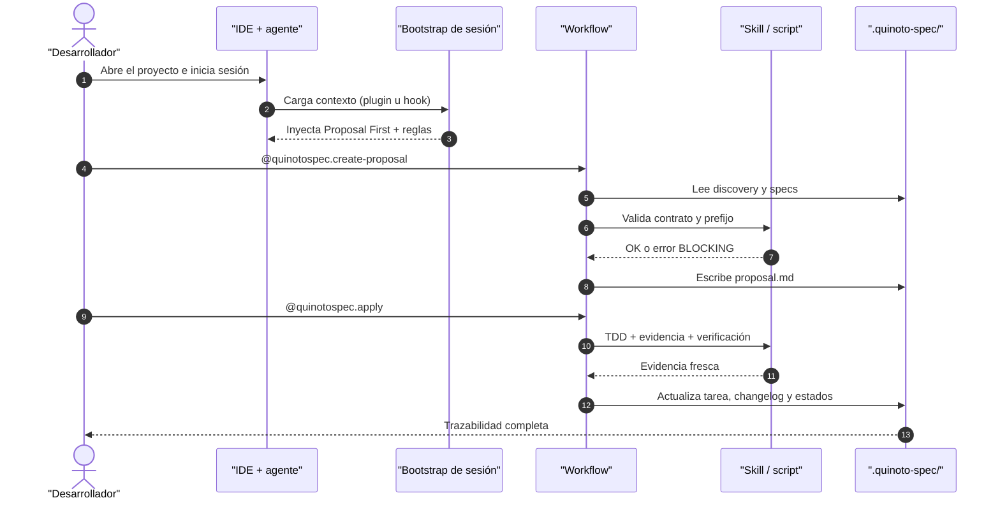

# Resumen Ejecutivo del Proyecto: QuinotoSpec

Vista general del paquete: qué hace, cómo se estructura, cómo se ejecuta y cuáles son sus riesgos principales.

Guardar en: `.quinoto-spec/discovery/02-overview.md`

**Discovery Date:** 2026-11-13
**Versión:** 3.4.0 — *Warband: Hird Edition*
**Estado de release:** `beta-rc`

## Resumen

**QuinotoSpec** es una metodología y un sistema de configuración de agentes para desarrollo asistido por IA. Su flujo central es **Proposal First / Context Slicing**: entender el proyecto, escribir una propuesta técnica, desglosarla en user stories y tareas atómicas, implementar con gates de TDD y evidencia, y archivar con trazabilidad.

El repositorio **no es una aplicación de negocio**. Es un paquete distribuible que instala instrucciones, workflows, skills, agentes, reglas y plantillas dentro del directorio de configuración del IDE que usa el agente:

| IDE | Instalación global | Instalación local |
|---|---|---|
| OpenCode | `~/.config/opencode/` | `<proyecto>/.opencode/` |
| Cursor | `~/.cursor/` | `<proyecto>/.cursor/` |
| Claude Code | `~/.claude/` | `<proyecto>/.claude/` |
| Cline | `~/.config/cline/` | `<proyecto>/.cline/` |
| Antigravity | `~/.gemini/config/` | `<proyecto>/.agents/` |
| Genérico | `~/.config/agent/` | `<proyecto>/.agent/` |

El valor del producto está en tres mecanismos:

1. **Bootstrap de sesión**: el contexto de QuinotoSpec se inyecta al iniciar cada sesión (plugin en OpenCode v1/v2, hook en Cursor y Claude Code).
2. **Artefactos estructurados**: propuestas, historias y tareas con IDs canónicos, estados normalizados y DAG de dependencias.
3. **Gobernanza ejecutable**: reglas que se validan con scripts (contrato, evidencia TDD, aprobación humana, constitución, entropía).

## Información del repositorio

### Estructura principal

```text
quinotospec-package/
├── install.sh                 # Instalador multi-IDE transaccional (1.723 líneas)
├── manifest.json              # Inventario y feature flags (fuente de verdad de conteos)
├── .version                   # 3.4.0
├── AGENTS.md                  # Guía de agentes (referencia offline)
├── README.md / README_EN.md   # Documentación bilingüe
├── CHANGELOG.md               # Changelog de release (Keep a Changelog)
├── V3_ROADMAP.md              # Roadmap por fases
│
├── agent-dist/                # PAYLOAD que se instala en el IDE
│   ├── workflows/             # 49 workflows → se instalan como commands/
│   ├── skills/                # 95 skills; 25 con scripts o referencias
│   ├── agents/                # 9 agentes especializados
│   ├── rules/                 # 18 reglas de gobernanza
│   ├── templates/             # 13 plantillas de artefactos
│   ├── bootstrap/             # Contexto de inicio de sesión
│   ├── hooks/                 # Hook compartido + manifiestos por IDE
│   ├── plugins/               # Adaptadores OpenCode v1 y v2
│   ├── config/                # agent-defaults.toml (3-layer config)
│   ├── lib/                   # Helpers Python compartidos
│   └── ui/                    # Dashboard web local read-only
│
├── scripts/                   # 11 scripts de validación, release y automatización
├── tests/                     # 28 suites shell + 7 suites unittest + fixtures
├── docs/                      # Arquitectura, contrato, guías y troubleshooting
├── examples/                  # Playgrounds FastAPI, Express y Axum
├── .github/workflows/         # ci.yml, release.yml, huginn-muninn.yml
├── .githooks/                 # pre-commit y pre-push
└── .quinoto-spec/             # Dogfooding: discovery, specs, changelog, approvals
```

### Archivos de entrada

| Punto de entrada | Propósito |
|---|---|
| `install.sh` | Instalar, verificar o desinstalar el paquete en un IDE |
| `agent-dist/bootstrap/quinotospec-bootstrap.md` | Contexto que recibe el agente al iniciar sesión |
| `agent-dist/plugins/opencode-v2/index.js` | Adaptador recomendado para OpenCode v2 |
| `agent-dist/plugins/opencode/quinotospec-plugin.js` | Adaptador legacy para OpenCode v1 |
| `agent-dist/hooks/session-start.sh` | Hook de sesión para Cursor y Claude Code |
| `agent-dist/ui/server.py` | Dashboard local read-only |
| `scripts/validate-all.sh` | Gate completo del paquete |
| `tests/run-all-tests.sh` | Runner de las 28 suites |

## Flujo de uso del paquete



## Comandos básicos

> No hay `dev`, `build` o `test` de una aplicación web. Los equivalentes para este paquete son los siguientes.

### Instalación y desarrollo

```bash
# Instalación global por IDE
./install.sh --opencode --global
./install.sh --cursor --global
./install.sh --claude --global
./install.sh --cline --global
./install.sh --antigravity --global

# Instalación local (target = directorio actual)
./install.sh --opencode --yes

# Verificar o desinstalar
./install.sh --verify --opencode --global
./install.sh --uninstall --opencode --global

# Dashboard local read-only
python3 -B agent-dist/ui/server.py --root . --port 8765
python3 -B agent-dist/ui/server.py --root . --json
python3 -B agent-dist/ui/server.py --root . --tui
python3 -B agent-dist/ui/server.py --stop
```

### Test

```bash
bash tests/run-all-tests.sh
bash scripts/validate-all.sh --strict
bash scripts/validate-all.sh --strict --allow-no-node
bash tests/test-install-e2e.sh
```

### Build / release

```bash
# Construir el tarball de release + checksum
bash scripts/package-release.sh 3.4.0 /tmp/quinotospec-dist

# Smoke test del artefacto
bash scripts/smoke-release.sh /tmp/quinotospec-dist/quinotospec-3.4.0.tar.gz

# Sincronizar versión en todos los archivos
bash scripts/update-version.sh 3.4.0
```

### Playground de 5 minutos

```bash
cd examples/python-fastapi
pip install -r requirements.txt
pytest -v
uvicorn app.main:app --reload
```

## Prerrequisitos de entorno

| Requisito | Mínimo | Obligatorio | Verificado por |
|---|---|---|---|
| `bash` | 4.0 | Sí | `install.sh` |
| `git` | 2.0 | Sí | `install.sh` |
| `python3` | 3.8 | Sí | `install.sh` y scripts |
| `node` | cualquiera | No | Solo `node --check` del plugin; su ausencia genera warning |
| `shellcheck` | versión de `.shellcheck-version` | No | CI y `scripts/lint-shell.sh` |
| Navegador | moderno | No | Solo para la UI; existe `--tui` y `--json` |

**No hay variables de entorno obligatorias, secretos, tokens ni `.env`.** El paquete no realiza llamadas de red en su camino crítico.

Variables opcionales observadas:

| Variable | Uso |
|---|---|
| `QUINOTOSPEC_ALLOW_NO_NODE` | Evita que la ausencia de Node sea fatal con `--strict` |
| `QUINOTOSPEC_HOOK_PLATFORM` | Plataforma del hook (`claude`, `cursor`, `generic`) |
| `PLUGIN_ROOT` | Raíz del payload para `session-start.sh` |
| `QUINOTOSPEC_OPENCODE_MAJOR` | Fuerza la detección de OpenCode v1/v2 en tests o instalación |

## Superficie del paquete

| Métrica | Valor |
|---|---:|
| Líneas en `install.sh` | 1.723 |
| Líneas en `agent-dist/ui/` | 1.569 |
| Scripts Python del payload | 32 |
| Workflows | 49 |
| Skills | 95 |
| Agentes | 9 |
| Reglas | 18 |
| Templates | 13 |
| Suites de test shell | 28 |
| Suites unittest | 7 |
| Dependencias obligatorias | 0 |

## Riesgos y puntos críticos identificados

| # | Riesgo | Severidad | Detalle |
|---|---|---|---|
| 1 | **Cobertura del paquete no medida** | 🔴 Alta | Las 28 suites pasan, pero no hay `coverage` sobre `agent-dist/`; no se conoce el porcentaje real ni hay umbral que bloquee regresiones. |
| 2 | **Cadena de suministro de CI y assets** | 🔴 Alta | GitHub Actions se referencian por tag mayor (`@v7`), no por SHA; `mermaid.min.js` (3.2 MB) está vendorizado sin verificación de integridad. |
| 3 | **Auditorías de dependencias fuera de CI** | 🟠 Media | No hay job de `pip-audit`/`npm audit`; hoy hay 2 avisos en `pytest` del ejemplo y 6 vulnerabilidades `low` en el árbol npm de Jest. |
| 4 | **Endurecimiento de la UI local** | 🟠 Media | Sin autenticación, sin CSP ni cabeceras de seguridad; por defecto escucha en `127.0.0.1`, pero `--host 0.0.0.0` expone todo `.quinoto-spec/`. |
| 5 | **Acuerdos de producto vacíos** | 🟠 Media | `08-product-and-agreements.md` es una plantilla vacía por diseño; el gate de `create-proposal` se bloqueará hasta que un humano complete DoR/DoD. |
| 6 | **Recuperación ante desastres parcial** | 🟠 Media | Hay backup verificable de `.quinoto-spec` y restore transaccional, pero el restore federado de Bifrost es manual y no hay cron de backup. |
| 7 | **Contrato JSON de CLIs no versionado** | 🟡 Baja | Los scripts con `--json` no comparten un schema formal; los agentes consumen claves por convención. |
| 8 | **Rendimiento de la UI en proyectos grandes** | 🟡 Baja | `State.refresh()` reconstruye el resumen completo en cada request y `ThreadingHTTPServer` comparte estado de clase. |

## Conclusión

El paquete está **maduro en gobernanza, instalación y pruebas funcionales**: ownership por hash, staging con rollback, 28 suites verdes, CI multi-SO y multi-Python, release con checksum y contrato de artefactos. Las brechas principales no están en la metodología sino en **medición de cobertura**, **cadena de suministro**, **endurecimiento de la UI** y **operación de recuperación**. El detalle priorizado está en `07-findings-and-recommendations.md`.

## 🔗 Referencias

- `01-stack-profile.md` — stack, comandos y estándares
- `03-architecture.md` — capas y flujos
- `06-devops-ci-security.md` — CI, seguridad y auditorías
- `07-findings-and-recommendations.md` — deuda técnica priorizada
