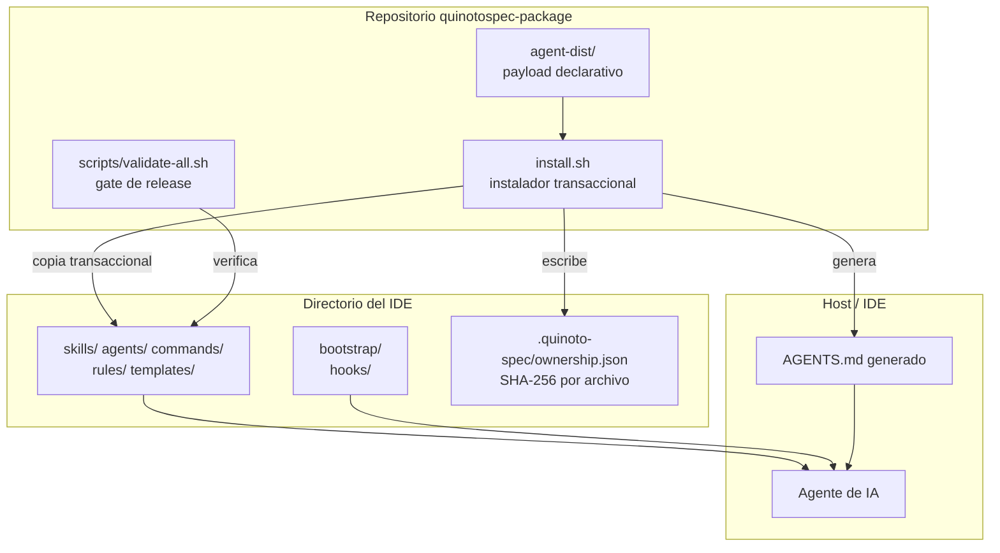
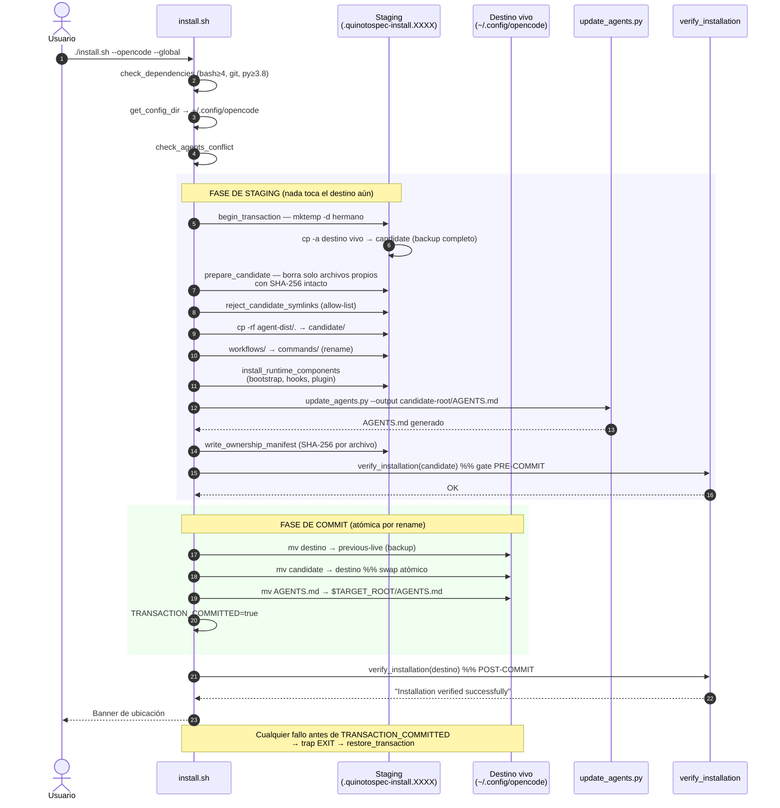

# Arquitectura: QuinotoSpec

**Discovery Date:** 2026-09-27

Guardar en: .quinoto-spec/discovery/03-architecture.md

## Diagrama conceptual

> Placeholder — diagrama de arquitectura de capas. Completar cuando se modele el sistema como
> servicio distribuido. Para el estado actual ver "Capas" y "Flujo de instalación" abajo, que es
> la arquitectura real (instalador transaccional + payload declarativo).

## Capas

QuinotoSpec tiene **tres capas con responsabilidades estrictamente separadas**, y ninguna depende
de otra en tiempo de ejecución.

### Capa 1 — Payload (`agent-dist/`)

Contenido **declarativo**: 86 skills, 43 workflows, 9 agentes, 18 reglas, 13 templates, 1 bootstrap,
4 hooks y 1 plugin. Casi todo es Markdown con frontmatter YAML. No se ejecuta; se instala y lo
interpreta el IDE.

Excepción: 15 scripts Python con stdlib, que exponen CLIs invocadas por los agentes.

### Capa 2 — Instalador (`install.sh`)

El **único componente con lógica de escritura sobre el sistema del usuario**. 1278 líneas de Bash
transaccional. Responsabilidades:

1. Resolver el directorio de destino por IDE y alcance (`get_config_dir`, `:821-845`).
2. Construir la instalación completa en un **staging hermano** (mismo filesystem → rename atómico).
3. Verificar el staging **antes** de tocar el destino vivo (`:1211-1214`).
4. Commitear con `mv` (`:1216-1242`).
5. Registrar ownership con SHA-256 (`:267-384`).
6. Generar `AGENTS.md` desde `config.yaml` (`:1183-1201`).
7. Rollback automático ante cualquier fallo, vía `trap EXIT` (`:59-96`).

### Capa 3 — Gobernanza (scripts + reglas)

`scripts/validate-all.sh` orquesta 7 validaciones; `agent-dist/skills/quinotospec-rules-enforce/`
aplica las 18 reglas como checks ejecutables y de solo lectura. Esta capa **nunca escribe** en el
código del proyecto: reporta.

## Patrones de diseño observados

| Patrón | Dónde | Evidencia |
|---|---|---|
| **Transactional install / staged commit** | `install.sh:98-124`, `1216-1242` | Staging hermano con `mktemp -d`, backup `cp -a`, commit por `mv` |
| **Rollback via EXIT trap** | `install.sh:59-96` | `cleanup_transaction` restaura si `TRANSACTION_COMMITTED != true` |
| **Ownership manifest / content hash** | `install.sh:267-436` | SHA-256 por archivo; aborta si el contenido fue modificado fuera |
| **Refuse-to-overwrite (fail closed)** | `install.sh:123-177`, `908-944` | Ante conflicto se aborta todo; nunca se sobrescribe a ciegas |
| **Adapter / Strategy por IDE** | `install.sh:718-818` | `case "$ide"` con 3 ramas específicas + default genérico |
| **Fail-closed security gates** | `rules_enforce.py` | Semántica de error explícita por cada regla; dispatcher read-only |
| **Append-only log** | `.quinoto-spec/changelog/` | Un archivo por entrada → sin conflictos de merge |
| **Four-layer resolution** | `template_resolver.py` | overrides → presets → extensions → core |
| **Plugin monolith (deuda)** | `quinotospec-plugin.js` | 115 líneas, 3 responsabilidades (config, transform de mensajes, aliases) |

## Flujo de instalación (secuencia real)

## Integración con el host: el punto frágil

Cada IDE recibe el payload por un mecanismo **nativo y distinto**. Esto es la causa raíz de que el
plugin de OpenCode sea la pieza más delicada del sistema:

| IDE | Mecanismo de Bootstrap | Estado en v2 |
|---|---|---|
| Cursor | Hook `sessionStart` mutando `hooks.json` | Depende del IDE |
| Claude Code | Hook `SessionStart` mutando `settings.json` | Depende del IDE |
| **OpenCode** | **Plugin JS** | 🔴 **Roto** — el contrato cambió en v2 |

Además, el payload *en sí* se apoya en descubrimiento nativo de rutas:

| Artefacto | Ruta instalada | ¿Descubierto nativamente? |
|---|---|---|
| Skills | `skills/` | ✅ (global `~/.config/opencode/skills`) |
| Agents | `agents/*.md` | ✅ |
| Commands | `commands/*.md` | ✅ (desde `workflows/`, renombrado en `:1162-1171`) |
| Rules | `rules/quinotospec-rules.md` | ❌ **no** — requiere `AGENTS.md` o plugin |
| Bootstrap | `bootstrap/quinotospec-bootstrap.md` | ❌ **no** — requiere `AGENTS.md` o plugin |

Es decir: en OpenCode v2 el plugin era el **único** mecanismo que hacía llegar `rules/` y
`bootstrap/` al agente. Y su función `config()` apoyaba en `config.instructions`, que la
documentación de v2 declara explícitamente como **no-op**.

## Componentes reutilizables

| Componente | Reutilizable en | Nota |
|---|---|---|
| `update_agents.py` | Todos los IDEs | Generación de `AGENTS.md`; agnóstico de IDE |
| `backup.py` | Todos | Motor de backup con verificación SHA-256; agnóstico |
| `contract.py` | Todos | Contrato de artefactos; la fuente de verdad del formato |
| `rules_enforce.py` | Todos | Dispatcher de gobernanza; lee paths, no conoce IDEs |
| `session-start.sh` | Cursor, Claude, genérico | Emite JSON por plataforma; ya tiene modo `--platform` |
| `extension_manager.py` | Todos | Ciclo de vida de extensiones/presets |

## 🔗 Referencias

- `02-overview.md` — estructura de carpetas y comandos
- `05-data-and-services.md` — modelo de datos de artefactos
- `07-findings-and-recommendations.md` — deuda priorizada
