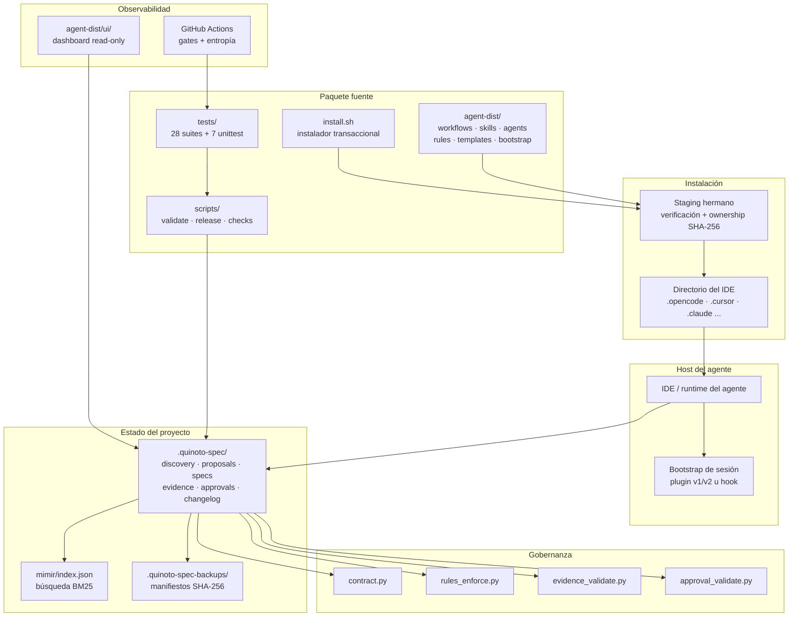
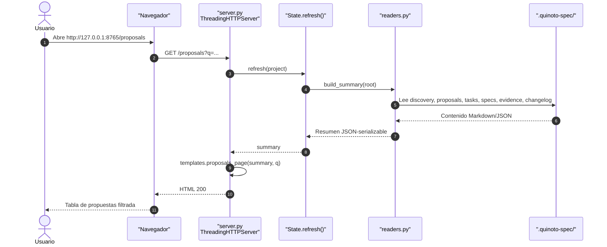
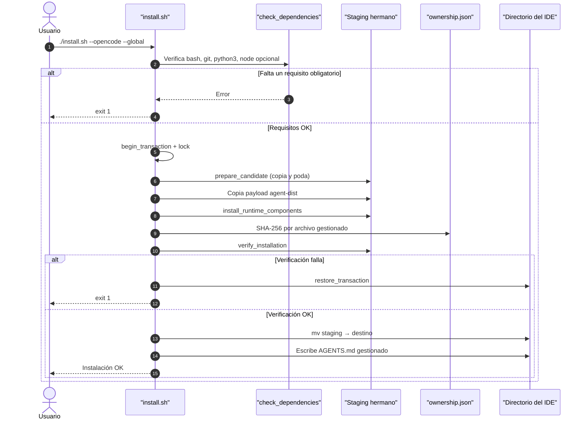
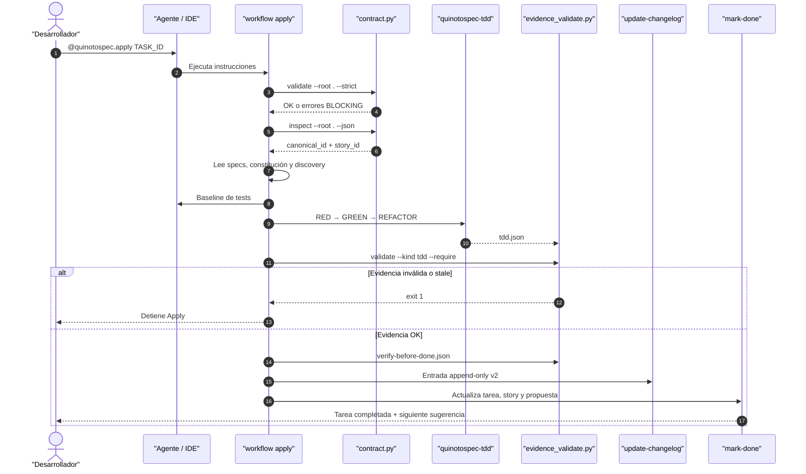

# Arquitectura: QuinotoSpec

Capas, módulos, patrones y flujos de datos del paquete y de su integración con los IDEs.

Guardar en: `.quinoto-spec/discovery/03-architecture.md`

**Discovery Date:** 2026-11-13
**Versión:** 3.4.0 — *Hird Edition*

## Resumen

QuinotoSpec se organiza en **seis capas** con responsabilidades separadas:

1. **Distribución**: el paquete fuente (`agent-dist/` + `scripts/` + `install.sh`).
2. **Instalación**: adaptación del payload al directorio y al mecanismo de carga de cada IDE.
3. **Host del agente**: OpenCode, Cursor, Claude Code, Cline o Antigravity.
4. **Artefactos**: el estado del proyecto en `.quinoto-spec/` (Markdown + JSON + YAML).
5. **Gobernanza**: contrato, reglas, evidencia, aprobaciones, constitución y entropía.
6. **Observabilidad**: dashboard local read-only y gates de CI.

No hay servidor de negocio ni base de datos. El "estado" es el sistema de archivos del proyecto.

## Diagrama conceptual

> **Placeholder — runtime interno del IDE:** no es posible inferir con certeza cómo cada versión de OpenCode, Cursor o Claude Code carga plugins, hooks y comandos. Este diagrama debe completarse con la documentación oficial de cada IDE y con una prueba de sesión real: orden de carga, prioridad entre `AGENTS.md` y hooks, y comportamiento ante compactación.

## Capas y módulos

| Capa | Módulo / ruta | Responsabilidad | Entradas | Salidas |
|---|---|---|---|---|
| Distribución | `agent-dist/workflows/` | Slash commands que orquestan el ciclo | Invocación del usuario | Instrucciones para el agente |
| Distribución | `agent-dist/skills/` | Capacidades especializadas y scripts | Contexto del workflow | Archivos, validaciones, reportes |
| Distribución | `agent-dist/rules/` | 18 reglas inmutables de gobernanza | Contexto del agente | Restricciones y gates |
| Distribución | `agent-dist/templates/` | Plantillas canónicas de artefactos | Variables del workflow | Markdown/YAML generado |
| Distribución | `agent-dist/bootstrap/` | Contexto de inicio de sesión | `session.start` | Texto inyectado al modelo |
| Instalación | `install.sh` | Staging, verificación, ownership, rollback | Flags de IDE y target | Configuración instalada |
| Adaptadores | `agent-dist/plugins/` | Integración con OpenCode v1/v2 | Hooks del runtime | Bootstrap inyectado |
| Adaptadores | `agent-dist/hooks/` | Integración con Cursor/Claude | `SessionStart` | JSON con `additionalContext` |
| Estado | `.quinoto-spec/` | Artefactos del proyecto | Workflows, scripts | Fuente de verdad legible |
| Gobernanza | `agent-dist/skills/quinotospec-contract/` | Modelo normalizado de artefactos | Markdown | JSON inspeccionable/validable |
| Gobernanza | `agent-dist/skills/quinotospec-rules-enforce/` | Dispatcher read-only de checks | Perfil, acción, paths | Exit code + JSON |
| Observabilidad | `agent-dist/ui/` | Dashboard local read-only | `.quinoto-spec/` | HTML/JSON/TUI |
| Automatización | `scripts/` | Validación, release, versionado, higiene | Repo | Artefactos y reportes |
| Calidad | `tests/` | Regresión funcional y E2E | Repo y fixtures | Exit code |

## Patrones de diseño observados

| Patrón | Dónde se ve | Por qué importa |
|---|---|---|
| **Adapter** | `agent-dist/plugins/` y `agent-dist/hooks/` | Aísla las diferencias entre IDEs y versiones de OpenCode. |
| **Transactional staging** | `install.sh` (`begin_transaction`, `prepare_candidate`) | Evita dejar una instalación a medias; el `EXIT trap` restaura. |
| **Repository / Reader** | `agent-dist/ui/readers.py` | Centraliza la lectura de artefactos y evita escrituras desde la UI. |
| **Policy engine read-only** | `rules_enforce.py` | Separa la decisión de gobernanza de la ejecución real. |
| **Layered configuration** | `agent_config.py` | Merge `defaults → team → personal`, con la última capa ganando. |
| **Template Method** | Workflows + `templates/` | El workflow define el proceso; la plantilla define la forma del artefacto. |
| **Append-only event log** | `.quinoto-spec/changelog/` | Evita conflictos de merge y conserva historia completa. |
| **Contract-first** | `contract.py` + `docs/ARTIFACT-CONTRACT.md` | Un solo parser para productores y consumidores. |
| **Strategy / router** | `quinotospec-complexity-router/router.py` | Deriva Quick Fix, Simple, Complex o Enterprise según el cambio. |
| **Plugin** | OpenCode v1/v2 y Cursor plugin | Permite extender el host sin modificarlo. |

## Flujo de datos principal: dashboard UI

**Características del flujo:**

- Solo lectura: `readers.py` no escribe en disco.
- El resumen se reconstruye por request; no hay caché persistente.
- `?project=` selecciona un root en modo multi-proyecto (`--roots`).
- Errores de archivos mal formados se capturan y devuelven HTTP 500 sin tumbar el servidor.

## Flujo de instalación transaccional

## Flujo de gobernanza: Apply con evidencia

## Componentes reutilizables

| Componente | Ruta | Reutilizado por |
|---|---|---|
| Helpers comunes | `agent-dist/lib/quinotospec_common.py` | Varios scripts Python (`resolve_root`, carga de módulos) |
| Contrato de artefactos | `agent-dist/skills/quinotospec-contract/contract.py` | Apply, review, archive, UI, Mimir, Valkyrie |
| Validador de evidencia | `.../quinotospec-rules-enforce/evidence_validate.py` | TDD, debug, verify-before-done, goldfish |
| Validador de aprobaciones | `.../quinotospec-rules-enforce/approval_validate.py` | Apply, archive, constitution |
| Plantillas | `agent-dist/templates/` | Propuestas, historias, tareas, specs, changelog, constitución |
| Bootstrap | `agent-dist/bootstrap/quinotospec-bootstrap.md` | Plugins y hooks de todos los IDEs |
| Configuración de agentes | `agent-dist/config/agent-defaults.toml` | `agent_config.py`, generación de `AGENTS.md` |
| Resolver de templates | `.../quinotospec-template-resolver/template_resolver.py` | Overrides → presets → extensions → core |
| Índice BM25 | `agent-dist/skills/quinotospec-mimir/index.py` | `search.py`, `quinotospec-search`, create-proposal |

## Integraciones internas

| Integración | Mecanismo | Riesgo |
|---|---|---|
| Installer → payload | Copia selectiva de `agent-dist/*` a `commands/`, `skills/`, `plugins/`, etc. | Un cambio de layout requiere actualizar `install.sh`, `manifest.json` y tests |
| Workflows → skills | Referencias por nombre en Markdown | Drift detectado por `check-skill-workflow-drift.py` |
| Skills → scripts | Rutas `agent-dist/skills/.../*.py` | Cambiar una ruta rompe workflows; cubierto parcialmente |
| UI → `.quinoto-spec` | Lectura directa por `readers.py` | Archivos mal formados degradan la vista, no el servidor |
| Mimir → artefactos | Indexación de discovery, specs y propuestas | Índice puede quedar stale; `search.py --check` lo detecta |
| Norns → versiones | Detección de drift entre `.version`, manifest, README, changelog | Cambios manuales pueden desincronizar |
| Huginn → CI | Entropía determinista y umbral `S_final >= 0.76` | El gate es heurístico, no una medida completa de calidad |

## Integraciones externas

| Integración | Tipo | Propósito | Dónde |
|---|---|---|---|
| OpenCode v1 | Plugin CJS | Inyectar bootstrap en mensajes/sistema | `agent-dist/plugins/opencode/` |
| OpenCode v2 | Plugin ESM | Hooks `context` y `compaction` | `agent-dist/plugins/opencode-v2/` |
| Cursor | Hook `sessionStart` + plugin staging | Inyectar contexto y descubrir skills | `agent-dist/hooks/hooks-cursor.json` |
| Claude Code | Hook `SessionStart` | Inyectar `additionalContext` | `agent-dist/hooks/hooks.json` |
| Cline / Antigravity | Archivos de configuración | Cargar workflows/skills como referencia | `install.sh` |
| Git | CLI | Branches, worktrees, notas federadas (Bifrost) | Skills y hooks |
| GitHub Actions | CI/CD | Tests, lint, release, entropía | `.github/workflows/` |
| Navegador | UI local | Dashboard read-only | `agent-dist/ui/` |

**No hay integraciones de red en runtime**: ni APIs de terceros, ni SDKs, ni bases de datos, ni colas.

## Decisiones arquitectónicas clave

1. **Archivos sobre servicios**: el estado es legible por humanos y versionable con Git; no hay migraciones de base de datos.
2. **Read-only por defecto**: la UI y los validadores no escriben; solo los workflows y scripts explícitos modifican artefactos.
3. **Gobernanza separada de ejecución**: `rules_enforce.py` decide con archivos; la ejecución real queda en el agente.
4. **Adaptadores por IDE**: el núcleo no depende de un IDE; los plugins/hooks son reemplazables.
5. **Cero dependencias obligatorias**: reduce superficie de ataque y facilita portabilidad.
6. **Append-only**: changelog y evidencia conservan historia; una reversión agrega, no borra.

## 🔗 Referencias

- `docs/ARCHITECTURE.md` — arquitectura oficial y matriz de madurez
- `docs/ARTIFACT-CONTRACT.md` — contrato de artefactos
- `install.sh` — transacción de instalación
- `agent-dist/ui/server.py` — rutas y servidor local
- `agent-dist/skills/quinotospec-contract/contract.py` — parser canónico
