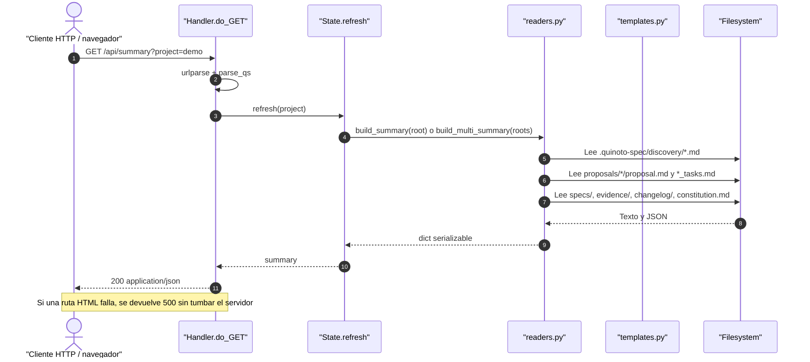

# Endpoints y OpenAPI: QuinotoSpec

Superficie HTTP local de la UI, contratos de request/response, OpenAPI mínimo y recomendaciones de pruebas de integración.

Guardar en: `.quinoto-spec/discovery/04-endpoints-and-openapi.md`

**Discovery Date:** 2026-11-13

## Resumen

QuinotoSpec **no expone una API de negocio ni GraphQL**. El paquete es una distribución de configuración para agentes. Sin embargo, desde la versión 3.4.0 incluye una **UI local read-only** (`agent-dist/ui/server.py`) que sí publica rutas HTTP sobre `http.server` de la stdlib.

Superficies detectadas:

| Superficie | Tipo | Autenticación | Escritura |
|---|---|---|---|
| UI local (`127.0.0.1:8765`) | HTTP GET | Ninguna | No (read-only) |
| `install.sh` | CLI | Permisos del sistema | Sí (instalación) |
| Scripts de skills (`*.py`) | CLI | Permisos del sistema | Depende del script |
| Plugins/hooks de IDE | Integración de runtime | Confianza del IDE | No en `.quinoto-spec/` |

No se detectaron endpoints REST de negocio ni GraphQL.

## Mapeo de endpoints HTTP

Base URL por defecto: `http://127.0.0.1:8765`

| Método | Ruta | Parámetros | Respuesta esperada | Código |
|---|---|---|---|---|
| GET | `/health` | — | `{"status":"ok","root":"/ruta"}` | 200 |
| GET | `/api/summary` | `project` (opcional) | Resumen JSON del proyecto o multi-proyecto | 200 |
| GET | `/` | `project` | HTML del panel principal | 200 |
| GET | `/projects` | — | HTML con tarjetas de proyectos (modo `--roots`) | 200 |
| GET | `/proposals` | `project`, `q` | HTML con tabla de propuestas filtradas | 200 |
| GET | `/proposals/{slug}` | `project` | HTML de detalle de propuesta | 200 / 404 |
| GET | `/tasks` | `project`, `q` | HTML con tablero/lista de tareas | 200 |
| GET | `/tasks/{taskId}` | `project` | HTML de detalle de tarea | 200 / 404 |
| GET | `/changelog` | `project` | HTML con entradas de changelog | 200 |
| GET | `/discovery` | `project` | HTML con listado de archivos de discovery | 200 |
| GET | `/discovery/{file}` | `project` | HTML con Markdown renderizado y Mermaid lazy | 200 / 404 |
| GET | `/constitution` | `project` | HTML de la constitución y principios | 200 |
| GET | `/specs` | `project` | HTML con dominios y requirements | 200 |
| GET | `/specs/{domain}` | `project` | HTML del spec consolidado | 200 / 404 |
| GET | `/evidence` | `project` | HTML de evidencia por tarea | 200 |
| GET | `/gates` | `project` | HTML de estado de gates TDD/debug/verify | 200 |
| GET | `/static/style.css` | — | CSS embebido | 200 |
| GET | `/static/mermaid.min.js` | — | JS vendorizado, carga lazy | 200 |
| GET | `/static/{archivo}` | — | Archivo estático permitido | 200 / 404 |

### Parámetros

| Parámetro | Ubicación | Tipo | Descripción |
|---|---|---|---|
| `project` | Query string | string | Nombre del proyecto cuando se usa `--roots` (multi-proyecto). Si no coincide, se usa el primer root. |
| `q` | Query string | string | Búsqueda textual en `/proposals` y `/tasks`. |
| `slug` | Path | string | Carpeta de la propuesta, por ejemplo `2026-10-28-review-handoff`. |
| `taskId` | Path | string | ID canónico de tarea, por ejemplo `TSK-AUTH-a1b2-001`. |
| `file` | Path | string | Nombre exacto de un archivo de discovery, por ejemplo `03-architecture.md`. |
| `domain` | Path | string | Dominio de spec, por ejemplo `ui`, `workflow` o `auth`. |

### Formato de errores

| Caso | Respuesta |
|---|---|
| Ruta inexistente | `404` + HTML “Ruta no encontrada.” |
| Propuesta/tarea/spec/discovery inexistente | `404` + HTML con el identificador solicitado |
| Excepción al leer un archivo | `500` + HTML “Error leyendo el proyecto” |
| Intento de path traversal en `/static/`, `/discovery/` o `/specs/` | `404` (se resuelve y se compara contra el directorio base) |

## Flujo de request/response



### Ejemplo real de respuesta

```bash
curl -s http://127.0.0.1:8765/health
```

```json
{
  "status": "ok",
  "root": "/home/barba/projects/quinotospec/quinotospec-package"
}
```

```bash
curl -s http://127.0.0.1:8765/api/summary | python3 -m json.tool | head -40
```

```json
{
  "root": "/home/barba/projects/quinotospec/quinotospec-package",
  "name": "quinotospec-package",
  "initialized": true,
  "discovery": {
    "present": true,
    "project_date": "2026-11-13",
    "age_days": 0,
    "stale": false
  },
  "constitution": {
    "present": true,
    "status": "active",
    "principles": 10
  },
  "proposals": [],
  "counts": {
    "proposals": 0,
    "proposals_active": 0,
    "stories": 0,
    "tasks": 0,
    "changelog": 45,
    "specs_domains": 2
  }
}
```

> Los conteos cambian con el estado del proyecto. Los valores anteriores son una salida observada durante este discovery.

## OpenAPI mínimo

```yaml
openapi: 3.1.0
info:
  title: QuinotoSpec UI API
  version: 1.0.0
  description: |
    Dashboard local read-only sobre .quinoto-spec/.
    No es una API de negocio ni un servicio remoto. Escucha en 127.0.0.1 por defecto.
servers:
  - url: http://127.0.0.1:8765
    description: Servidor local por defecto
tags:
  - name: health
  - name: summary
  - name: pages
paths:
  /health:
    get:
      tags: [health]
      operationId: getHealth
      summary: Estado del servidor
      responses:
        "200":
          description: Servidor activo
          content:
            application/json:
              schema:
                type: object
                required: [status, root]
                properties:
                  status:
                    type: string
                    const: ok
                  root:
                    type: string
              example:
                status: ok
                root: /home/user/proyecto
  /api/summary:
    get:
      tags: [summary]
      operationId: getSummary
      summary: Resumen JSON del proyecto
      parameters:
        - name: project
          in: query
          required: false
          schema:
            type: string
          description: Proyecto seleccionado en modo multi-root
      responses:
        "200":
          description: Resumen serializable
          content:
            application/json:
              schema:
                type: object
                required: [root, name, initialized, counts, proposals, changelog]
                properties:
                  root:
                    type: string
                  name:
                    type: string
                  initialized:
                    type: boolean
                  multi:
                    type: boolean
                  projects:
                    type: array
                    items:
                      type: object
                  discovery:
                    type: object
                    properties:
                      present:
                        type: boolean
                      project_date:
                        type: string
                      age_days:
                        type: integer
                      stale:
                        type: boolean
                  constitution:
                    type: object
                    properties:
                      present:
                        type: boolean
                      status:
                        type: string
                      principles:
                        type: integer
                  proposals:
                    type: array
                    items:
                      type: object
                  changelog:
                    type: array
                    items:
                      type: object
                  counts:
                    type: object
                    properties:
                      proposals:
                        type: integer
                      proposals_active:
                        type: integer
                      stories:
                        type: integer
                      tasks:
                        type: integer
                      changelog:
                        type: integer
                      specs_domains:
                        type: integer
                      evidence:
                        type: integer
        "500":
          description: Error leyendo el proyecto
  /:
    get:
      tags: [pages]
      operationId: getDashboard
      summary: Panel principal
      parameters:
        - $ref: "#/components/parameters/Project"
      responses:
        "200":
          description: HTML del panel
          content:
            text/html:
              schema:
                type: string
  /proposals:
    get:
      tags: [pages]
      operationId: listProposals
      summary: Listado de propuestas
      parameters:
        - $ref: "#/components/parameters/Project"
        - $ref: "#/components/parameters/Search"
      responses:
        "200":
          description: HTML con propuestas
          content:
            text/html:
              schema:
                type: string
  /proposals/{slug}:
    get:
      tags: [pages]
      operationId: getProposal
      summary: Detalle de propuesta
      parameters:
        - $ref: "#/components/parameters/Project"
        - name: slug
          in: path
          required: true
          schema:
            type: string
      responses:
        "200":
          description: HTML de la propuesta
          content:
            text/html:
              schema:
                type: string
        "404":
          description: Propuesta no encontrada
  /tasks/{taskId}:
    get:
      tags: [pages]
      operationId: getTask
      summary: Detalle de tarea
      parameters:
        - $ref: "#/components/parameters/Project"
        - name: taskId
          in: path
          required: true
          schema:
            type: string
            pattern: "^TSK-"
      responses:
        "200":
          description: HTML de la tarea
          content:
            text/html:
              schema:
                type: string
        "404":
          description: Tarea no encontrada
  /discovery/{file}:
    get:
      tags: [pages]
      operationId: getDiscoveryFile
      summary: Archivo de discovery renderizado
      parameters:
        - $ref: "#/components/parameters/Project"
        - name: file
          in: path
          required: true
          schema:
            type: string
            example: 03-architecture.md
      responses:
        "200":
          description: HTML con Markdown y Mermaid
          content:
            text/html:
              schema:
                type: string
        "404":
          description: Archivo no encontrado o ruta no permitida
  /specs/{domain}:
    get:
      tags: [pages]
      operationId: getSpec
      summary: Spec consolidado por dominio
      parameters:
        - $ref: "#/components/parameters/Project"
        - name: domain
          in: path
          required: true
          schema:
            type: string
      responses:
        "200":
          description: HTML del spec
          content:
            text/html:
              schema:
                type: string
        "404":
          description: Dominio no encontrado o ruta no permitida
components:
  parameters:
    Project:
      name: project
      in: query
      required: false
      schema:
        type: string
    Search:
      name: q
      in: query
      required: false
      schema:
        type: string
  securitySchemes: {}
security: []
```

> Este OpenAPI documenta solo las rutas principales. El resto de páginas (`/projects`, `/tasks`, `/changelog`, `/discovery`, `/constitution`, `/specs`, `/evidence`, `/gates`) siguen el mismo contrato HTML/`200`/`404`.

## Autenticación y autorización

| Aspecto | Estado |
|---|---|
| Autenticación HTTP | **No implementada** |
| Autorización por rol | **No implementada** |
| Cookies/sesión | **No implementadas** |
| CORS | No se emiten cabeceras CORS; el navegador aplica same-origin |
| Binding por defecto | `127.0.0.1` (solo loopback) |
| Exposición accidental | Posible con `--host 0.0.0.0`; no hay advertencia ni TLS |
| Datos expuestos | Todo el contenido de `.quinoto-spec/` (propuestas, specs, evidencia, changelog) |

**Recomendación:** tratar la UI como herramienta local. No usar `--host 0.0.0.0` en redes no confiables. Si se necesita acceso remoto, colocar un proxy con autenticación y TLS por delante.

La autorización del agente es otra capa: las 18 reglas de `agent-dist/rules/quinotospec-rules.md` y los gates de `rules_enforce.py` restringen lo que el agente puede hacer, pero **no protegen la UI HTTP**.

## Superficie CLI

Además de la UI, la "API" operativa del paquete son sus comandos:

| Comando | Propósito | `--json` |
|---|---|---|
| `install.sh` | Instalar, verificar o desinstalar | No |
| `contract.py inspect\|validate\|changelog` | Contrato de artefactos | Sí |
| `rules_enforce.py` | Dispatcher de gobernanza | Sí |
| `evidence_validate.py` | Evidencia TDD/debug/verify | Sí |
| `approval_validate.py` | Aprobación humana registrada | Sí |
| `backup.py create\|verify\|list\|restore\|cleanup` | Backup verificable | Sí |
| `extension_manager.py` | Extensiones y presets | Sí |
| `template_resolver.py` | Resolución de templates | Sí |
| `update_agents.py` | Generar `AGENTS.md` | Sí |
| `mimir/index.py`, `mimir/search.py` | Índice BM25 y búsqueda | Sí |
| `valkyrie/rank.py` | Triage de propuestas | Sí |
| `jormungandr/check.py` | Ciclos del DAG | No |
| `bifrost/bifrost.py` | Federación multi-repo | No |
| `huginn-muninn/check.py` | Entropía | Sí |

## Recomendaciones para pruebas de integración de API

### Pruebas mínimas sugeridas

```bash
# 1. Levantar la UI en puerto efímero
python3 -B agent-dist/ui/server.py --root . --port 0 --no-browser &
UI_PID=$!

# 2. Health check
curl -fsS http://127.0.0.1:8765/health | python3 -m json.tool

# 3. Resumen JSON y claves obligatorias
curl -fsS http://127.0.0.1:8765/api/summary \
  | python3 -c 'import json,sys; d=json.load(sys.stdin); assert {"root","name","initialized","counts"} <= d.keys()'

# 4. 404 de propuesta inexistente
curl -s -o /dev/null -w "%{http_code}\n" http://127.0.0.1:8765/proposals/no-existe

# 5. Path traversal en discovery
curl -s -o /dev/null -w "%{http_code}\n" 'http://127.0.0.1:8765/discovery/../../etc/passwd'

# 6. Read-only: hash de .quinoto-spec antes y después
find .quinoto-spec -type f -exec sha256sum {} + | sort > /tmp/before.sha
curl -fsS http://127.0.0.1:8765/api/summary >/dev/null
find .quinoto-spec -type f -exec sha256sum {} + | sort > /tmp/after.sha
diff -u /tmp/before.sha /tmp/after.sha

kill "$UI_PID"
```

### Matriz de casos

| Caso | Esperado |
|---|---|
| `/health` sin `.quinoto-spec/` | 200 con `status: ok` |
| `/api/summary` con proyecto vacío | 200 con `initialized: false` y conteos en cero |
| `/proposals/<slug>` inexistente | 404 |
| `/tasks/<id>` inexistente | 404 |
| `/discovery/../../etc/passwd` | 404 |
| `/static/../server.py` | 404 |
| Archivo Markdown con bloque Mermaid | 200 y render lazy |
| `.quinoto-spec/` sin permisos de lectura | 500 controlado, servidor sigue vivo |
| Dos requests concurrentes | Respuestas consistentes (revisar `State` compartido) |
| `--roots r1,r2` + `?project=` | Selección correcta del proyecto |

### Brechas de prueba

- No hay test de concurrencia real sobre `ThreadingHTTPServer`.
- No se valida CSP, `X-Content-Type-Options` ni `X-Frame-Options`.
- No hay test de accesibilidad ni de navegación por teclado.
- No hay test de límites de tamaño para proyectos grandes.
- El contrato JSON de `/api/summary` no está congelado con un JSON Schema.

## Datos que requieren ejecución

| Dato | Comando | Permiso |
|---|---|---|
| Puerto real asignado con `--port 0` | Leer la salida del servidor o usar `--json` | Ejecutar Python |
| Contenido renderizado de cada página | Navegador o `curl` con el servidor activo | Loopback |
| Comportamiento multi-proyecto | `--roots "r1,r2"` con dos repos con `.quinoto-spec/` | Lectura de ambos roots |
| Comportamiento bajo carga | `ab`, `hey` o script concurrente | Herramienta externa |

## 🔗 Referencias

- `agent-dist/ui/server.py` — implementación de rutas
- `agent-dist/ui/readers.py` — modelo de lectura
- `agent-dist/ui/templates.py` — render HTML/Markdown/Mermaid
- `tests/test-ui.sh` — pruebas HTTP existentes
- `05-data-and-services.md` — modelo de datos consultado por la UI
