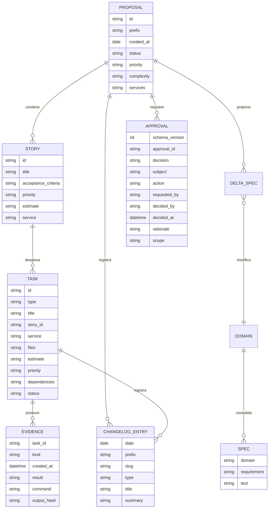
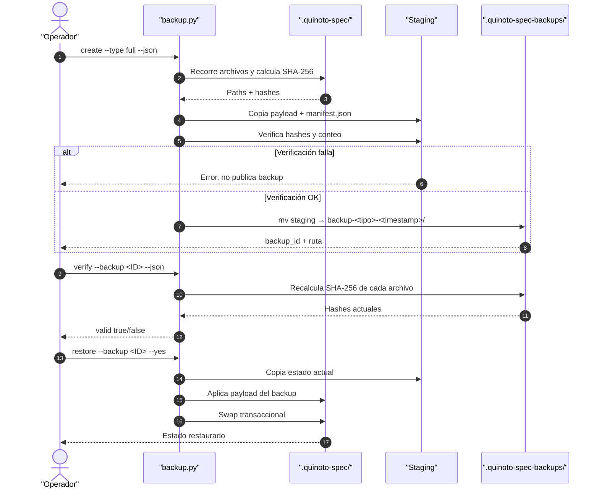

# Datos y Servicios: QuinotoSpec

Modelo de datos en sistema de archivos, entidades, evidencia, backups, estado global y servicios externos.

Guardar en: `.quinoto-spec/discovery/05-data-and-services.md`

**Discovery Date:** 2026-11-13

## Resumen

QuinotoSpec **no usa base de datos, ORM, cache distribuida ni cola de mensajes**. Su almacenamiento es el **sistema de archivos**:

- `.quinoto-spec/` guarda el estado del proyecto (propuestas, historias, tareas, specs, evidencia, aprobaciones, changelog, métricas e índice de búsqueda).
- `.quinoto-spec-backups/` guarda backups verificables de `.quinoto-spec/`.
- `<config-dir>/ownership.json` (dentro del target del IDE) registra los archivos instalados y sus hashes.
- `agent-dist/` es el payload de solo lectura que se copia al IDE.

No hay migraciones de esquema relacional ni seeds de base de datos. La "migración" es de formato de artefactos y de versión del paquete.

## Estructura de datos

```text
.quinoto-spec/
├── discovery/                     # 8 archivos de contexto
│   ├── 01-stack-profile.md
│   ├── 02-overview.md
│   ├── 03-architecture.md
│   ├── 04-endpoints-and-openapi.md
│   ├── 05-data-and-services.md
│   ├── 06-devops-ci-security.md
│   ├── 07-findings-and-recommendations.md
│   └── 08-product-and-agreements.md
├── proposals/
│   ├── <DATE>-<slug>/
│   │   ├── proposal.md
│   │   ├── user-stories.md
│   │   ├── <US_ID>_tasks.md
│   │   ├── design.md              # opcional
│   │   ├── delta-specs/           # opcional
│   │   └── _archived/
│   └── _archived/
├── specs/
│   └── <domain>/spec.md
├── evidence/
│   └── <TASK_ID>/
│       ├── tdd.json
│       ├── debug.json
│       ├── verify-before-done.json
│       └── goldfish.json
├── approvals/
│   └── <APPROVAL_ID>.json
├── changelog/
│   └── YYYY-MM-DD-PREFIX-SLUG.md
├── reviews/
├── metrics/
│   └── entropy-history.jsonl
├── mimir/
│   ├── index.json
│   └── mimir-sources.json
├── fixes/
├── scripts/
├── constitution.md
└── prefix-registry.md
```

## Modelo de entidades



> El diagrama ER es inferido del contrato de artefactos y de los parsers. Las cardinalidades exactas de `APPROVAL` y `CHANGELOG_ENTRY` dependen del uso del proyecto; no hay claves foráneas ni integridad referencial en disco.

## Entidades y campos

### Proposal

Archivo: `.quinoto-spec/proposals/<DATE>-<slug>/proposal.md`

| Campo | Obligatorio | Formato | Ejemplo |
|---|---|---|---|
| `ID` | Sí | `YYYY-MM-DD-slug` | `2026-10-28-review-handoff` |
| `Prefijo` | Sí | `MNEMONIC-SUFFIX` | `QSPE-a7f3` |
| `Fecha de Creación` | Sí | `YYYY-MM-DD` | `2026-11-13` |
| `Estado` | Sí | Estado canónico | `🟡 Propuesta` |
| `Prioridad` | Sí | `P0`–`P3` | `P1` |
| `Complejidad` | Sí | `Baja` / `Media` / `Alta` | `Media` |
| `Servicios Afectados` | Sí | CSV | `installer, ui` |

### User Story

Archivo: `user-stories.md` (tabla canónica de 6 columnas).

| Columna | Descripción |
|---|---|
| `ID` | `US-<MNEMONIC>-<suffix>-<NNN>` |
| `User Story` | “Como … quiero … para …” |
| `Criterios de Aceptación` | Lista de criterios verificables |
| `Prioridad` | `P0`–`P3` |
| `Estimación` | `S` / `M` / `L` / `XL` |
| `Servicio` | Componente afectado |

El estado de la story se **deriva** de sus tareas: `completed` si todas están completadas, `in_progress` si hay mezcla, `pending` si todas siguen pendientes.

### Task

Archivo: `<US_ID>_tasks.md` o tabla/heading equivalente.

| Campo | Descripción |
|---|---|
| `ID` | `TSK-<MNEMONIC>-<suffix>-<NNN>` |
| `Tipo` | Backend, Frontend, Docs, Test, Ops, etc. |
| `Título` | Descripción corta |
| `Historia Relacionada` | `US-…` obligatoria |
| `Servicio` | Componente afectado |
| `Archivos a Modificar` | Rutas relativas |
| `Estimación` | `S` / `M` / `L` |
| `Prioridad` | `P0`–`P3` |
| `Dependencias` | IDs de tareas o `—` |
| `Estado` | `[ ]`, `[x]`, `pending`, `completed`, `blocked`, `cancelled` |

### Evidence

Archivo: `.quinoto-spec/evidence/<TASK_ID>/<kind>.json`

| Kind | Propósito | Gate |
|---|---|---|
| `tdd` | Test RED observado antes de producción | `tests/test-evidence.py`, Apply |
| `debug` | Reproducción, hipótesis y causa raíz | Debug workflow |
| `verify-before-done` | Evidencia fresca antes de cerrar | Mark Done / Apply |
| `goldfish` | Un agente sin contexto explicó el alcance desde propuesta + tareas | Mark Done / Verify Before Done |

Campos observados: `task_id`, `kind`, `created_at`, `result`, `command`, `output` o `output_hash`, `notes`. El validador `evidence_validate.py` exige frescura y estructura.

### Approval

Archivo: `.quinoto-spec/approvals/<APPROVAL_ID>.json`

```json
{
  "schema_version": 1,
  "approval_id": "QSPE-REVIEW-HANDOFF",
  "subject": "agent-dist/workflows/quinotospec.review-handoff.md",
  "action": "create",
  "decision": "approved",
  "requested_by": "agente",
  "decided_by": "maintainer",
  "rationale": "Aprobación explícita de la excepción",
  "scope": "Workflow + skill + documentación",
  "decided_at": "2026-10-28T16:26:44+00:00"
}
```

`decision` admite `approved`, `rejected` o `deferred`. Solo `approved` habilita el gate. El validador **no prueba identidad**.

### Changelog v2

Archivo: `.quinoto-spec/changelog/YYYY-MM-DD-PREFIX-SLUG.md`

```markdown
---
date: 2026-11-13
prefix: QSPE-a7f3
slug: discovery-executed
type: change
---

## [2026-11-13] - Discovery Executed

### Resumen
- Detalle 1
- Detalle 2

**Tiempo Ahorrado**: ~2h (IA: ~15m vs Humano: ~2h)
```

Formato **append-only**. Una reversión agrega una entrada con `type: revert`; nunca elimina una entrada previa.

### Spec consolidado

Archivo: `.quinoto-spec/specs/<domain>/spec.md`

```markdown
# Spec: <domain>

## ADDED Requirements

### Requirement: <nombre>
El sistema MUST ...
```

Los delta specs de una propuesta usan `ADDED`, `MODIFIED`, `REMOVED` y `RENAMED`. El merge se ejecuta en `quinotospec.archive`.

### Ownership manifest

Archivo: `<config-dir>/ownership.json` (generado por el instalador).

| Campo | Descripción |
|---|---|
| `schema_version` | Versión del manifiesto |
| `installer_version` | Versión que instaló |
| `ide` | `opencode`, `cursor`, `claude`, `cline`, `antigravity`, `generic` |
| `opencode_major` | `1`, `2` o `null` |
| `files[]` | `path` + `sha256` de cada archivo gestionado |
| `external_config[]` | Configuración ajena que no debe borrarse |
| `hook_commands[]` | Comandos de hook registrados |
| `agents` | `AGENTS.md` gestionado y su hash |

`uninstall` solo borra archivos cuyo hash coincide. Si el usuario modificó un archivo, se conserva.

### Backup manifest

Store por defecto: `.quinoto-spec-backups/backup-<tipo>-<timestamp>/manifest.json`

| Campo | Descripción |
|---|---|
| `schema_version` | Versión del manifiesto |
| `backup_id` | Identificador del backup |
| `type` | `full`, `incremental`, `proposals`, `discovery` |
| `scope` | Alcance |
| `created_at` / `created_epoch` | Fecha y epoch |
| `algorithm` | `sha256` |
| `files[]` | Path relativo, tamaño y hash |
| `deleted[]` | Archivos eliminados respecto del backup base |
| `file_count` | Cantidad de archivos |
| `base_backup` | Backup base para incrementales |

### Mimir index

Archivo: `.quinoto-spec/mimir/index.json` (aprox. 314 KB en este repo).

| Campo | Descripción |
|---|---|
| `schema_version` | Versión del índice |
| `chunks[]` | Fragmentos con archivo, línea, texto y metadatos |
| `sources` | Archivos indexados y sus hashes/fechas |
| `mimir-sources.json` | Estado para reindexado incremental |

## Flujo de backup y restore



## Acceso a datos

| Operación | Componente | Modo |
|---|---|---|
| Leer resumen del proyecto | `agent-dist/ui/readers.py` | Read-only |
| Parsear propuestas/historias/tareas | `contract.py` | Read-only |
| Inspeccionar changelog v1/v2 | `contract.py changelog` | Read-only |
| Buscar en discovery/specs/propuestas | `mimir/search.py` | Read-only |
| Indexar | `mimir/index.py` | **Escribe** `index.json` |
| Validar reglas/evidencia/aprobaciones | `rules_enforce.py` y validadores | Read-only |
| Actualizar estados de tareas | `quinotospec-mark-done` | **Escribe** Markdown |
| Archivar y mergear delta specs | `quinotospec.archive` | **Escribe** Markdown |
| Registrar changelog | `quinotospec-update-changelog` | **Escribe** archivo v2 |
| Crear/restaurar backup | `backup.py` | **Escribe** en `.quinoto-spec-backups/` |
| Generar `AGENTS.md` | `update_agents.py --write` | **Escribe** |
| Resolver extensiones/presets | `extension_manager.py` | **Escribe** registro y staging |

## Estado global

### Servidor UI

`agent-dist/ui/server.py` usa una clase `State` con atributos de clase:

```python
class State:
    roots = []
    root = Path(".")
    summaries = []
    summary = None
```

- `State.refresh(project)` reconstruye `summaries`, selecciona el root y devuelve el resumen.
- Es estado **en memoria**, no persistido.
- `ThreadingHTTPServer` atiende requests concurrentes sobre el mismo estado de clase: posible condición de carrera si dos requests refrescan a la vez con `project` distinto.

### Cliente

- Tema claro/oscuro persistido en `localStorage`.
- Sin store global de aplicación, sin Redux/Zustand, sin sesión.
- Las páginas son HTML server-side; Mermaid se carga de forma lazy con `IntersectionObserver`.

## Migraciones, seeds y mantenimiento

No hay migraciones de base de datos ni seeds.

| Necesidad | Comando | Efecto |
|---|---|---|
| Migrar estructura/versión de QuinotoSpec | `@quinotospec.migrate` | Detecta breaking changes y crea backup |
| Sincronizar versión del paquete | `bash scripts/update-version.sh 3.4.0` | Actualiza `.version`, manifest, installer, README, changelog, roadmap |
| Regenerar `AGENTS.md` | `python3 -B agent-dist/skills/quinotospec-update-agents/update_agents.py --root . --write` | Reescribe el `AGENTS.md` gestionado |
| Reindexar búsqueda | `python3 -B agent-dist/skills/quinotospec-mimir/index.py --root .` | Genera `mimir/index.json` y `mimir-sources.json` |
| Reindexado completo | `python3 -B agent-dist/skills/quinotospec-mimir/index.py --root . --full` | Recalcula todos los chunks |
| Backup completo | `python3 -B agent-dist/skills/quinotospec-backup/backup.py create --root . --type full --json` | Crea backup SHA-256 |
| Verificar backup | `python3 -B .../backup.py verify --backup <ID> --json` | Verifica hashes |
| Restaurar backup | `python3 -B .../backup.py restore --backup <ID> --yes` | Restore transaccional |
| Limpiar backups | `python3 -B .../backup.py cleanup --keep 5 --dry-run` | Solo simula; requiere confirmación para borrar |

### Política de backup observada

- Store por defecto **fuera** de `.quinoto-spec/`: `.quinoto-spec-backups/`.
- Backup full e incremental; tipos acotados `proposals` y `discovery`.
- Verificación por SHA-256 de cada archivo y del manifiesto.
- Restore staged: copia el estado actual a staging, aplica el backup y hace swap.
- **No hay cron de backup** en el repo; el backup es explícito.
- Bifrost puede crear un `tar.gz` federado multi-repo (`--backup`), pero el restore es manual.

## Servicios externos

| Servicio | Propósito | Integración | Runtime |
|---|---|---|---|
| OpenCode v1 | Host de agente | Plugin CJS | Sí, en el IDE |
| OpenCode v2 | Host de agente | Plugin ESM | Sí, en el IDE |
| Cursor | Host de agente | Hook `sessionStart` + plugin | Sí, en el IDE |
| Claude Code | Host de agente | Hook `SessionStart` | Sí, en el IDE |
| Cline | Host de agente | Archivos de configuración | Sí, en el IDE |
| Antigravity | Host de agente | Archivos de configuración | Sí, en el IDE |
| GitHub | Repositorio y releases | Git + Actions | Sí, en CI/release |
| npm / PyPI / crates.io | Dependencias de ejemplos | Solo playgrounds | No en el paquete |

**No hay APIs de terceros, SDKs propietarios, bases de datos gestionadas ni servicios de mensajería.**

## Datos que requieren ejecución o permisos

| Dato | Cómo obtenerlo | Permiso |
|---|---|---|
| Contenido real de `ownership.json` | Instalar en un sandbox y leer el archivo | Escritura en target |
| Hashes de backup de este repo | `backup.py create --root . --type full --json` | Escritura en `.quinoto-spec-backups/` |
| Estado de extensiones/presets | `extension_manager.py list --root . --json` | Lectura |
| Índice Mimir actualizado | `mimir/index.py --root .` | Escritura en `.quinoto-spec/mimir/` |
| Evidencia de tareas | Ejecutar Apply real con TDD | Ejecución de tests |

## 🔗 Referencias

- `docs/ARTIFACT-CONTRACT.md` — contrato y estados
- `agent-dist/skills/quinotospec-contract/contract.py` — parser
- `agent-dist/skills/quinotospec-backup/backup.py` — motor de backup
- `agent-dist/ui/readers.py` — lectura de artefactos
- `.quinoto-spec/approvals/QSPE-REVIEW-HANDOFF.json` — ejemplo de aprobación
- `.quinoto-spec/specs/ui/spec.md` — ejemplo de spec consolidado
