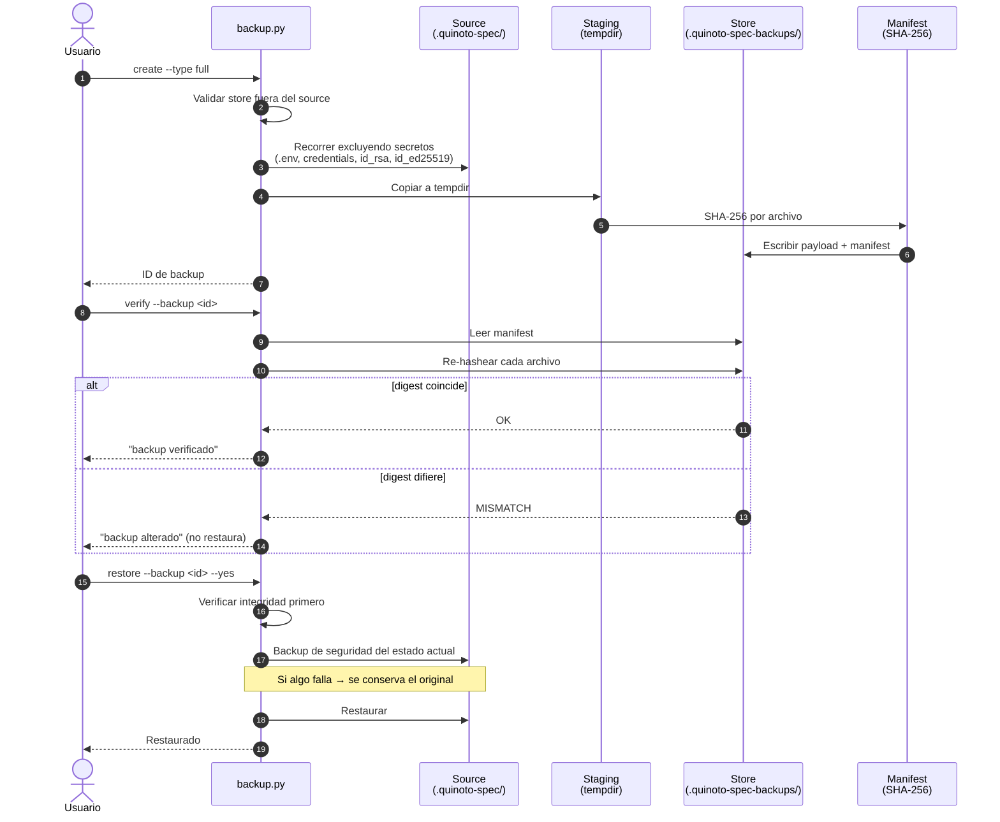

# Datos y Servicios: QuinotoSpec

**Discovery Date:** 2026-09-27

Guardar en: .quinoto-spec/discovery/05-data-and-services.md

## Resumen

QuinotoSpec **no tiene base de datos**. Su "datos" son **artefactos Markdown versionados en git**:
propuestas, user stories, tareas, changelog y registro de prefijos. La única base de datos binaria
en el entorno de uso es externa (Engram, SQLite) y **no forma parte de este paquete**.

## Modelo de datos: artefactos Markdown

### Jerarquía en el proyecto consumidor

```
<proyecto>/.quinoto-spec/
├── config.yaml                  # config del proyecto (opcional; fallback = config-template.yml)
├── constitution.md              # principios verificables + gates
├── prefix-registry.md           # registro de prefijos únicos
├── schema.yaml                  # DAG de artefactos (fork opcional del core)
├── discovery/                   # 8 archivos de descubrimiento
│   ├── 01-stack-profile.md ... 08-product-and-agreements.md
├── specs/                       # specs base por dominio (delta-specs se mergean acá)
│   └── <dominio>/spec.md
├── proposals/
│   └── <YYYY-MM-DD>-<slug>/
│       ├── proposal.md
│       ├── user-stories.md
│       ├── <US_ID>_tasks.md
│       ├── delta-specs/<dominio>/spec.md
│       └── _archived/           # NUNCA prefijo __
├── evidence/<TASK_ID>/          # evidencia estructurada (tdd|debug|verify).json
├── approvals/<APPROVAL_ID>.json # decisiones humanas registradas
├── extensions/.registry         # extensiones/presets instalados
├── blood-bond/                  # analysis.json, suggestions.md
├── mimir/                       # index.json, mimir-sources.json
├── backups/ o .quinoto-spec-backups/  # store del motor de backup
├── changelog/                   # v2: un archivo por entrada (append-only)
│   └── YYYY-MM-DD-PREFIX-SLUG.md
└── INDEX.md                     # regenerable, gitignored
```

### IDs canónicos

| Tipo | Formato | Ejemplo |
|---|---|---|
| Propuesta (prefijo) | `MNEM-suffix` | `AUTH-a1b2` |
| User story | `US-MNEM-suffix-NNN` | `US-AUTH-a1b2-001` |
| Tarea | `TSK-MNEM-suffix-NNN` | `TSK-AUTH-a1b2-001` |
| Evidencia | `<TASK_ID>/<kind>.json` | `TSK-AUTH-a1b2-001/tdd.json` |
| Aprobación | `APR-MNEM-suffix-NNN` | `APR-BASE-a1b2-001` |

`MNEM` = 4 letras, `suffix` = 4 caracteres alfanuméricos (garantiza unicidad/idempotencia entre
entornos). Estados canónicos: `proposed`, `in_progress`, `pending`, `completed`, `blocked`,
`cancelled`, `archived`.

Fuente de verdad del contrato: `agent-dist/skills/quinotospec-contract/contract.py` (`CONTRACT_VERSION = 1`).
Los formatos legados se leen mediante **adapters** y nunca se reescriben automáticamente.

### Formato de delta-spec

`spec.md` por dominio, con secciones:

| Sección | Uso |
|---|---|
| `## ADDED Requirements` | Capacidades nuevas |
| `## MODIFIED Requirements` | Cambios sobre existentes (con `Was:` y `Reason:`) |
| `## REMOVED Requirements` | Eliminaciones (con `Reason:` y `Migration:`) |
| `## RENAMED Requirements` | Renombres |

## Servicios externos

**Ninguno.** El paquete no hace llamadas de red. Verificado: no hay `curl`/`wget` en `install.sh` ni
módulos de red en los scripts Python.

Servicios **del entorno de consumo** (fuera del paquete):

| Servicio | Tipo | Relación |
|---|---|---|
| OpenCode | Host de agente | Consume `agent-dist/` vía plugin + descubrimiento nativo |
| Cursor | Host de agente | Consume vía hook `sessionStart` + `.cursor-plugin/plugin.json` |
| Claude Code | Host de agente | Consume vía hook `SessionStart` + `settings.json` |
| Engram | MCP server (externo) | Memoria persistente. Configurado en `~/.config/opencode/opencode.jsonc`, **no** es parte de este paquete |

## Estado global

No aplica. No hay singletons ni stores en memoria; los scripts son procesos stateless que leen y
escriben archivos.

## Scripts de migración, seeds y acceso a datos

### Migraciones

**No hay migraciones en el sentido de esquema de base de datos.** La migración de *formatos* de
artefactos se resuelve en el contrato mediante **adapters de lectura**:

```bash
# Inspeccionar un artefacto legacy y ver su forma normalizada
python3 agent-dist/skills/quinotospec-contract/contract.py inspect --path <archivo>

# Validar un proyecto completo
python3 agent-dist/skills/quinotospec-contract/contract.py validate --root . --strict
```

Para migración de versiones del propio paquete existe el workflow
`/quinotospec.migrate` (con detección de breaking changes y backup automático).

### Seeds

Los **13 templates** de `agent-dist/templates/` son el seed canónico. El más relevante:

```bash
# Crear proposal.md desde la plantilla
python3 agent-dist/skills/quinotospec-template-resolver/template_resolver.py \
  --root . --kind template --name proposal-template

# Resolver el orden de capas: overrides → presets → extensions → core
```

### Acceso a datos: el backup

El único componente con escritura en el proyecto es el motor de backup.

```bash
B=agent-dist/skills/quinotospec-backup/backup.py

# Crear backup verificado (excluye secretos)
python3 $B create --type full --store /tmp/qs-backups
# Tipos: full | incremental | proposals | discovery

# Verificar integridad contra el manifest SHA-256
python3 $B verify --backup /tmp/qs-backups/<id>

# Restaurar (exige --yes y hace un backup de seguridad previo)
python3 $B restore --backup /tmp/qs-backups/<id> --yes

# Limpiar (dry-run por defecto)
python3 $B cleanup --keep 5
```

**Exclusiones de secretos** (`backup.py:19`): `.env`, `credentials`, `id_rsa`, `id_25519` → nunca se
incluyen en el backup. El store por defecto es `.quinoto-spec-backups/`, y se **rechaza** que el store
esté dentro del source (`test-backup.py`).

## Flujo de datos: backup verificado



## Ownership manifest: el modelo de datos de la instalación

`$CONFIG_DIR/.quinoto-spec/ownership.json` es el artefacto clave que hace seguro el uninstall.

```json
{
  "schema_version": 1,
  "installer_version": "3.2.0",
  "ide": "opencode",
  "installed_at": "2026-09-25T13:29:20Z",
  "owned": [
    { "path": "plugins/quinotospec-plugin.js", "sha256": "<hex>" }
  ],
  "external_config": [ { "path": "hooks.json", "managed": false } ],
  "hook_commands": [ "/abs/path/hooks/session-start.sh --platform cursor" ],
  "agents": { "path": "AGENTS.md", "managed": true, "sha256": "<hex>" }
}
```

Semántica:

| Campo | Invariante |
|---|---|
| `owned` | Todo archivo regular que el instalador escribió. `uninstall` **solo** borra los que están acá **y** cuyo hash coincide |
| `external_config` | Archivos de config del usuario que el instalador *edita pero no posee* |
| `hook_commands` | Comandos exactos inyectados; permite quitar solo esas entradas |
| `agents` | `AGENTS.md` gestionado, con digest |

**Invariante de seguridad**: si un archivo `owned` fue modificado → `uninstall` **aborta entero**, no
borra nada (`install.sh:908-944`). Verificado por `tests/test-install-e2e.sh:249-262`.

## Diagrama ER

> **Placeholder.** El modelo es jerárquico de archivos (no relacional), así que un ER tradicional
> no aplica. Si en el futuro se migra a SQLite, documentar aquí: `artifacts`, `observations`,
> `sessions`, `user_prompts`, `prefixes`, `approval_decisions`.

## 🔗 Referencias

- `03-architecture.md` — capas y flujo de instalación
- `06-devops-ci-security.md` — prácticas de seguridad y CI
- `agent-dist/skills/quinotospec-contract/contract.py` — fuente de verdad del contrato
