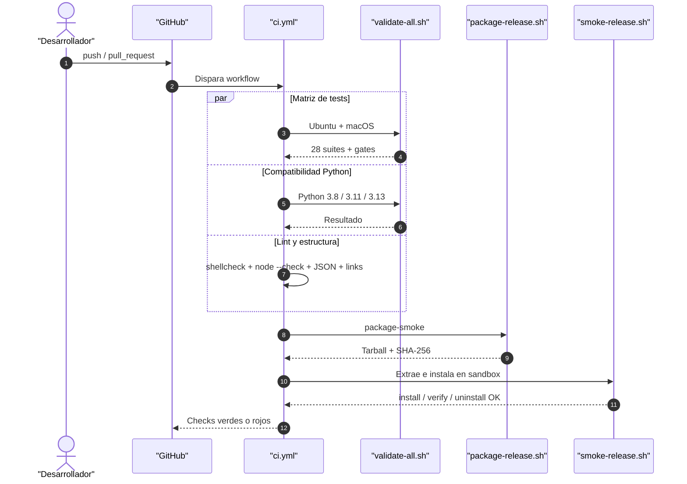
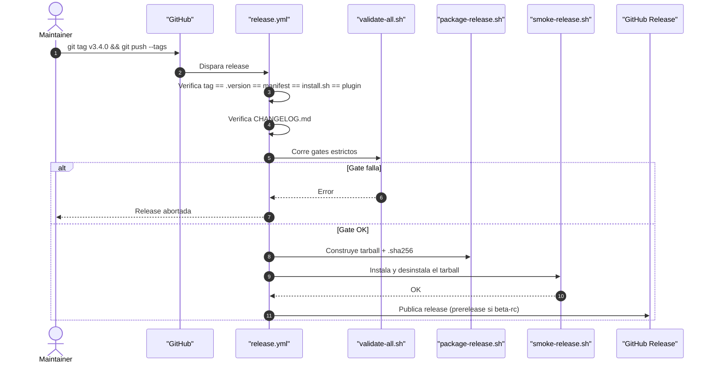

# DevOps, CI y Seguridad: QuinotoSpec

Entornos, pipelines, automatización, auditoría de dependencias, postura de seguridad y estrategia de backup.

Guardar en: `.quinoto-spec/discovery/06-devops-ci-security.md`

**Discovery Date:** 2026-11-13
**Versión:** 3.4.0 — *Hird Edition*

## Resumen

QuinotoSpec se distribuye como **tarball versionado** y se instala con un **script Bash transaccional**. La integración continua corre en **GitHub Actions** con matriz de sistema operativo (Ubuntu/macOS) y de Python (3.8/3.11/3.13). No hay contenedores, Kubernetes, base de datos ni secretos de aplicación.

| Área | Estado |
|---|---|
| Contenedores | No hay `Dockerfile` ni `docker-compose.yml` |
| CI | 3 workflows: `ci.yml`, `release.yml`, `huginn-muninn.yml` |
| Release | Tag `v*` → validación → tarball + SHA-256 → GitHub Release |
| Cron | Diario 06:00 UTC para entropía |
| Secretos requeridos | Ninguno |
| Variables obligatorias | Ninguna |
| Auditoría de dependencias | Manual; no está en CI |

## Configuración de entorno de desarrollo

### Requisitos

```bash
bash --version    # >= 4.0
git --version     # >= 2.0
python3 --version # >= 3.8
node --version    # opcional, solo para validar plugins
shellcheck --version
```

### Variables de entorno

| Variable | Obligatoria | Uso |
|---|---|---|
| `QUINOTOSPEC_ALLOW_NO_NODE` | No | Con `true`, la ausencia de Node no es fatal en `--strict` |
| `QUINOTOSPEC_HOOK_PLATFORM` | No | `claude`, `cursor` o `generic` para `session-start.sh` |
| `PLUGIN_ROOT` | No | Raíz del payload para el hook |
| `QUINOTOSPEC_OPENCODE_MAJOR` | No | Fuerza `1` o `2` para pruebas/instalación |
| `BASH_PATH` | No | Bash alternativo en CI de macOS |
| `CI`, `GITHUB_*` | No | Provistas por GitHub Actions |

**No hay `.env`, tokens, claves de API ni credenciales en el repositorio.** El paquete no hace llamadas de red en su operación normal.

### Setup local

```bash
git clone https://github.com/Quinoto-Tech/QuinotoSpec.git
cd QuinotoSpec
chmod +x install.sh

# Instalar hooks de desarrollo (opcional)
bash scripts/install-hooks.sh

# Verificar entorno
./install.sh --version
bash tests/run-all-tests.sh
```

## Pipelines de CI/CD

### CI — `.github/workflows/ci.yml`

Disparadores: `push` a `master`, `main` y `release-*`; `pull_request` a `master`/`main`.

| Job | Runner | Qué hace | Bloquea merge |
|---|---|---|---|
| `test` | Ubuntu + macOS | `scripts/validate-all.sh --strict` (suite completa + gates) | Sí |
| `compatibility` | Ubuntu, Python 3.8 / 3.11 / 3.13 | Mismo gate en versiones soportadas | Sí |
| `package-smoke` | Ubuntu, Python 3.13 | Construye tarball y corre smoke de install/verify/uninstall | Sí |
| `example-playground` | Ubuntu, Python 3.13 | `pip install -r examples/python-fastapi/requirements.txt` + `pytest` | Sí |
| `lint-shell` | Ubuntu | Instala `shellcheck` fijado y corre `scripts/lint-shell.sh` | Sí |
| `lint-runtime` | Ubuntu | Valida JSON de hooks/plugin y sintaxis JS con `node --check` | Sí |
| `lint-docs` | Ubuntu | Links internos, naming de workflows/skills/agents, templates | Sí |
| `structure` | Ubuntu | Directorios y archivos críticos presentes | Sí |

### Pipeline de CI



### Release — `.github/workflows/release.yml`

Disparador: push de tag `v*`.



**Pasos del release:**

1. Verificar que el tag coincide con `.version`, `manifest.json`, `INSTALLER_VERSION` y `.cursor-plugin/plugin.json`.
2. Verificar que `CHANGELOG.md` tiene la sección de la versión.
3. Determinar `prerelease` a partir de `manifest.json` (`beta-rc` ⇒ prerelease).
4. Ejecutar `validate-all.sh --strict`.
5. Generar notas desde `CHANGELOG.md`.
6. Construir `quinotospec-<version>.tar.gz` y su `.sha256`.
7. Smoke test del tarball.
8. Publicar en GitHub Releases con ambos artefactos.

### Entropía — `.github/workflows/huginn-muninn.yml`

| Aspecto | Valor |
|---|---|
| Disparadores | `pull_request`, `push` a `master`/`main`, `schedule`, `workflow_dispatch` |
| Cron | `0 6 * * *` (06:00 UTC diario) |
| Comando | `agent-dist/skills/quinotospec-huginn-muninn/check.sh --json` |
| Gate | Falla si `S_final >= 0.76` |
| Permisos | `contents: read`, `pull-requests: write` |
| Salida | JSON + historial en `.quinoto-spec/metrics/entropy-history.jsonl` |

> El gate es una señal heurística de entropía, no una medida completa de calidad. Un `S_final` bajo no garantiza ausencia de bugs.

## Scripts de automatización

| Script | Propósito | Cuándo se ejecuta |
|---|---|---|
| `scripts/validate-all.sh` | Gate completo del paquete | CI, release, pre-push manual |
| `scripts/package-release.sh` | Construye tarball + checksum, excluye caches | Release y smoke |
| `scripts/smoke-release.sh` | Instala/verifica/desinstala el tarball | CI y release |
| `scripts/update-version.sh` | Sincroniza versión en todos los archivos | Bump de versión |
| `scripts/lint-shell.sh` | Shellcheck con versión fijada | CI, pre-commit |
| `scripts/check-links.sh` | Links internos y externos | CI, validación |
| `scripts/check-readme-parity.py` | Paridad estructural ES/EN | CI, validación |
| `scripts/check-readme-commands.py` | Comandos citados existen | CI, validación |
| `scripts/check-skill-workflow-drift.py` | Drift skill ↔ workflow | CI, validación |
| `scripts/install-hooks.sh` | Instala `.githooks` en `.git/hooks` | Setup local |
| `scripts/cleanup-temp.sh` | Limpia scripts/artefactos temporales | Mantenimiento |

### Git hooks

| Hook | Qué valida |
|---|---|
| `.githooks/pre-commit` | Frontmatter/H1 en workflows y skills, `name` en skills, sintaxis de `install.sh`, shellcheck de scripts modificados |
| `.githooks/pre-push` | Ejecuta `tests/run-all-tests.sh` completo |

### Cron jobs

| Job | Frecuencia | Propósito |
|---|---|---|
| `huginn-muninn.yml` | Diario 06:00 UTC | Calcular entropía y bloquear si `S_final >= 0.76` |
| Backups | **No automatizados** | El backup es explícito mediante `backup.py` |

## Revisión rápida de seguridad

### Fortalezas observadas

1. **Sin secretos en el repositorio**: no hay `.env`, tokens ni claves; CI no requiere secrets.
2. **Instalador transaccional**: staging + verificación + `mv`; `EXIT trap` restaura ante fallo.
3. **Ownership por hash**: `uninstall` no borra archivos modificados por el usuario.
4. **Rechazo de symlinks** en rutas gestionadas, con allow-list explícita para configuración ajena.
5. **Path traversal mitigado** en UI: `/static/`, `/discovery/` y `/specs/` resuelven y comparan contra el directorio base.
6. **UI read-only**: no escribe en `.quinoto-spec/`; no hay endpoints de escritura.
7. **Binding loopback por defecto**: `--host 127.0.0.1`.
8. **Sin CORS abierto**: no se emiten cabeceras `Access-Control-Allow-*`.
9. **Validación de JSON** de hooks y plugins en CI.
10. **Shellcheck fijado** por versión para evitar falsos positivos entre releases.

### Riesgos y brechas

| Riesgo | Severidad | Evidencia | Mitigación recomendada |
|---|---|---|---|
| UI sin autenticación ni TLS | 🟠 Media | `server.py` no implementa auth; `--host` configurable | Documentar uso local; añadir advertencia si `--host != 127.0.0.1`; proxy con auth para remoto |
| Sin cabeceras de seguridad HTTP | 🟠 Media | `_send()` solo define `Content-Type`, `Content-Length`, `Cache-Control` | Añadir CSP, `X-Content-Type-Options`, `X-Frame-Options`, `Referrer-Policy` |
| Estado compartido en UI | 🟡 Baja | `State` usa atributos de clase con `ThreadingHTTPServer` | Hacer el estado por request o añadir lock |
| Acciones de GitHub por tag, no SHA | 🟠 Media | `actions/checkout@v7`, `setup-python@v7`, `action-gh-release@v3` | Pinning por SHA + Dependabot/Renovate |
| Asset vendorizado sin integridad | 🟠 Media | `agent-dist/ui/static/mermaid.min.js` (3.2 MB) | Fijar versión, documentar licencia y verificar hash en CI |
| Release sin firma | 🟡 Baja | Solo `.tar.gz.sha256` | Firmar con Sigstore/cosign o GPG; publicar procedencia |
| Auditorías de dependencias manuales | 🟠 Media | No hay job de `pip-audit`/`npm audit`/`cargo audit` | Añadir jobs de auditoría |
| Sin escaneo de secretos | 🟡 Baja | No hay gitleaks/trufflehog en CI | Añadir escaneo en pre-commit/CI |
| `--host 0.0.0.0` expone datos | 🟠 Media | UI sirve todo `.quinoto-spec/` | Bloquear por defecto o exigir confirmación explícita |
| Sin rate limiting | 🟡 Baja | `ThreadingHTTPServer` sin límites | Solo relevante si se expone en red |

### Superficie de ataque

| Superficie | Entrada | Validación |
|---|---|---|
| `install.sh` | Flags, rutas, entorno | Comprobación de dependencias, symlinks, locks, staging |
| Hooks/plugins | Eventos del IDE | Lectura de bootstrap, marcador de idempotencia |
| UI HTTP | Path/query | Path traversal mitigado; sin auth |
| Scripts Python | Argumentos CLI y archivos | Parsers propios; validadores de evidencia/aprobación |
| Git hooks | Archivos staged | Frontmatter, shellcheck, suite completa |
| CI | Código del PR | Gates, shellcheck, node check, links, estructura |

## Auditoría de dependencias

### Paquete QuinotoSpec

**No tiene dependencias obligatorias de terceros.** No hay `package.json`, `requirements.txt`, `pyproject.toml` ni `Cargo.toml` en la raíz. Por lo tanto:

- `pip-audit` sobre el paquete: **N/A**.
- `npm audit` sobre el paquete: **N/A**.
- `cargo audit` sobre el paquete: **N/A**.

La única dependencia opcional es PyYAML (soft-import) y Node.js (solo para `node --check`).

### Ejemplo Python (`examples/python-fastapi`)

```bash
pip-audit -r examples/python-fastapi/requirements.txt
```

**Resultado observado:**

```text
Found 2 known vulnerabilities in 1 package
Name   Version ID              Fix Versions
pytest 8.4.2   PYSEC-2026-1845  9.0.3
pytest 8.4.2   PYSEC-2026-1845  9.0.3
```

| Paquete | Versión | Advisory | Severidad | Fix | Alcance |
|---|---|---|---|---|---|
| `pytest` | 8.4.2 | `PYSEC-2026-1845` | No reportada por `pip-audit` (sin CVSS) | `9.0.3` | **Solo ejemplo/desarrollo**, no runtime del paquete |

> `pytest` está declarado como `>=8,<9` en el playground. El instalador del paquete no lo usa. Recomendación: actualizar el rango del ejemplo a `pytest>=9.0.3,<10` cuando sea compatible, o aceptar el riesgo documentado por ser dependencia de test.

### Ejemplo Node (`examples/node-express`)

El ejemplo no versiona `package-lock.json`. Para auditar se generó un lock temporal en `/tmp/opencode/npm-audit`:

```bash
mkdir -p /tmp/opencode/npm-audit
cp examples/node-express/package.json /tmp/opencode/npm-audit/
cd /tmp/opencode/npm-audit
npm install --package-lock-only
npm audit
```

**Resultado observado:**

```text
6 low severity vulnerabilities
```

| Paquete | Severidad | Advisory | Alcance |
|---|---|---|---|
| `deepmerge` | Low | Prototype poisoning en `mergeObject()` | Transitiva de `jest-config` (dev) |
| `jest`, `jest-cli`, `jest-config`, `@jest/core`, `create-jest` | Low | Dependen de `deepmerge` vulnerable | Dev/test |

**No se encontraron vulnerabilidades `moderate`, `high` ni `critical`.**

### Ejemplo Rust (`examples/rust-axum`)

```bash
# Requiere instalar la herramienta
cargo install cargo-audit
cd examples/rust-axum
cargo audit
```

**Estado:** no ejecutado en este discovery porque `cargo` no está instalado en el entorno. Se requiere toolchain Rust y acceso a la base de advisories.

### Recomendación de automatización

```yaml
# Ejemplo de jobs a añadir a ci.yml
dependency-audit-python:
  runs-on: ubuntu-latest
  steps:
    - uses: actions/checkout@<sha>
    - run: pip install pip-audit
    - run: pip-audit -r examples/python-fastapi/requirements.txt

dependency-audit-node:
  runs-on: ubuntu-latest
  steps:
    - uses: actions/checkout@<sha>
    - run: cd examples/node-express && npm install --package-lock-only && npm audit --audit-level=high

dependency-audit-rust:
  runs-on: ubuntu-latest
  steps:
    - uses: actions/checkout@<sha>
    - run: cargo install cargo-audit && cd examples/rust-axum && cargo audit
```

## Backup, versionado y recuperación

### Versionado

- **SemVer** con tags `v*`.
- Versión replicada en 4 archivos y verificada en CI/release.
- Changelog de release en `CHANGELOG.md`; changelog operativo en `.quinoto-spec/changelog/` (append-only).
- `scripts/update-version.sh` sincroniza todos los archivos y valida drift con Norns.

### Backup

```bash
# Crear backup completo
python3 -B agent-dist/skills/quinotospec-backup/backup.py create --root . --type full --json

# Verificar integridad
python3 -B agent-dist/skills/quinotospec-backup/backup.py verify --backup <BACKUP_ID> --json

# Listar
python3 -B agent-dist/skills/quinotospec-backup/backup.py list --root . --json

# Restaurar (transaccional, requiere confirmación)
python3 -B agent-dist/skills/quinotospec-backup/backup.py restore --backup <BACKUP_ID> --yes

# Limpiar (dry-run por defecto)
python3 -B agent-dist/skills/quinotospec-backup/backup.py cleanup --keep 5 --dry-run
```

Características:

- Store por defecto: `.quinoto-spec-backups/`.
- SHA-256 por archivo y manifiesto.
- Restore staged con swap.
- Backups `full`, `incremental`, `proposals`, `discovery`.
- Bifrost DR: `bifrost.py --backup` genera un `tar.gz` federado; el restore es manual.

### Recuperación ante desastres

| Escenario | Procedimiento | Automatizado |
|---|---|---|
| Corrupción de `.quinoto-spec/` | `backup.py restore --backup <ID> --yes` | Parcial |
| Instalación fallida | El `EXIT trap` restaura; reinstalar con `install.sh` | Sí |
| Archivo gestionado modificado | `--verify` detecta hash distinto; reinstalar | Sí |
| Pérdida de un repo federado | Restaurar desde backup Bifrost manualmente | No |
| Pérdida del repositorio Git | Clonar desde GitHub y restaurar `.quinoto-spec/` desde backup | No |
| Release incorrecta | Revertir tag y publicar nueva versión | Manual |

### Brechas de recuperación

- No hay cron de backups.
- No hay retención automática fuera de `cleanup`.
- No hay restore automatizado multi-repo (Bifrost).
- No hay prueba de restore completo en CI (solo create/verify/list/restore en tests unitarios con fixtures).

## Checklist de DevOps

- [ ] Mantener `validate-all.sh --strict` verde antes de cada push.
- [ ] Ejecutar `bash tests/run-all-tests.sh` (el pre-push ya lo hace).
- [ ] Fijar GitHub Actions por SHA y activar Dependabot/Renovate.
- [ ] Añadir `pip-audit`, `npm audit` y `cargo audit` a CI.
- [ ] Añadir escaneo de secretos (`gitleaks`) a CI/pre-commit.
- [ ] Añadir cabeceras de seguridad a la UI y advertencia con `--host != 127.0.0.1`.
- [ ] Documentar versión, licencia y hash de `mermaid.min.js`.
- [ ] Firmar artefactos de release y publicar procedencia.
- [ ] Programar backups y probar restore en un sandbox.
- [ ] Documentar el runbook de recuperación multi-repo.

## 🔗 Referencias

- `.github/workflows/ci.yml` — CI
- `.github/workflows/release.yml` — release
- `.github/workflows/huginn-muninn.yml` — entropía
- `scripts/validate-all.sh` — gate completo
- `scripts/package-release.sh` / `smoke-release.sh` — artefactos
- `agent-dist/skills/quinotospec-backup/` — backup y restore
- `docs/TROUBLESHOOTING.md` — problemas operativos
