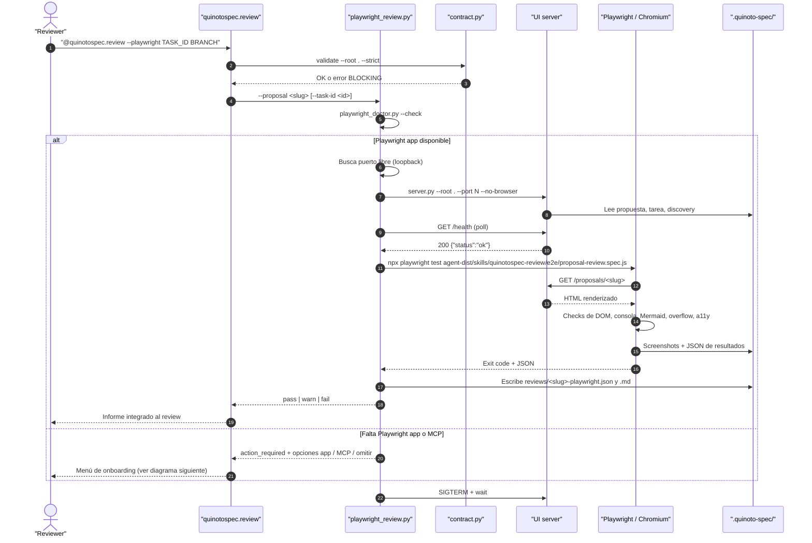
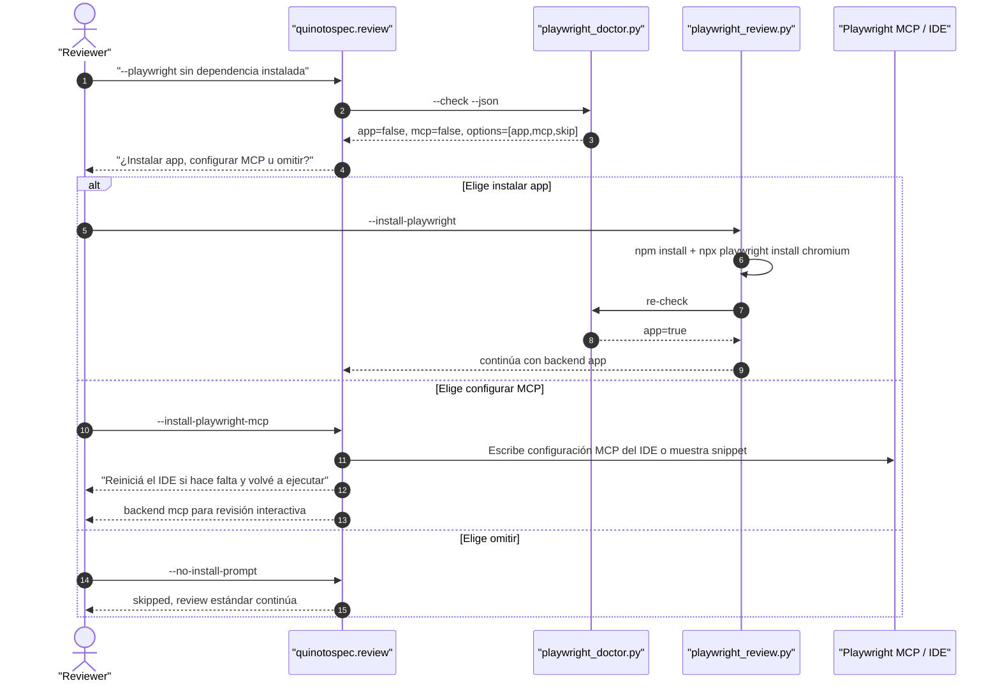

# Propuesta Técnica: Playwright Proposal Review

**Contract Version:** 1
**ID:** 2026-11-13-playwright-proposal-review
**Prefijo:** PWRE-9f2c
**Fecha de Creación:** 2026-11-13
**Estado:** 🟢 En Curso
**Prioridad:** P1
**Complejidad:** Media
**Servicios Afectados:** review-workflow, ui
**Autor:** Agente QuinotoSpec

**⚠️ Excepción DoR/DoD:** `.quinoto-spec/discovery/08-product-and-agreements.md` está vacío como plantilla para completar por humanos. El usuario confirmó explícitamente un override para generar esta propuesta y documentar la excepción. La propuesta NO queda aprobada para Apply hasta que se complete el DoR/DoD o se registre una aprobación humana específica.

**Conflictos Detectados:** Ninguno. No hay propuestas activas en `.quinoto-spec/proposals/`.

---

## Resumen Ejecutivo

El workflow `@quinotospec.review` revisa el diff y el Markdown de una propuesta, pero no verifica cómo se ve esa propuesta en la UI local ni si su contenido renderizado funciona. Un Markdown válido puede tener tablas desbordadas, Mermaid roto, enlaces internos caídos o errores de consola que el revisor nunca ve.

Esta propuesta agrega un modo opcional `--playwright` al review. Cuando se activa, un orquestador Python inicia la UI local en loopback, abre la propuesta (y opcionalmente la tarea) en Chromium con Playwright, valida render, Mermaid, responsive, consola y accesibilidad básica, captura screenshots y escribe evidencia JSON + Markdown en `.quinoto-spec/reviews/`.

Si la persona **no tiene Playwright**, el review no se omite en silencio: ofrece un menú explícito con tres caminos:

1. **Instalar Playwright app** (`@playwright/test` + Chromium) para ejecución reproducible y CI.
2. **Configurar Playwright MCP** para revisión interactiva desde el agente/IDE.
3. **Omitir el review visual** y continuar con el review estándar.

La instalación nunca es automática: requiere confirmación explícita o flags de autorización (`--install-playwright`, `--install-playwright-mcp`). El harness (`package.json`, config, spec y reporter) vive en `agent-dist/skills/quinotospec-review/e2e/` como **dependencia de desarrollo opcional**: viaja con el paquete, pero `node_modules` y los navegadores nunca se instalan. El paquete mantiene su política de cero dependencias obligatorias en runtime.

---

## Contexto y Problema

### Problema Actual

El review actual se apoya en:

- `git diff` del branch.
- Lectura del `proposal.md` y `*_tasks.md`.
- Checklist de criterios, tests y convenciones.
- Opcionalmente, Goldfish con subagentes aislados.

Ese proceso no detecta problemas que solo aparecen en el navegador:

1. **Mermaid roto**: un bloque con sintaxis inválida se muestra como error o queda vacío.
2. **Layout roto**: tablas anchas, código sin scroll o contenido que desborda en móvil.
3. **Errores de consola**: JavaScript de la UI o de Mermaid falla y nadie lo registra.
4. **Enlaces internos caídos**: la propuesta referencia un archivo o ruta que no existe.
5. **Regresiones de UI**: un cambio en `templates.py` rompe la página de propuestas sin que `test-ui.sh` lo note.
6. **Accesibilidad básica**: falta un `h1`, un `label` o un nombre accesible en un control.
7. **Barrera de adopción**: si Playwright no está instalado, el revisor abandona el modo visual o no sabe cómo habilitarlo. La propuesta debe detectar la ausencia y ofrecer instalar la app o configurar el MCP, no simplemente fallar.

### Evidencia / Discovery

- `04-endpoints-and-openapi.md` documenta `/proposals/<slug>` y `/tasks/<taskId>` como superficies HTML read-only.
- `07-findings-and-recommendations.md` (F-04 y F-10) señala que la UI no tiene endurecimiento ni auditoría de accesibilidad.
- `tests/test-ui.sh` valida endpoints y estructura, pero no renderiza en un navegador real.
- `grep -ri playwright` solo encuentra la palabra en `quinotospec-stack-detect/SKILL.md`; no hay Playwright app instalado ni tests E2E en el repositorio.
- Este entorno de agente expone herramientas **Playwright MCP**, pero el paquete no puede asumir que todos los IDEs las tengan; el onboarding debe cubrir ambos casos.
- `docs/ARCHITECTURE.md` mantiene la UI como `experimental`; este modo agrega evidencia objetiva para promoverla.

---

## Solución Propuesta

### Enfoque

Agregar un modo de review asistido por navegador con cuatro piezas:

1. **Flag `--playwright`** en `agent-dist/workflows/quinotospec.review.md` y en `agent-dist/skills/quinotospec-review/SKILL.md`.
2. **Doctor de dependencias** `agent-dist/skills/quinotospec-review/playwright_doctor.py`:
   - detecta Node, `@playwright/test`, Chromium y Playwright MCP;
   - devuelve JSON con `app`, `mcp`, `options` y `recommended`;
   - nunca instala nada por sí solo.
3. **Orquestador stdlib** `agent-dist/skills/quinotospec-review/playwright_review.py`:
   - valida el contrato de artefactos;
   - resuelve la propuesta y, si se pasa, la tarea;
   - ejecuta el doctor y, si falta Playwright, presenta el onboarding;
   - encuentra un puerto libre y arranca `agent-dist/ui/server.py --root . --port <N> --no-browser`;
   - espera `/health`;
   - invoca Playwright app o delega al backend MCP;
   - escribe evidencia JSON + reporte Markdown;
   - detiene el servidor con `finally`, incluso si Playwright falla.
4. **Harness Playwright dev-only** en `agent-dist/skills/quinotospec-review/e2e/`:
   - `@playwright/test` + Chromium;
   - viewports desktop, tablet y mobile;
   - assertions de render, Mermaid, consola, requests y overflow;
   - screenshots por viewport;
   - reporter JSON propio.

### Onboarding cuando falta Playwright

Si el doctor no encuentra Playwright app ni MCP configurado, el workflow presenta:

```text
Playwright no está disponible.

  1) Instalar Playwright app (recomendado para CI y resultados reproducibles)
     - requiere Node.js 20+
     - descarga Chromium (~150–300 MB)
     - comando: cd agent-dist/skills/quinotospec-review/e2e && npm install && npx playwright install chromium

  2) Configurar Playwright MCP (recomendado para revisión interactiva en el IDE)
     - el agente usa herramientas de navegador MCP
     - requiere configurar el servidor MCP del IDE y, a veces, reiniciar
     - comando base: npx -y @playwright/mcp@latest

  3) Omitir el review visual y continuar con el review estándar

Elegí una opción [1/2/3]:
```

| Opción | Cuándo conviene | Acción | Resultado |
|---|---|---|---|
| **1. App** | CI, revisión reproducible, screenshots y JSON determinista | `npm install` + `npx playwright install chromium` tras confirmación | El orquestador re-ejecuta el doctor y continúa con el backend `app` |
| **2. MCP** | Revisión interactiva en un IDE que ya soporta MCP | El workflow escribe la configuración MCP del IDE o muestra el snippet; el agente usa las herramientas MCP | Evidencia armada por el agente; puede requerir reinicio del IDE |
| **3. Omitir** | El usuario no quiere instalar nada ahora | No se instala nada | `result: skipped`; el review estándar continúa |

**Snippet MCP genérico** (el adaptador del IDE ajusta el formato exacto):

```json
{
  "mcp": {
    "playwright": {
      "type": "local",
      "command": ["npx", "-y", "@playwright/mcp@latest"],
      "enabled": true
    }
  }
}
```

### Flags de onboarding

| Flag | Efecto |
|---|---|
| `--playwright` | Activa el modo visual; backend `auto` |
| `--playwright-backend auto\|app\|mcp` | Fuerza el backend; `auto` prefiere app y luego MCP |
| `--install-playwright` | Autoriza instalar la app y Chromium sin preguntar |
| `--install-playwright-mcp` | Autoriza escribir/configurar la entrada MCP del IDE |
| `--no-install-prompt` | Si falta Playwright, omite el review visual sin preguntar |
| `--require-playwright` | Si falta Playwright, falla en vez de omitir |
| `--yes` | Modo no interactivo; **no autoriza instalaciones por sí solo** |

### Principios de diseño

| Principio | Decisión |
|---|---|
| Cero dependencias en runtime | El harness dev-only viaja en `agent-dist/skills/quinotospec-review/e2e/`; `node_modules` y navegadores no se instalan con el paquete |
| Onboarding explícito | Sin Playwright, se ofrecen app, MCP u omitir; no se omite en silencio |
| Instalación consentida | Nunca se instala sin confirmación o flag explícito; nunca `sudo` |
| Solo loopback | El orquestador rechaza URLs que no sean `127.0.0.1` o `localhost` |
| No escribir artefactos | El review no modifica propuestas, tareas ni specs; solo escribe en `.quinoto-spec/reviews/` |
| Evidencia reproducible | JSON con `schema_version`, checks, errores y screenshots |
| Coste controlado | Chromium por defecto; job de CI solo para cambios de UI/review |
| Selectores estables | `data-testid` aditivos en templates, sin romper clases/IDs existentes |

### Alternativas Consideradas

| Alternativa | Pros | Contras | Descartada porque |
|---|---|---|---|
| Solo Playwright MCP | Sin instalar nada; usa herramientas del IDE | No disponible en todos los IDEs; no reproducible en CI; depende del agente | No sirve como gate determinista |
| Python Playwright (`pip install playwright`) | Lenguaje alineado con el resto del paquete | Dependencia externa + descarga de navegadores; menos natural para UI | Añade dependencia al entorno Python del paquete |
| Cypress | Buen DX para E2E | Más pesado, menor soporte multi-browser, otro stack | Playwright ya es el estándar del ecosistema y soporta Chromium/Firefox/WebKit |
| Parsear HTML con stdlib/BeautifulSoup | Sin navegador; rápido | No ejecuta JS, no detecta Mermaid roto, consola ni layout real | No cubre el problema principal |

---

## Arquitectura y Diseño Técnico

### Diagrama de secuencia



### Onboarding de Playwright



### Estructura y variables principales

```text
agent-dist/skills/quinotospec-review/e2e/
├── package.json                 # devDependencies: @playwright/test
├── playwright.config.js         # chromium, timeouts, reporter, outputDir
├── proposal-review.spec.js      # assertions y screenshots
└── reporter.js                  # escribe JSON normalizado

agent-dist/skills/quinotospec-review/
├── SKILL.md                     # flag y checklist
├── playwright_doctor.py         # detección app/MCP y opciones
└── playwright_review.py         # orquestador stdlib
```

Variables de entorno que recibe Playwright:

| Variable | Propósito |
|---|---|
| `QS_BASE_URL` | URL loopback de la UI (`http://127.0.0.1:<N>`) |
| `QS_PROPOSAL_SLUG` | Carpeta de la propuesta a revisar |
| `QS_TASK_ID` | Tarea opcional a revisar |
| `QS_OUTPUT_DIR` | Directorio de screenshots y JSON |
| `QS_PLAYWRIGHT_BACKEND` | `auto`, `app` o `mcp` |
| `QS_REQUIRE_PLAYWRIGHT` | `1` para convertir `skipped`/`action_required` en error |
| `QS_FORCE_MISSING_PLAYWRIGHT` | `1` para probar el onboarding en tests |

### Flujo de ejecución paso a paso

1. El workflow valida `contract.py validate --root . --strict`.
2. El orquestador comprueba que la propuesta existe y que el slug no contiene path traversal.
3. Ejecuta `playwright_doctor.py --check --json`.
4. Si falta app y MCP: presenta onboarding (app / MCP / omitir) o devuelve `action_required` en modo no interactivo.
5. Si elige app: instala solo tras confirmación y vuelve a ejecutar el doctor.
6. Si elige MCP: escribe la configuración del IDE o muestra el snippet; si requiere reinicio, lo indica y no simula el resultado.
7. Si elige omitir: devuelve `skipped` y el review estándar continúa.
8. Con app disponible: busca un puerto libre en `127.0.0.1`.
9. Lanza `server.py` con `--host 127.0.0.1 --port N --no-browser`.
10. Espera `/health` con timeout de 10 segundos.
11. Ejecuta `npx playwright test` con `--project=chromium` y los env vars.
12. El spec abre `/proposals/<slug>` y, si existe, `/tasks/<taskId>`.
13. Valida y captura screenshots en 1440×900, 768×1024 y 390×844.
14. El reporter escribe `playwright.json`; el orquestador escribe el Markdown.
15. El servidor se detiene en `finally`.
16. El workflow agrega el resultado al informe de review.

### Checks de Playwright

| Check | Severidad | Regla |
|---|---|---|
| HTTP status de la propuesta | BLOCKING | Debe ser 200 |
| Título/H1 de la propuesta | BLOCKING | Debe existir y coincidir con el título |
| Errores de consola | BLOCKING | Cualquier `console.error` no allowlisted |
| Errores de página | BLOCKING | Cualquier `pageerror` |
| Requests fallidos same-origin | BLOCKING | 4xx/5xx inesperados |
| Mermaid renderizado | BLOCKING | Si el Markdown tiene bloques Mermaid, debe haber SVG y `data-mermaid-state="rendered"` |
| Overflow horizontal | WARN | `scrollWidth <= clientWidth + 1` en cada viewport |
| Screenshots | WARN | Deben generarse los 3 viewports |
| Accesibilidad smoke | WARN | Un `h1`, labels en búsqueda, nombres accesibles en controles |
| Enlaces internos | WARN | Links relativos de la página responden 200 |

### Evidencia JSON

```json
{
  "schema_version": 1,
  "tool": "playwright",
  "browser": "chromium",
  "base_url": "http://127.0.0.1:54321",
  "proposal": "2026-11-13-playwright-proposal-review",
  "task_id": null,
  "dependency": {
    "app": {"available": true, "version": "1.52.0", "chromium": true},
    "mcp": {"available": false, "configured": false},
    "selected_backend": "app",
    "install_action": "install-app",
    "consent": "explicit-flag"
  },
  "viewports": ["1440x900", "768x1024", "390x844"],
  "checks": [
    {"id": "http-status", "status": "pass", "detail": "200"},
    {"id": "mermaid", "status": "pass", "detail": "3 SVG"}
  ],
  "console_errors": [],
  "page_errors": [],
  "failed_requests": [],
  "screenshots": [
    "screenshots/desktop.png",
    "screenshots/tablet.png",
    "screenshots/mobile.png"
  ],
  "result": "pass",
  "generated_at": "2026-11-13T12:00:00+00:00"
}
```

### Salida del doctor

```json
{
  "schema_version": 1,
  "node": {"available": true, "version": "20.11.0"},
  "app": {"available": false, "version": null, "chromium": false},
  "mcp": {"configured": false, "detected_in": []},
  "options": [
    {"id": "install-app", "recommended": true, "size": "~150-300 MB"},
    {"id": "install-mcp", "recommended": false},
    {"id": "skip", "recommended": false}
  ],
  "recommended": "install-app"
}
```

### Especificación Técnica Detallada

#### workflow

- **AGREGA**: flag `--playwright`, doctor de dependencias, onboarding app/MCP/omitir, paso de review visual, checklist y reglas de bloqueo → ver `delta-specs/workflow/spec.md#added-requirements`.
- **MODIFICA**: ninguna requirement vigente de `specs/workflow/spec.md`.
- **ELIMINA**: ninguna.

#### ui

- **AGREGA**: selectores E2E estables (`data-testid`) y estado observable de Mermaid (`data-mermaid-state`) → ver `delta-specs/ui/spec.md#added-requirements`.
- **MODIFICA**: ninguna requirement vigente de `specs/ui/spec.md`.
- **ELIMINA**: ninguna.

---

## Alcance

### Incluye

- Flag `--playwright` en workflow y skill de review.
- Doctor de dependencias (`playwright_doctor.py`) con detección de app, Chromium y MCP.
- Onboarding interactivo con tres opciones: instalar app, configurar MCP u omitir.
- Flags de autorización (`--install-playwright`, `--install-playwright-mcp`) y modo no interactivo.
- Orquestador Python stdlib con arranque/parada segura de la UI.
- Harness Playwright dev-only con Chromium.
- Checks de render, Mermaid, consola, requests, overflow y accesibilidad smoke.
- Screenshots en 3 viewports.
- Evidencia JSON versionada + reporte Markdown.
- `data-testid` aditivos en templates de propuesta, tarea y navegación.
- Job de CI opcional para cambios de UI/review.
- Tests del doctor y del orquestador (skip, app, MCP, timeout, path traversal).
- Documentación en `docs/PLAYWRIGHT-REVIEW.md`.

### No Incluye (Out of Scope)

- Firefox, WebKit ni Safari en la primera fase.
- Baseline de regresión visual con comparación pixel-perfect.
- Auditoría completa de accesibilidad con axe-core (se evalúa en roadmap).
- Pruebas contra URLs externas o entornos remotos.
- Autenticación de la UI.
- Modificar el contenido de la propuesta desde el review.
- Convertir Playwright en dependencia obligatoria del paquete.
- Instalar dependencias sin consentimiento explícito, usar `sudo` o instalar globalmente.
- Empaquetar navegadores o funcionar completamente offline.
- Garantizar la instalación automática del MCP en todos los IDEs; cada IDE tiene su propio formato y puede requerir reinicio.

### Servicios/Dominios Afectados

- `review-workflow`: workflow y skill de review.
- `ui`: templates, selectores y estado de Mermaid.
- `tests` y `ci`: soporte de implementación, sin delta spec propia.

---

## Riesgos y Mitigaciones

| Riesgo | Probabilidad | Impacto | Mitigación |
|---|---|---|---|
| Descarga de navegadores pesada (~150–300 MB) | Alta | Medio | Chromium only; cache en CI; instalación documentada como opcional; tamaño avisado antes de instalar |
| Instalación no consentida o supply chain | Media | Alto | Solo npm/npx oficiales; sin `sudo`; versiones fijadas; confirmación o flag explícito; nunca instalar en modo `--yes` por sí solo |
| MCP no disponible o requiere reinicio | Alta | Medio | Doctor best-effort; instrucciones por IDE; fallback a app o skip; no simular resultados MCP |
| Flakiness por Mermaid lazy o animaciones | Media | Alto | Esperar `data-mermaid-state="rendered"`; desactivar animaciones; timeouts explícitos |
| Screenshots con datos sensibles | Media | Alto | Guardar screenshots en `.quinoto-spec/reviews/.artifacts/` ignorado por Git; solo JSON/MD versionables |
| Playwright no disponible en el IDE del usuario | Alta | Bajo | Menú app/MCP/omitir; `skipped` solo si el usuario lo elige o falta `--yes`; no rompe el review normal |
| Colisión de puerto o servidor huérfano | Media | Medio | Puerto efímero + `finally` + `SIGTERM` + timeout |
| Aumento del tiempo de CI | Media | Medio | Job condicionado a cambios de UI/review; timeout de 10 min |
| Selectores frágiles | Media | Medio | `data-testid` estables y tests de contrato de selectores |
| Deriva de dependencias Node | Baja | Medio | `@playwright/test` dev-only + lockfile + Dependabot |
| Falsos positivos por warnings de consola | Media | Bajo | Allowlist explícita y solo `console.error`/`pageerror` |
| Superficie de seguridad de la UI | Baja | Medio | Solo loopback; el orquestador rechaza hosts no locales |

---

## Plan de Implementación

| Fase | Entregable | Estimación |
|---|---|---:|
| 1. Fundación | Flag, doctor, orquestador, arranque/parada de UI, skip path, tests unitarios | 2 días |
| 2. Onboarding | Menú app/MCP/omitir, flags de autorización, modo no interactivo, tests | 1–2 días |
| 3. Harness Playwright | `agent-dist/skills/quinotospec-review/e2e`, config, spec, reporter, fixture de propuesta | 2–3 días |
| 4. Selectores y checks | `data-testid`, `data-mermaid-state`, checks de consola/Mermaid/overflow/a11y | 1–2 días |
| 5. Evidencia y review | JSON + Markdown, integración al workflow, checklist y severidades | 1 día |
| 6. CI y docs | Job condicionado, cache, documentación, dogfooding | 1 día |
| **Total** | | **8–11 días** |

### Orden sugerido

1. Crear el fixture `tests/fixtures/quinoto-spec-playwright/` con una propuesta que tenga tablas, código y Mermaid.
2. Implementar `playwright_doctor.py` con detección de app/MCP y salida JSON.
3. Implementar el orquestador y su modo `action_required`/`skipped`.
4. Implementar el menú de onboarding y los flags de autorización.
5. Agregar `data-testid` y `data-mermaid-state` sin romper la UI actual.
6. Implementar el spec de Playwright y el reporter JSON.
7. Integrar el resultado al workflow de review.
8. Agregar el job de CI y la documentación.
9. Ejecutar `--playwright` sobre esta misma propuesta como dogfooding, probando app y MCP.

---

## Criterios de Aceptación (DoD)

### Implementación

- [ ] `@quinotospec.review --playwright` documentado en workflow y skill.
- [ ] El doctor detecta app, Chromium y MCP, y devuelve `options` con app/MCP/omitir.
- [ ] Si falta Playwright, el workflow presenta el menú y no instala nada sin confirmación.
- [ ] `--install-playwright` instala solo `@playwright/test` + Chromium después de la confirmación y re-ejecuta el doctor.
- [ ] `--install-playwright-mcp` escribe/configura la entrada MCP o muestra el snippet; si requiere reinicio, lo indica.
- [ ] En modo no interactivo sin flags, devuelve `action_required` con exit code distinto de 0.
- [ ] Si el usuario elige omitir, devuelve `skipped` y el review estándar continúa.
- [ ] El orquestador arranca y detiene la UI sin dejar procesos huérfanos.
- [ ] Si Playwright falla, devuelve `failed` y el review lo muestra como BLOCKING.
- [ ] El orquestador rechaza slugs con `..`, `/` o rutas fuera de `.quinoto-spec/proposals/`.
- [ ] Solo se permiten URLs `127.0.0.1` y `localhost`.
- [ ] Se generan screenshots desktop/tablet/mobile.
- [ ] Se genera `playwright.json` con `schema_version: 1` y bloque `dependency`.
- [ ] Se genera `reviews/<slug>-playwright.md` con resumen, opción elegida y hallazgos.

### Testing

- [ ] Test unitario del doctor: app presente, app ausente, MCP configurado, MCP ausente.
- [ ] Test unitario del orquestador: action_required, skip, install-app, install-mcp, éxito, fallo, timeout, path traversal.
- [ ] Test E2E de Playwright sobre el fixture.
- [ ] `bash tests/test-review-playwright.sh` en verde.
- [ ] `bash tests/run-all-tests.sh` en verde.
- [ ] `bash scripts/validate-all.sh --strict` en verde.
- [ ] Job de CI de Playwright en verde.
- [ ] Prueba manual del onboarding con `QS_FORCE_MISSING_PLAYWRIGHT=1`.

### Documentación

- [ ] `docs/PLAYWRIGHT-REVIEW.md` con instalación, uso, outputs y troubleshooting.
- [ ] `README.md`/`README_EN.md` mencionan el flag opcional.
- [ ] `docs/ARCHITECTURE.md` actualiza la madurez de la capacidad.
- [ ] Changelog v2 con la implementación.
- [ ] El review de esta propuesta se ejecuta con `--playwright` como dogfooding.

---

## Plan de Verificación

### Tests manuales

```bash
# 1. Verificar qué falta (no instala nada)
python3 -B agent-dist/skills/quinotospec-review/playwright_doctor.py --check --json

# 2. Ejecutar sin Playwright para ver el menú de onboarding
QS_FORCE_MISSING_PLAYWRIGHT=1 python3 -B agent-dist/skills/quinotospec-review/playwright_review.py \
  --root . \
  --proposal 2026-11-13-playwright-proposal-review
# Esperado: menú 1) app 2) MCP 3) omitir

# 3. Elegir "omitir" en modo no interactivo
python3 -B agent-dist/skills/quinotospec-review/playwright_review.py \
  --root . \
  --proposal 2026-11-13-playwright-proposal-review \
  --no-install-prompt \
  --json
# Esperado: result=skipped, exit 0

# 4. Autorizar instalación de la app y continuar
python3 -B agent-dist/skills/quinotospec-review/playwright_review.py \
  --root . \
  --proposal 2026-11-13-playwright-proposal-review \
  --install-playwright \
  --json
# Esperado: instala @playwright/test + Chromium, re-check y ejecuta el review

# 5. Configurar MCP (si el IDE lo soporta)
python3 -B agent-dist/skills/quinotospec-review/playwright_review.py \
  --root . \
  --proposal 2026-11-13-playwright-proposal-review \
  --playwright-backend mcp \
  --install-playwright-mcp
# Esperado: escribe configuración o muestra snippet; puede pedir reinicio del IDE

# 6. Verificar artefactos
ls -la .quinoto-spec/reviews/2026-11-13-playwright-proposal-review-playwright.md
cat .quinoto-spec/reviews/2026-11-13-playwright-proposal-review-playwright.json
```

### Tests automatizados sugeridos

| Tipo | Qué cubre | Comando |
|---|---|---|
| Unit | Doctor: app/MCP/Node/Chromium | `python3 -B tests/test-playwright-doctor.py` |
| Unit | Orquestador, puerto, cleanup, path traversal, onboarding | `python3 -B tests/test-review-playwright.py` |
| Integration | UI + orquestador + fixture + skip/app | `bash tests/test-review-playwright.sh` |
| E2E | Render, Mermaid, consola, responsive, screenshots | `cd agent-dist/skills/quinotospec-review/e2e && npx playwright test` |
| Smoke | Gate completo del paquete | `bash scripts/validate-all.sh --strict` |

### Criterios de éxito medibles

- 0 errores de consola y 0 `pageerror` en el fixture.
- 100% de los bloques Mermaid del fixture con `data-mermaid-state="rendered"`.
- 3 screenshots generados por ejecución.
- Tiempo del job de CI < 10 minutos con cache de navegador.
- `--playwright` sin dependencia devuelve `action_required` con 3 opciones en < 2 segundos.
- `--no-install-prompt` devuelve `skipped` en < 2 segundos.
- `--install-playwright` solo instala después de confirmación y no usa `sudo`.
- 0 dependencias de runtime nuevas; `node_modules` y navegadores quedan fuera del payload instalable.

---

## Impacto en el Sistema

### Archivos nuevos

| Archivo | Propósito |
|---|---|
| `agent-dist/skills/quinotospec-review/playwright_doctor.py` | Detección de app/Chromium/MCP y opciones |
| `agent-dist/skills/quinotospec-review/playwright_review.py` | Orquestador stdlib |
| `agent-dist/skills/quinotospec-review/e2e/package.json` | Dependencia dev de Playwright |
| `agent-dist/skills/quinotospec-review/e2e/playwright.config.js` | Configuración de Chromium, timeouts y reporter |
| `agent-dist/skills/quinotospec-review/e2e/proposal-review.spec.js` | Assertions y screenshots |
| `agent-dist/skills/quinotospec-review/e2e/reporter.js` | JSON normalizado |
| `tests/test-playwright-doctor.py` | Tests del doctor |
| `tests/test-review-playwright.py` | Tests unitarios del orquestador y onboarding |
| `tests/test-review-playwright.sh` | Integración |
| `tests/fixtures/quinoto-spec-playwright/` | Fixture con propuesta, tablas y Mermaid |
| `docs/PLAYWRIGHT-REVIEW.md` | Documentación de instalación, app, MCP, uso y troubleshooting |
| `.quinoto-spec/reviews/.artifacts/` | Screenshots ignorados por Git |

### Archivos modificados

| Archivo | Cambio |
|---|---|
| `agent-dist/workflows/quinotospec.review.md` | Flag, doctor, onboarding app/MCP/omitir, checklist y reglas de severidad |
| `agent-dist/skills/quinotospec-review/SKILL.md` | Paridad con el workflow |
| `agent-dist/ui/templates.py` | `data-testid` aditivos y `data-mermaid-state` |
| `agent-dist/ui/static/mermaid.min.js` | Hook de estado si no se puede hacer desde templates |
| `tests/run-all-tests.sh` | Registro de la nueva suite |
| `.github/workflows/ci.yml` | Job `ui-playwright` condicionado |
| `.gitignore` | Ignorar screenshots de review |
| `manifest.json` | `features.playwright_review` y madurez `experimental` |
| `README.md` / `README_EN.md` | Mención del flag opcional |
| `docs/ARCHITECTURE.md` | Matriz de madurez y flujo |

### Dependencias y tooling

| Dependencia | Tipo | Obligatoria | Uso |
|---|---|---|---|
| `@playwright/test` | Dev (Node) | No | Harness E2E |
| Chromium | Dev (navegador) | No | Ejecución de tests |
| Node.js 20+ | Dev | No | Solo para Playwright y checks de JS |
| `@playwright/mcp` | Dev opcional | No | Backend MCP para revisión interactiva |
| `@axe-core/playwright` | Dev opcional | No | Roadmap de accesibilidad |

El paquete instalable sigue sin dependencias obligatorias. `npx playwright` y `npx @playwright/mcp` solo se invocan cuando el usuario pasa `--playwright` y elige el backend correspondiente. La instalación de la app o del MCP requiere confirmación o un flag explícito; `--yes` por sí solo no autoriza instalar.

---

## Roadmap Futuro (Opcional)

1. **Multi-browser**: Firefox y WebKit en CI nocturno.
2. **Regresión visual**: snapshots con comparación de imágenes y umbral configurable.
3. **Accesibilidad completa**: `@axe-core/playwright` con reglas WCAG 2.1 AA.
4. **Auto-detección MCP por IDE**: adaptadores para OpenCode, Cursor, Claude Code y Cline.
5. **Instalación guiada multiplataforma**: detectar Homebrew/apt/winget y mostrar el comando correcto.
6. **Review de specs y discovery**: además de propuestas y tareas.
7. **Trace viewer**: adjuntar `trace.zip` cuando un check falla.
8. **Integración con Goldfish**: el modo visual complementa las lentes de revisión.

---

## Conclusión

El review actual es fuerte en criterios y diff, pero ciego a lo que el usuario ve. Playwright cierra esa brecha con evidencia objetiva y reproducible, sin contaminar el runtime del paquete: el flag es opcional, la dependencia es dev-only y el modo ofrece instalar la app o configurar el MCP antes de degradar.

La propuesta es acotada, testeable y puede dogfoodearse sobre sí misma. El siguiente paso es generar user stories y tareas, y luego implementar la Fase 1.

**Aprobación Requerida:** Sí — completar DoR/DoD o registrar aprobación humana para Apply.
**Estimación Total:** 8–11 días.
**Prioridad:** P1.
**Fecha Límite Sugerida:** 2026-11-27.

---

## Referencias

- `.quinoto-spec/discovery/04-endpoints-and-openapi.md` — rutas de la UI
- `.quinoto-spec/discovery/07-findings-and-recommendations.md` — F-04 y F-10
- `.quinoto-spec/specs/workflow/spec.md` — requirements del workflow
- `.quinoto-spec/specs/ui/spec.md` — requirements de la UI
- `agent-dist/workflows/quinotospec.review.md` — workflow de review
- `agent-dist/skills/quinotospec-review/SKILL.md` — skill de review
- `agent-dist/ui/server.py` — servidor local
- `tests/test-ui.sh` — pruebas actuales de la UI
- `docs/ARCHITECTURE.md` — arquitectura y madurez
