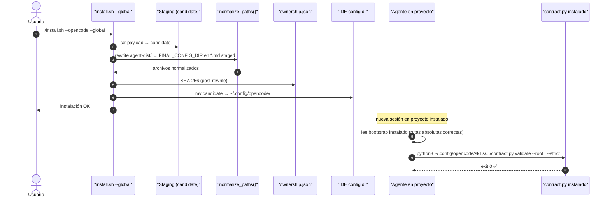

# Propuesta Técnica: Validator Path Resolution

**ID:** 2026-11-17-validator-path-resolution
**Prefijo:** VPAT-k4m7
**Fecha de Creación:** 2026-11-17
**Estado:** ✅ Completada
**Prioridad:** P1
**Complejidad:** Media
**Servicios Afectados:** installer, payload-documentacion, payload-python
**Party Mode:** — No ejecutado

**⚠️ Excepción DoR/DoD:** `.quinoto-spec/discovery/08-product-and-agreements.md` está vacío como plantilla para completar por humanos (hallazgo F-05 del discovery). El usuario confirmó explícitamente un override para generar esta propuesta y documentar la excepción. La propuesta NO queda aprobada para Apply hasta que se complete el DoR/DoD o se registre una aprobación humana específica en `.quinoto-spec/approvals/`.

**Conflictos Detectados:** Ninguno. La única propuesta activa (`PWRE-9f2c` — Playwright Proposal Review) afecta `review-workflow`/`ui`; esta propuesta afecta `installer`/`payload`. Sin solapamiento de archivos.

---

## Resumen Ejecutivo

QuinotoSpec 3.4.0 instala correctamente su payload en cualquier destino (global: `~/.config/opencode/`, `~/.claude/`, etc.; local: `<proyecto>/.opencode/`), pero **108 archivos de documentación del payload (workflows, SKILL.md, rules, bootstrap, templates) referencian rutas relativas `agent-dist/...` que solo existen en el checkout fuente del paquete**. Cuando un agente ejecuta un workflow en un proyecto instalado, comandos como `python3 agent-dist/skills/quinotospec-contract/contract.py validate --root . --strict` fallan porque no hay `agent-dist/` en el proyecto ni en el directorio de instalación.

Además, dos entrypoints Python (`update_agents.py`, `template_resolver.py`) resuelven workflows/rules/templates exclusivamente vía `root/agent-dist`, sin fallback a la ubicación de instalación del propio script.

Objetivo: que **todos los validadores y comandos documentados funcionen tal cual desde cualquier proyecto instalado**, sin pasos manuales, resolviendo la ruta real de instalación en tiempo de instalación y en tiempo de ejecución.

## Problema Actual

1. El instalador copia el *contenido* de `agent-dist/` al config dir (`install.sh:1566-1573`), pero los `.md` staged conservan las rutas `agent-dist/...` intactas.
2. El bootstrap de sesión (`agent-dist/bootstrap/quinotospec-bootstrap.md:93`) instruye el preflight `python3 agent-dist/skills/quinotospec-contract/contract.py validate --root . --strict` — primera instrucción que todo agente recibe y primera que falla.
3. `update_agents.py:70-196` solo busca `root/agent-dist/workflows|skills|rules|templates`; en un proyecto instalado `/quinotospec.update-agents` no puede regenerar `AGENTS.md`.
4. `template_resolver.py:97` resuelve skills "core" solo vía `root/agent-dist/skills`.
5. El workaround actual (symlink manual `agent-dist → ~/.config/opencode` en cada proyecto) no está documentado, no es idempotente y ensucia el proyecto del usuario.

## Alternativas Consideradas

| Alternativa | Pros | Contras | Veredicto |
|---|---|---|---|
| **A. Rewrite en staging (elegida)**: en `install.sh`, tras copiar el payload, reescribir `agent-dist/` → `$FINAL_CONFIG_DIR/` en los `.md` staged + fallback Python a ubicación del script | Diff pequeño (install.sh + tests + 2 scripts); docs quedan correctos para el agente en runtime; el repo fuente no cambia (drift checks intactos) | Los `.md` instalados contienen una ruta absoluta por usuario (aceptable: son installs por usuario); hay que acotar el rewrite a texto/markdown, no a código shell/python | ✅ Elegida |
| **B. Token placeholder `{{QUINOTOSPEC_HOME}}` en ~108 archivos fuente** | Fuente autodescriptiva; sin post-procesamiento | Diff masivo, alto riesgo de drift con `check-skill-workflow-drift.py`; el repo fuente quedaría con tokens sin resolver para desarrollo local | ❌ Descartada por coste/riesgo |
| **C. Symlink automático creado por el agente** (`ln -s config_dir agent-dist`) | Cero cambios en el paquete | En global el instalador no conoce los proyectos; el symlink depende de cwd; ensucia el repo del usuario; `git status` ruidoso | ❌ Descartada |
| **D. Env var `QUINOTOSPEC_HOME` definida por hooks/plugins y docs que la referencien** | Sin archivos reescritos | Requiere editar igualmente los 108 docs para usar la variable; los hooks no siempre corren (CLI headless); agente debe saber expandir la var | ❌ Descartada |

## Solución Propuesta

Dos mecanismos complementarios:

### 1. Resolución en tiempo de instalación (`install.sh`)
Tras el staging del payload (`config_dir`), y **antes** de calcular el ownership manifest y `mv` a destino, ejecutar un paso de normalización de rutas:

- Para cada archivo staged con extensión `.md` bajo `workflows|commands`, `skills`, `rules`, `bootstrap`, `templates`, `agents`, `config`:
  - `sed "s|agent-dist/|$FINAL_CONFIG_DIR/|g"` (primero con slash; luego `agent-dist` standalone con word-boundary).
  - Preservar la línea de endings (LF) y no tocar código Python/shell/JS.
- Excluir del rewrite los scripts (`*.py`, `*.sh`, `*.js`, `*.json`) — estos ya se auto-localizan vía `quinotospec_common.py` o `__file__`.
- El ownership manifest se calcula después del rewrite, por lo que los SHA-256 reflejan el contenido final instalado (coherencia uninstall intacta).

### 2. Resolución en tiempo de ejecución (fallback por ubicación de script)
En `update_agents.py` y `template_resolver.py`: cuando `args.root / "agent-dist"` no exista, resolver workflows/rules/templates/skills desde la raíz de instalación del propio script (`Path(__file__).resolve().parents[2]`), patrón ya establecido en `agent-dist/lib/quinotospec_common.py:55`. El `--root` del usuario sigue siendo el proyecto; solo cambia dónde se buscan los assets del paquete.

### 3. Regresión protegida
Test nuevo (`tests/test-installed-paths.sh`) + aserción en `scripts/smoke-release.sh`: tras instalar en un directorio temporal, ningún `.md` instalado contiene `agent-dist/`, y `contract.py` invocado con la ruta documentada en el bootstrap instalado existe y corre `validate --root <proyecto-fixture> --strict` con exit 0.

## Beneficios

- **DX:** los 49 workflows y 95 skills funcionan en proyectos instalados sin pasos manuales; elimina el bloqueo del preflight de bootstrap (primer comando de toda sesión).
- **Calidad:** el gate `contract validate` vuelve a ser ejecutable en cualquier proyecto → las reglas TDD/verify-before-done/aprovals vuelven a ser enforceables fuera del repo fuente.
- **Mantenimiento:** patrón único de resolución (ubicación de instalación), ya existente en `quinotospec_common.py`, aplicado de forma consistente.

## Alineación con Producto y Acuerdos

- **Visión de Producto:** ⚠️ no disponible — `08-product-and-agreements.md` es plantilla vacía (F-05). Se registra como supuesto: la alineación se juzga por los objetivos declarados en `02-overview.md` (instalación por IDE sin fricción) y el propósito del paquete en `01-stack-profile.md`.
- **KPIs Impactados:** no definidos (pendiente DoR/DoD). Proxy propuesto: 0 referencias `agent-dist/` rotas en installs verificados; suites `run-all-tests.sh` 28/28 + suite nueva en verde.
- **Cumplimiento de DoR:** bloqueado por plantilla vacía — override documentado arriba; pendiente aprobación humana previa a Apply.

## Arquitectura y Diseño Técnico

**Variables/estructura principales:**

- `install.sh`: nueva función `normalize_staged_paths <candidate_dir> <install_root>`; solo `.md`; lista de directorios acotada.
- `update_agents.py` / `template_resolver.py`: helper `resolve_package_root(user_root)` → `user_root/agent-dist` si existe, si no `Path(__file__).resolve().parents[2]`.

**Flujo de ejecución:**

1. Staging transaccional existente (sin cambios).
2. Nuevo paso de normalización (idempotente: si no hay matches, no-op).
3. Ownership manifest + verify_installation (sin cambios de lógica, hash post-rewrite).
4. Runtime: docs instalados apuntan a rutas absolutas válidas; scripts Python con layout-deps caen a su propia raíz.

## Especificación Técnica Detallada

### installer
- **AGREGA**: paso `normalize_staged_paths` post-staging que reescribe `agent-dist/` → raíz de instalación en `.md` staged → ver `delta-specs/installer/spec.md#added-requirements`
- **MODIFICA**: — (nada de los requisitos existentes de instalación transaccional cambia)
- **ELIMINA**: —

### payload-python
- **AGREGA**: `resolve_package_root()` con fallback a la ubicación del script en `update_agents.py` y `template_resolver.py` → ver `delta-specs/payload-python/spec.md#added-requirements`
- **MODIFICA**: —
- **ELIMINA**: —

### payload-documentacion
- **AGREGA**: invariant de distribución: ningún `.md` instalado puede referenciar `agent-dist/` → ver `delta-specs/payload-documentacion/spec.md#added-requirements`
- **MODIFICA**: —
- **ELIMINA**: —

## Riesgos y Mitigaciones

| Riesgo | Prob. | Impacto | Mitigación |
|---|---|---|---|
| Rewrite toca un `.md` donde `agent-dist/` es semánticamente "repo fuente" (ej. docs de contribución) | Media | Bajo | Auditoría previa de los 108 archivos; lista de exclusión si algún archivo lo requiere |
| `$FINAL_CONFIG_DIR` con espacios o `&` rompe el `sed` | Baja | Medio | Delimitador `|`, escaping de `&`, quoting estricto; test con path con espacio |
| Ownership manifest calculado pre-rewrite dejaría hashes inconsistentes | Media | Alto | Orden garantizado: rewrite ANTES del digest; test de uninstall verifies |
| Drift entre docs fuente e instalados confunde a checkers futuros | Baja | Medio | Los checks de drift (`check-skill-workflow-drift.py`, `validate-all.sh`) operan sobre el repo fuente, no sobre installs; documentarlo en el test |
| `parents[2]` frágil si cambia la jerarquía de skills | Baja | Medio | Usar la misma convención documentada en `quinotospec_common.py` y test unitario del fallback |
| Rewrite rompe `session-start.sh` que lee bootstrap con `PLUGIN_ROOT` | Baja | Alto | El hook lee contenido, no rutas; el bootstrap reescrito es el esperado; test E2E del hook (`test-bootstrap.sh` ya cubre inyección) |

## Plan de Implementación

| Fase | Contenido | Estimado |
|---|---|---|
| 1 | RED: test `tests/test-installed-paths.sh` que falla contra la versión actual | 0.5 d |
| 2 | `normalize_staged_paths` en `install.sh` + wiring post-staging | 0.5 d |
| 3 | Fallback `resolve_package_root` en `update_agents.py` + `template_resolver.py` | 0.5 d |
| 4 | Aserción en `smoke-release.sh`; auditoría de los 108 archivos (exclusiones si aplican) | 0.5 d |
| 5 | GREEN + `validate-all.sh --strict` + `run-all-tests.sh` 29/29; changelog | 0.5 d |

Total estimado: ~2.5 días de agente.

## Criterios de Aceptación (DoD)

- [ ] Tras `./install.sh --opencode --global` (y local), ningún `.md` bajo el config dir contiene la cadena `agent-dist/`.
- [ ] `grep -rn "agent-dist" ~/.config/opencode/bootstrap/quinotospec-bootstrap.md` → 0 matches tras reinstalar.
- [ ] `python3 <install_root>/skills/quinotospec-contract/contract.py validate --root <proyecto-fixture> --strict` → exit 0 en un proyecto que NO es el repo fuente.
- [ ] `/quinotospec.update-agents` ejecutable desde un proyecto instalado (usa fallback de script).
- [ ] `bash scripts/validate-all.sh --strict` → 0 errores 0 warnings.
- [ ] `bash tests/run-all-tests.sh` → 29/29 suites verdes.
- [ ] Evidencia registrada en `.quinoto-spec/evidence/TSK-VPAT-*/` y validada con `evidence_validate.py`.

## Plan de Verificación

**Tests manuales:**
1. Instalar global en un dir de config temporal (`QUINOTOSPEC_INSTALL_TEST_MODE=true`) → verificar bootstrap reescrito.
2. En un proyecto fixture sin `.quinoto-spec/`, correr el preflight del bootstrap → exit 0 esperado.
3. Desinstalar → verificar rollback y que el manifest cubre los archivos reescritos.

**Tests automatizados sugeridos:**
- Tipo: shell integration (patrón `tests/test-bootstrap.sh`). Cubrir: rewrite idempotente, exclusión de `*.py/*.sh/*.js`, uninstall coherente, fallback de `update_agents.py`/`template_resolver.py` con proyecto fixture. Comando: `bash tests/test-installed-paths.sh`.

**Criterio de éxito medible:** 0 referencias `agent-dist/` en installs verificados (global + local + generic), suites 29/29 verdes en CI.

## Impacto en el Sistema

**Archivos nuevos:**
| Archivo | Propósito |
|---|---|
| `tests/test-installed-paths.sh` | Suite de regresión del rewrite + fallbacks |

**Archivos modificados:**
| Archivo | Cambio |
|---|---|
| `install.sh` | Nueva fase `normalize_staged_paths` entre staging y manifest |
| `agent-dist/skills/quinotospec-update-agents/update_agents.py` | Fallback de package root |
| `agent-dist/skills/quinotospec-template-resolver/template_resolver.py` | Fallback de package root |
| `scripts/smoke-release.sh` | Aserción de invariant post-install |

**Dependencias y tooling:** ninguno nuevo (bash + python3 stdlib; `sed` ya requisito del instalador).

## Roadmap Futuro

- Token `{{QUINOTOSPEC_HOME}}` en fuente + render dual (dev/instalado) si el team quiere docs fuente portables (Alternativa B revisitada).
- Entrypoint CLI único `quinotospec` que centralice resolución de rutas para todos los entrypoints Python.
- Documentar el patrón de resolución en `03-architecture.md` del próximo refresh-discovery.

## Conclusión

El paquete instala bien pero instruye mal: los docs del payload asumen un layout (`agent-dist/`) que solo existe en el repo fuente. La corrección propuesta resuelve la ruta real en dos puntos (instalación y runtime del script), con regresión protegida y diff acotado. 

**Aprobación Requerida:** sí — aprobación humana para Apply (gate de constitución + reglas), además de completar DoR/DoD o registrar override formal en `.quinoto-spec/approvals/`.
**Estimación Total:** ~2.5 días de agente.
**Prioridad:** P1.
**Fecha Límite Sugerida:** 2026-11-24.
