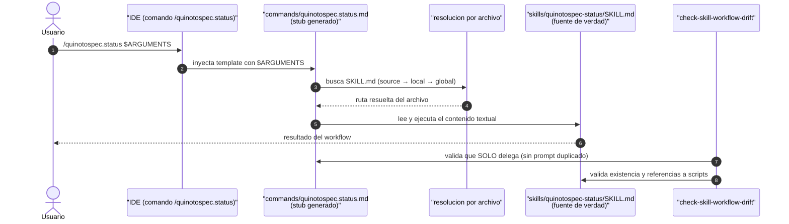

# Propuesta Técnica: Command-to-Skill Delegation

**ID:** 2026-11-18-command-to-skill-delegation
**Prefijo:** SKDP-m2q8
**Fecha de Creación:** 2026-11-18
**Estado:** ✅ Completada
**Prioridad:** P2
**Complejidad:** Alta
**Servicios Afectados:** command-layer, skill-layer, drift-checker, docs
**Party Mode:** — No ejecutado

**⚠️ Excepción DoR/DoD:** `.quinoto-spec/discovery/08-product-and-agreements.md` continúa como plantilla vacía (hallazgo F-05). El usuario confirmó explícitamente el override en esta sesión (documentado en `VPAT-k4m7`) y habilitó la generación de esta propuesta con la misma excepción. La propuesta NO queda aprobada para Apply sin aprobación humana registrada en `.quinoto-spec/approvals/`.

**⚠️ Conflictos Detectados:** La propuesta activa `PWRE-9f2c` (*Playwright Proposal Review*, 🟢 En Curso) afecta `review-workflow` y `ui`, solapando con la conversión del par `agent-dist/workflows/quinotospec.review.md` ↔ `agent-dist/skills/quinotospec-review/SKILL.md`. Mitigación: convertir ese par al final, revalidando su contenido contra los cambios de PWRE antes de reemplazarlo; si PWRE sigue activa al momento del Apply, excluir temporalmente ese par y registrar la deuda. Resto de pares sin solapamiento.

---

**Regla de conteo (prevalece sobre el resto del documento):** 49 = universo de pares; **48 = target operativo de este Apply**; el par `review` es el techo condicional que se convierte solo cuando PWRE-9f2c cierre (deuda en `.quinoto-spec/reviews/SKDP-m2q8-review-pair-debt.md`). **Secuencia de aprobación:** `SKDP-m2q8-APPLY.json` se registró y validó con `approval_validate.py` ANTES de TSK-001 y de cualquier edición de producción; TSK-012 únicamente verifica su vigencia.

## Resumen Ejecutivo

Los 49 comandos (`agent-dist/workflows/quinotospec.*.md`) y sus 49 skills pareadas (`agent-dist/skills/quinotospec-*/SKILL.md`) contienen **el mismo prompt duplicado**: 39 pares tienen similitud ≥ 0.7 y varios son idénticos salvo el `name:` del frontmatter (ej. `init`: 591 vs 592 líneas; `agent-train`, `tiwaz-rune`, `onboard`, `party-mode`: similitud 1.00). El diseño actual declara al workflow "fuente de verdad" y a la skill "versión invocable a sincronizar", y el checker `check-skill-workflow-drift.py` **exige** que ambos repitan las mismas referencias a scripts.

Objetivo: invertir esa relación. Cada comando pasa a ser un **stub de delegación** de ~6 líneas que resuelve por archivo y ejecuta el `SKILL.md` correspondiente; la skill se convierte en la **única fuente del prompt**. Para los ~10 pares donde la skill hoy es un resumen (flow 0.18, constitution 0.24, agent-config 0.29, review-handoff 0.30, help 0.30, ui 0.31, quick-dev 0.40, preset-install 0.46, update-agents 0.47, extension-install 0.52), se consolida primero el contenido del workflow dentro de la skill. El checker de drift se reescribe para validar delegación en lugar de paridad.

## Problema Actual

1. **Duplicación masiva:** ~49 pares × decenas/cientos de líneas repetidas; cualquier cambio de proceso debe aplicarse dos veces y el olvido es silencioso (o lo detecta el drift como warning).
2. **Fuentes de verdad contradictorias:** los SKILL.md dicen "Fuente de verdad de ejecución: workflow... sincronízala"; los workflows son copiados como `commands/` por el instalador y las skills como `skills/`, por lo que ambas superficies se cargan por separado en el IDE.
3. **Skills incompletas:** en 10 pares la skill es un resumen; delegar hoy sin consolidación perdería gates, parámetros y secciones del workflow.
4. **Checker sesgado:** `check-skill-workflow-drift.py` reporta ERROR si el workflow cita scripts que la skill no cita — exactamente lo que ocurriría con un stub.
5. **Coste de mantenimiento:** cada cambio de una regla (p. ej. el gate Goldfish) obliga a editar ambas copias y sus tests de paridad.

## Alternativas Consideradas

| Alternativa | Pros | Contras | Veredicto |
|---|---|---|---|
| **A. Stub por archivo + skill como fuente única (elegida)** | Un solo prompt por capacidad; funciona en los 5 IDEs sin depender de tool de skills; `$ARGUMENTS` es estándar de comandos Markdown; el stub se genera/verifica automáticamente | Requiere consolidar ~10 skills resumidas; el stub es boilerplate mínimo repetido (6 líneas); hay que reescribir el checker y partes de docs | ✅ Elegida — la que pidió el usuario |
| **B. Stub que invoca la skill por tool (`@skill-id`)** | Más corto aún; OpenCode carga la skill vía `skill({name})` | No garantizado en Cursor/Claude/Cline/Antigravity; depende de permisos `skill` del agente; rompe la portabilidad multi-IDE del paquete | ❌ Descartada (usuario eligió referencia de archivo) |
| **C. Generar comandos desde skills en install.sh** | Cero stubs en el repo | Añade complejidad al instalador y hace que el repo fuente no tenga comandos ejecutables (rompe desarrollo local y tests); más superficie de fallo | ❌ Descartada |
| **D. Mantener workflows y generar skills desde ellos** | Menos cambios en skills resumidas | Es la dirección inversa a la pedida; la skill seguiría siendo copia, no fuente | ❌ Descartada |

## Solución Propuesta

### 1. Stub de delegación canónico (49 comandos)
Cada `agent-dist/workflows/quinotospec.<name>.md` queda con el frontmatter original (`description`, y `agent`/`model` si aplica) y este cuerpo parametrizado por `<skill-id>`:

```markdown
Lee la skill `quinotospec-<name>` (archivo `SKILL.md`) y ejecuta su contenido
como instrucciones, pasando `$ARGUMENTS` como contexto.

Resuelve la ruta en este orden: `agent-dist/skills/quinotospec-<name>/SKILL.md`
(repo fuente), `.opencode/skills/...`, `.cursor/skills/...`, `.claude/skills/...`,
`.agent/skills/...` (instalación local), `~/.config/opencode/skills/...`,
`~/.cursor/skills/...`, `~/.claude/skills/...` (global).
Si no existe, detén y reporta las rutas intentadas. No resumas ni reescribas la
skill: aplícala textualmente.
```

El stub es idéntico para los 49 salvo el `<name>`; se genera con `scripts/generate-command-stubs.py` desde el inventario de skills. `$ARGUMENTS` está soportado por OpenCode para comandos Markdown y preserva toda la cadena de argumentos.

### 2. Consolidación de skills incompletas (10 pares)
Antes de convertir su comando, cada skill resumida absorbe las secciones/gates/parámetros que hoy solo viven en el workflow (inventario comparado por headings H2 y referencias a scripts). Especial atención a `flow` (orquestador), `constitution` (gates), `agent-config` (capas TOML) y `review-handoff`. Sin pérdida de capacidad: el checker viejo se ejecuta una vez antes de la conversión como evidencia de paridad.

### 3. Checker de drift invertido
`scripts/check-skill-workflow-drift.py` deja de comparar scripts y pasa a validar:
- cada workflow es exactamente el stub generado para su skill pareada (sin contenido extra);
- la skill referenciada existe, no está vacía y conserva las referencias a scripts que el workflow original tenía (snapshot de paridad previo);
- pares sin skill → ERROR; skills sin workflow → INFO (las 46 skills standalone siguen siendo válidas).

`tests/test-skill-workflow-drift.sh` se actualiza al nuevo contrato: detecta un workflow con prompt duplicado como regresión.

### 4. Documentación y fuente de verdad
Se invierten las declaraciones en los ~40 SKILL.md que dicen "Fuente de verdad de ejecución: workflow...", en `AGENTS.md` del paquete, `docs/ARCHITECTURE.md`, `README*` y el bootstrap si hace falta: ahora **la skill es la fuente de verdad del prompt** y el comando es su punto de entrada. Se documenta el patrón de resolución de archivos (coherente con la resolución de rutas de VPAT-k4m7).

### 5. Verificación extendida
Nuevos checks en `tests/test-skill-workflow-drift.sh` y extensión de `tests/test-installed-paths.sh`: desde un proyecto instalado local y global, el stub del comando resuelve al `SKILL.md` instalado y no contiene el prompt duplicado.

## Beneficios

- **Mantenimiento:** un solo lugar por capacidad; un cambio de gate/regla se aplica una vez.
- **Coherencia:** el agente que carga una skill y el que invoca un comando reciben exactamente el mismo prompt.
- **Auditoría:** el checker pasa de detectar drift de scripts a garantizar delegación efectiva — imposible volver a duplicar sin que falle.
- **Portabilidad:** la resolución por archivo cubre repo fuente + 5 IDEs + installs globales, reutilizando el patrón de VPAT-k4m7.

## Alineación con Producto y Acuerdos

- **Visión de Producto:** no disponible (F-05). Supuesto: `02-overview.md` describe el paquete como metodología distribuida por IDE; reducir duplicación mejora la consistencia de esa distribución.
- **KPIs Impactados:** no definidos. Proxy: 0 prompts duplicados en los 48 stubs generados (el par `review` queda diferido con deuda registrada), 0 regresiones en `validate-all --strict` y `run-all-tests`.
- **Cumplimiento de DoR:** bloqueado por plantilla vacía; override documentado, aprobación humana pendiente para Apply.

## Arquitectura y Diseño Técnico



**Estructura/variables:** `<skill-id>` y `$ARGUMENTS` son los únicos valores dinámicos del stub. `scripts/generate-command-stubs.py` produce y verifica (`--check`) los 49 archivos.

**Flujo:** (1) generar stubs, (2) consolidar skills incompletas, (3) reemplazar comandos, (4) invertir checker y tests, (5) reescribir docs, (6) gates + released smoke.

## Especificación Técnica Detallada

### command-layer
- **AGREGA**: contrato de stub de delegación por archivo con `$ARGUMENTS` y resolución multi-IDE → ver `delta-specs/command-layer/spec.md#added-requirements`
- **MODIFICA**: —
- **ELIMINA**: —

### skill-layer
- **AGREGA**: skill como fuente de verdad del prompt; consolidación de las 10 skills resumidas → ver `delta-specs/skill-layer/spec.md#added-requirements`
- **MODIFICA**: —
- **ELIMINA**: —

### drift-checker
- **AGREGA**: validación de delegación (stub exacto + skill existente), detector de prompt duplicado → ver `delta-specs/drift-checker/spec.md#added-requirements`
- **MODIFICA**: —
- **ELIMINA**: —

## Riesgos y Mitigaciones

| Riesgo | Prob. | Impacto | Mitigación |
|---|---|---|---|
| Skill resumida pierde gates al convertir su comando (pares <0.5) | Alta | Alto | Fase de consolidación con inventario H2/scripts y comparación antes/después; el checker viejo se corre como evidencia de paridad pre-conversión |
| `$ARGUMENTS` no se expande en algún IDE | Media | Medio | Verificar en los 5 IDEs vía smoke; el stub degrada a "argumentos del usuario" sin romper la ejecución |
| Resolución multi-IDE del SKILL.md falla en global | Media | Alto | Reutilizar patrón probado de `test-installed-paths.sh`; nueva aserción en ese suite |
| Solapamiento con PWRE-9f2c (`review`) | Alta | Medio | Convertir ese par al final y revalidar contra PWRE; excluirlo si sigue activa |
| Checker nuevo rompe CI por stubs no exactos | Media | Medio | Generador con `--check` y diff; los 49 stubs se generan desde una sola plantilla |
| Usuarios con comandos personalizados que copiaban el prompt viejo | Baja | Bajo | No se sobrescriben archivos ajenos; solo los managed por el instalador (ownership.json) |

## Plan de Implementación

| Fase | Contenido | Estimado |
|---|---|---|
| 1 | Inventario de paridad (H2 + scripts) de los 49 pares; consolidación de las 10 skills resumidas | 1 d |
| 2 | `scripts/generate-command-stubs.py` + generación de 49 stubs (RED: test detecta duplicado) | 0.5 d |
| 3 | Reemplazo de comandos y migración del par `review` tras PWRE | 0.5 d |
| 4 | Checker invertido + tests (`test-skill-workflow-drift.sh`, extensión de installed-paths) | 0.5 d |
| 5 | Docs (SKILL.md, AGENTS.md, arquitectura, README) + gates + changelog | 0.5 d |

Total estimado: ~3 días de agente.

## Criterios de Aceptación (DoD)

- [ ] 48/49 comandos son el stub generado; 0 comandos convertidos contienen el prompt completo. El par `review` permanece sin convertir con deuda registrada en `.quinoto-spec/reviews/SKDP-m2q8-review-pair-debt.md` (excepción prevalece sobre el objetivo 49/49 mientras PWRE-9f2c esté En Curso).
- [ ] 49/49 skills pareadas existen, no están vacías y conservan todos los H2/scripts del workflow original (evidencia de paridad pre-conversión).
- [ ] `scripts/check-skill-workflow-drift.py --root . --strict` pasa con la nueva semántica (0 errores, 0 warnings).
- [ ] Desde proyecto instalado (local y global), el stub resuelve el SKILL.md instalado y `$ARGUMENTS` se preserva.
- [ ] `bash scripts/validate-all.sh --strict` 0/0 y `bash tests/run-all-tests.sh` ≥31/31.
- [ ] Sin regresión en `test-installed-paths.sh` (VPAT-k4m7): 0 refs `agent-dist/` en `.md` instalados.
- [ ] Documentación sin frases "el workflow es la fuente de verdad"; aprobación humana registrada y validada ANTES del Apply (`SKDP-m2q8-APPLY.json`, TSK-012 solo verifica su vigencia).

## Plan de Verificación

**Tests manuales:** invocar `/quinotospec.status` en repo fuente y en proyecto instalado global; confirmar que el agente lee exactamente el SKILL.md y ejecuta sus pasos; pasar argumentos y verificar que llegan al prompt.

**Tests automatizados sugeridos:**
- Unit: `tests/test-skill-workflow-drift.sh` — stub exacto vs duplicado detectado; skill huérfana; skill resumida sin capacity gates.
- Integración: extensión de `tests/test-installed-paths.sh` — resolución del stub en layout fuente, local y global.
- Comando: `python3 -B scripts/check-skill-workflow-drift.py --root . --json`.

**Criterio medible:** 0 prompts duplicados en 49 pares; suite en verde; drift 0/0.

## Impacto en el Sistema

**Archivos nuevos:** `scripts/generate-command-stubs.py`; evidencia en `.quinoto-spec/evidence/TSK-SKDP-*/`.

**Archivos modificados:** 49 workflows, ~10 skills consolidadas + ~40 cabeceras de SKILL.md, `scripts/check-skill-workflow-drift.py`, `tests/test-skill-workflow-drift.sh`, `tests/test-installed-paths.sh`, `AGENTS.md`, `docs/ARCHITECTURE.md`, `README*`, `manifest.json` si cambian conteos, changelog.

**Dependencias:** ninguna nueva (Python stdlib; patrón de resolución de VPAT-k4m7).

## Roadmap Futuro

- Evaluar el tool `skill` de OpenCode (`@skill-id`) como stub alternativo cuando el soporte multi-IDE sea uniforme.
- Generar también las skills desde una fuente única de prompts semánticos (doc-driven), si aparece una tercera superficie que consuma los mismos pasos.

## Conclusión

La duplicación es real y cuantificable (49 pares, hasta similitud 1.00). La solución invierte la fuente de verdad sin depender de capacidades específicas de un IDE: comandos delgados que leen el SKILL.md por archivo, skills consolidadas y un checker que hace imposible volver a duplicar. Requiere aprobación humana formal antes de Apply y coordinación con PWRE-9f2c para el par `review`.

**Aprobación Requerida:** sí — override DoR/DoD + gate de constitución + resolución del solape con PWRE-9f2c.
**Estimación Total:** ~3 días de agente.
**Prioridad:** P2.
**Fecha Límite Sugerida:** 2026-11-25.
