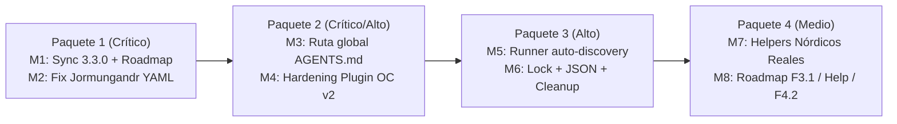

# Backlog de Mejoras Técnicas y Funcionales — QuinotoSpec v3.3.0

**Fecha de análisis**: `2026-10-20`  
**Versión analizada**: `3.3.0` (post-commit `c4e021d` — *feat(opencode): soporte OpenCode v2 y release 3.3.0 (F3.3)*)  
**Estado general del paquete**: Funcional en runtime e instalador multi-IDE, pero con **drift de versión** tras el bump parcial a `3.3.0`, un **falso positivo crítico** en la detección de ciclos de DAG (`Jormungandr`), una desviación en la ruta global de `AGENTS.md` en `install.sh` y oportunidades de endurecimiento en el plugin de OpenCode v2, el runner de tests y los helpers nórdicos.

**Estado de implementación**: ✅ `M1`–`M8` implementadas y verificadas con `scripts/validate-all.sh --strict`, `tests/run-all-tests.sh` y las suites `test-nordic-skills.sh` / `test-help-and-routing.sh`. Inventario sincronizado en **46 workflows** y **89 skills**.

---

## 1. Resumen Ejecutivo

Durante la exploración integral del repositorio posterior al commit `c4e021d`, se identificaron **8 mejoras estructuradas (M1–M8)** clasificadas en tres niveles de prioridad (**Crítica 🔴**, **Alta 🟠** y **Media 🟡**) y agrupadas en **4 paquetes de implementación** incrementales.

### Tabla Resumen de Mejoras

| ID | Título | Prioridad | Esfuerzo | Paquete | Estado |
|----|--------|-----------|----------|---------|--------|
| **M1** | Sincronización de versión `3.3.0` y resolución de colisión de ID `F3.3` en `V3_ROADMAP.md` | 🔴 Crítica | Bajo (~1h) | Paquete 1 — Release & Gobernanza | `[x] Completado` |
| **M2** | Corregir el falso positivo de `Jormungandr` con YAML multilínea | 🔴 Crítica | Bajo (~1.5h) | Paquete 1 — Release & Gobernanza | `[x] Completado` |
| **M3** | Corregir la ruta global de `AGENTS.md` por IDE en `install.sh` (Hallazgo F-02) | 🔴 Crítica | Medio (~2h) | Paquete 2 — Instalador & OpenCode v2 | `[x] Completado` |
| **M4** | Endurecer el plugin de OpenCode v2 (`agent-dist/plugins/opencode-v2/index.js`) | 🟠 Alta | Bajo (~1h) | Paquete 2 — Instalador & OpenCode v2 | `[x] Completado` |
| **M5** | Auto-descubrimiento de suites de test y coherencia de `--strict` con Node.js | 🟠 Alta | Medio (~2h) | Paquete 3 — Calidad, Tests & Higiene | `[x] Completado` |
| **M6** | Limpieza de artefactos muertos, esquemas JSON y lock de concurrencia en `install.sh` | 🟠 Alta | Medio (~3h) | Paquete 3 — Calidad, Tests & Higiene | `[x] Completado` |
| **M7** | Promover los Helpers Nórdicos de Demo/Experimental a Implementación Real (`Huginn & Muninn`, `Norns`, `Skald`) | 🟡 Media | Alto (~5h) | Paquete 4 — Evolución Funcional v3.4 | `[x] Completado` |
| **M8** | Siguientes hitos funcionales del Roadmap (`F3.1`, `quinotospec-help`, `F4.2`) | 🟡 Media | Alto (~8h) | Paquete 4 — Evolución Funcional v3.4 | `[x] Completado` |

---

## 2. Detalle de Mejoras (M1 a M8)

---

### M1 — Sincronización de versión `3.3.0` y resolución de colisión en `V3_ROADMAP.md`

- **ID**: `M1`
- **Severidad**: 🔴 Crítica
- **Esfuerzo estimado**: Bajo (~1 hora)
- **Estado**: `[x] Completado`

#### Problema / Evidencia exacta
El commit `c4e021d` actualizó la versión a `3.3.0` únicamente en 4 archivos (`.version`, `manifest.json`, `install.sh:8` y `.cursor-plugin/plugin.json`), dejando el resto de la documentación, el banner del instalador y el historial en `3.2.0`:

1. **Archivos ya en `3.3.0`**:
   - [`../.version`](../.version) (línea 1: `3.3.0`)
   - [`../manifest.json`](../manifest.json) (línea 3: `"version": "3.3.0"`)
   - [`../install.sh`](../install.sh) (línea 8: `INSTALLER_VERSION="3.3.0"`)
   - [`../.cursor-plugin/plugin.json`](../.cursor-plugin/plugin.json) (línea 3: `"version": "3.3.0"`)
2. **Archivos desincronizados que siguen en `3.2.0`**:
   - [`../README.md`](../README.md) — líneas `5` (badge `version-3.2.0-blue`), `18` (`QuinotoSpec v3.2.0 — Warband: Hird Edition`) y `28` (`La versión 3.2.0 se publica como beta / release candidate`).
   - [`../README_EN.md`](../README_EN.md) — líneas `5` (badge `version-3.2.0-blue`), `18` y `28`.
   - [`../CHANGELOG.md`](../CHANGELOG.md) — línea `9`: la última versión documentada es `## [3.2.0] - 2026-09-25`; no existe sección `## [3.3.0]`.
   - [`ARCHITECTURE.md`](ARCHITECTURE.md) — líneas `11` (`v3.2.0 Hird Edition; Gate 0 + F3.2 bootstrap complete`) y `124` (`Línea base de Gate 0 + F2.5 + F3.2`).
   - [`../V3_ROADMAP.md`](../V3_ROADMAP.md) — línea `12` (`**Version actual:** 3.2.0`).
   - [`../install.sh`](../install.sh) — línea `3` (`# QuinotoSpec Installer v3.2.0`) y línea `1011` (`"version": manifest.get("version", "3.2.0")`).
3. **Changelog interno faltante**:
   - No se creó entrada en [`../.quinoto-spec/changelog/`](../.quinoto-spec/changelog/) para el feature de OpenCode v2 introducido en `c4e021d`.
4. **Colisión de identificador `F3.3`**:
   - [`../manifest.json`](../manifest.json) líneas `13` (`"approved_exceptions": ["F1.1-F1.7", "F2.3-F2.5", "F3.2", "F3.3"]`) y `137` asignan `F3.3` a `"OpenCode v2 support"`.
   - [`../V3_ROADMAP.md`](../V3_ROADMAP.md) línea `1054` ya utiliza `### F3.3 — Navegacion Contextual de Workflows` (`quinotospec-help`) con tareas pendientes (`T3.3.1`–`T3.3.3`).
5. **Cobertura incompleta en `validate-all.sh`**:
   - [`../scripts/validate-all.sh`](../scripts/validate-all.sh) líneas `70-85` solo valida `.version` contra `manifest.json`, `install.sh` y `.cursor-plugin/plugin.json`, ignorando `README.md`, `README_EN.md`, `CHANGELOG.md`, `docs/ARCHITECTURE.md` y `V3_ROADMAP.md`.

#### Solución técnica propuesta
1. Ejecutar [`../scripts/update-version.sh`](../scripts/update-version.sh) `3.3.0` y ampliar el script para que también actualice `docs/ARCHITECTURE.md` (`**Versión**: X.Y.Z`), `V3_ROADMAP.md` (`**Versión actual**: X.Y.Z`) y las líneas comentadas de `install.sh` (`líneas 3 y 1011`).
2. Añadir la sección `## [3.3.0] - 2026-04-20` en [`../CHANGELOG.md`](../CHANGELOG.md) detallando el soporte para OpenCode v2 (`--opencode`, `--opencode-v1`, `agent-dist/opencode-v2/`, `agent-dist/plugins/opencode-v2/index.js`).
3. Registrar la entrada append-only correspondiente en [`../.quinoto-spec/changelog/`](../.quinoto-spec/changelog/).
4. Resolver la colisión de `F3.3` en [`../V3_ROADMAP.md`](../V3_ROADMAP.md) y [`../manifest.json`](../manifest.json): documentar `F3.3` como el hito entregado de OpenCode v2 (o renumerar `quinotospec-help` a `F3.4` en `V3_ROADMAP.md:1054` actualizando la tabla resumen de la línea `1227`).
5. Extender [`../scripts/validate-all.sh`](../scripts/validate-all.sh) (bloque `3. Version Consistency`, líneas `70-85`) para verificar que `README.md`, `README_EN.md`, `CHANGELOG.md`, `docs/ARCHITECTURE.md` y `V3_ROADMAP.md` contengan la versión de `.version`.

#### Criterios de aceptación / Comandos de verificación
```bash
# 1. Validar que ningún archivo clave conserve 3.2.0 como versión actual
! grep -n "3\.2\.0" README.md README_EN.md docs/ARCHITECTURE.md V3_ROADMAP.md install.sh

# 2. Verificar que CHANGELOG.md tenga el encabezado de 3.3.0
grep -q "^## \[3\.3\.0\]" CHANGELOG.md

# 3. Ejecutar el validador estricto del paquete
bash scripts/validate-all.sh --strict
```

#### Checklist de tareas accionables
- [x] Actualizar [`../scripts/update-version.sh`](../scripts/update-version.sh) para cubrir `docs/ARCHITECTURE.md`, `V3_ROADMAP.md` e `install.sh:3,1011`.
- [x] Ejecutar `./scripts/update-version.sh 3.3.0` y verificar los cambios en `README.md`, `README_EN.md`, `docs/ARCHITECTURE.md`, `V3_ROADMAP.md` e `install.sh`.
- [x] Documentar `## [3.3.0]` en [`../CHANGELOG.md`](../CHANGELOG.md) y crear la entrada v2 en [`../.quinoto-spec/changelog/`](../.quinoto-spec/changelog/).
- [x] Desambiguar el ID `F3.3` entre [`../manifest.json`](../manifest.json) (`líneas 13, 137`) y [`../V3_ROADMAP.md`](../V3_ROADMAP.md) (`líneas 1054, 1227`).
- [x] Ampliar [`../scripts/validate-all.sh`](../scripts/validate-all.sh) (`líneas 70-85`) para fallar si `README.md`, `README_EN.md`, `CHANGELOG.md`, `docs/ARCHITECTURE.md` o `V3_ROADMAP.md` difieren de `.version`.

---

### M2 — Corregir el falso positivo de `Jormungandr` con YAML multilínea

- **ID**: `M2`
- **Severidad**: 🔴 Crítica
- **Esfuerzo estimado**: Bajo (~1.5 horas)
- **Estado**: `[x] Completado`

#### Problema / Evidencia exacta
El detector de ciclos de DAG de artefactos (`Jormungandr`) tiene un bug en su parser YAML que provoca que **nunca ejecute el algoritmo de Kahn** sobre el template real del proyecto y devuelva siempre éxito mediante un fallback de demostración:

1. En [`../agent-dist/skills/quinotospec-jormungandr/check.py`](../agent-dist/skills/quinotospec-jormungandr/check.py) (líneas `7-23`):
   - Las líneas `7-10` solo parsean listas inline del tipo `requires: [a, b]`.
   - Las líneas `11-23` entran en `if not requires:` con un bloque incompleto:
     ```python
     elif cur and re.match(r'\s*-\s+\w+', line) and 'requires' in text.splitlines()[text.splitlines().index(line)-2] if cur else False:
         pass
     # simple: if still empty, assume aciclico demo
     print("OK: DAG aciclico (demo fallback, ids=%s)" % ",".join(ids))
     sys.exit(0)
     ```
   - Cuando se ejecuta sobre [`../agent-dist/templates/schema-template.yaml`](../agent-dist/templates/schema-template.yaml) (que define `requires:` en formato de lista multilínea con `- proposal`, `- delta-specs`, `- design`, `- user-stories`), el diccionario `requires` queda vacío o sin poblar y el script imprime `OK: DAG aciclico (demo fallback)` y termina con `sys.exit(0)` antes de llegar al algoritmo de Kahn (líneas `25-49`). Si alguien introduce un ciclo real en formato multilínea, `check.py` reporta `OK` (falso negativo ante ciclos / falso positivo de validación).
2. Duplicación innecesaria: en [`../agent-dist/skills/quinotospec-valkyrie/rank.py`](../agent-dist/skills/quinotospec-valkyrie/rank.py) (líneas `151-211`, función `detect_schema_cycle`), **sí** existe una implementación completa y funcional que soporta tanto `requires: [a, b]` inline como items multilínea `- dep` (líneas `171-190`) y detecta nodos huérfanos además de ciclos.

#### Solución técnica propuesta
1. Reemplazar el parser incompleto de [`../agent-dist/skills/quinotospec-jormungandr/check.py`](../agent-dist/skills/quinotospec-jormungandr/check.py) (`líneas 7-39`) por la lógica completa de `detect_schema_cycle` de [`../agent-dist/skills/quinotospec-valkyrie/rank.py`](../agent-dist/skills/quinotospec-valkyrie/rank.py) (`líneas 151-211`), o hacer que `rank.py` importe `detect_schema_cycle` desde `jormungandr/check.py` como única fuente de verdad.
2. Eliminar por completo el bloque `if not any(deps.values()): print("OK: DAG aciclico (demo fallback)")` (`check.py:20-23`). Si un schema válido no tiene dependencias entre sus nodos, Kahn lo validará normalmente sin necesidad de un bypass; si el archivo no define ningún artifact (`not deps`), debe devolver error (`sys.exit(1)`).
3. Ampliar [`../tests/test-nordic-skills.sh`](../tests/test-nordic-skills.sh) (líneas `25-30`) para probar:
   - El `schema-template.yaml` real verificando que la salida **no** contenga `(demo fallback)`.
   - Un schema temporal con un ciclo en formato inline (`requires: [b]` / `requires: [a]`) que debe devolver `exit 1`.
   - Un schema temporal con un ciclo en formato multilínea (`requires:\n  - b`) que debe devolver `exit 1`.

#### Criterios de aceptación / Comandos de verificación
```bash
# 1. Verificar que el schema oficial se valide con Kahn real y sin demo fallback
out="$(python3 -B agent-dist/skills/quinotospec-jormungandr/check.py agent-dist/templates/schema-template.yaml)"
echo "$out" | grep -q "OK: DAG aciclico"
! echo "$out" | grep -q "demo fallback"

# 2. Ejecutar la suite de skills nórdicas actualizada
bash tests/test-nordic-skills.sh
```

#### Checklist de tareas accionables
- [x] Reescribir [`../agent-dist/skills/quinotospec-jormungandr/check.py`](../agent-dist/skills/quinotospec-jormungandr/check.py) soportando `requires:` tanto inline (`[a, b]`) como multilínea (`- item`) y eliminando el `demo fallback`.
- [x] Unificar la lógica de detección de ciclos entre `quinotospec-jormungandr/check.py` y [`../agent-dist/skills/quinotospec-valkyrie/rank.py`](../agent-dist/skills/quinotospec-valkyrie/rank.py) (`líneas 151-211`).
- [x] Añadir tests unitarios en [`../tests/test-nordic-skills.sh`](../tests/test-nordic-skills.sh) para ciclos inline, ciclos multilínea y ausencia de `demo fallback`.

---

### M3 — Corregir la ruta global de `AGENTS.md` por IDE en `install.sh` (Hallazgo F-02)

- **ID**: `M3`
- **Severidad**: 🔴 Crítica
- **Esfuerzo estimado**: Medio (~2 horas)
- **Estado**: `[x] Completado`

#### Problema / Evidencia exacta
Cuando se instala QuinotoSpec en modo `--global`, `install.sh` calcula una única variable `TARGET_ROOT` y escribe `AGENTS.md` directamente en `$TARGET_ROOT/AGENTS.md`, colocándolo fuera del directorio de configuración esperado por cada IDE (Hallazgo F-02 de [`../.quinoto-spec/discovery/07-findings-and-recommendations.md`](../.quinoto-spec/discovery/07-findings-and-recommendations.md)):

1. En [`../install.sh`](../install.sh) líneas `1395-1408` y `1375-1382`:
   - Si `IDE_CHOICE="opencode"` (o `"cline"` / `"generic"`), cae en el `else` donde `TARGET_ROOT="$HOME/.config"`.
   - En la línea `1590` (`mv "$STAGED_AGENTS" "$TARGET_ROOT/AGENTS.md"`), el archivo se escribe en **`~/.config/AGENTS.md`** en lugar de **`~/.config/opencode/AGENTS.md`** (que es la ruta global real que lee OpenCode v2).
   - Si `IDE_CHOICE="cursor"` con `--global`, `TARGET_ROOT="$HOME"`, escribiendo **`~/AGENTS.md`** en la raíz del `$HOME` del usuario en lugar de `~/.cursor/AGENTS.md`.
2. En [`../install.sh`](../install.sh) líneas `371-373` (`write_ownership_manifest`), `435-439` (`verify_ownership_manifest`) y `1226-1239` (`uninstall`), el manifiesto de ownership busca y registra `AGENTS.md` relativo a `TARGET_ROOT`, acoplado a este comportamiento.

#### Solución técnica propuesta
1. Ajustar la resolución de `TARGET_ROOT` / ruta de `AGENTS.md` en [`../install.sh`](../install.sh) cuando `GLOBAL_INSTALL=true` para que apunte al directorio real del IDE (`$FINAL_CONFIG_DIR/AGENTS.md`, es decir `~/.config/opencode/AGENTS.md` para OpenCode, `~/.cursor/AGENTS.md` para Cursor, `~/.claude/AGENTS.md` para Claude Code).
2. Actualizar `write_ownership_manifest()` (`install.sh:269-393`), `verify_ownership_manifest()` (`install.sh:395-445`) y `uninstall()` (`install.sh:1144-1304`) para que verifiquen y desinstalen `AGENTS.md` en la ruta correspondiente.
3. Añadir aserciones explícitas en [`../tests/test-install-e2e.sh`](../tests/test-install-e2e.sh) para verificar que:
   - `--opencode --global` crea `$HOME/.config/opencode/AGENTS.md` y **no** `$HOME/.config/AGENTS.md`.
   - `--cursor --global` crea `$HOME/.cursor/AGENTS.md` y **no** `$HOME/AGENTS.md`.

#### Criterios de aceptación / Comandos de verificación
```bash
# Ejecutar la suite E2E de instalación (local, global por IDE, multi-IDE y uninstall)
bash tests/test-install-e2e.sh
```

#### Checklist de tareas accionables
- [x] Crear `resolve_agents_md_targets()` en [`../install.sh`](../install.sh) diferenciando instalaciones locales de instalaciones `--global` por IDE.
- [x] Actualizar `generate_agents_md()` (`install.sh:1375-1388`) para escribir en cada ruta resuelta respetando `merge_managed_markdown` y `--force`.
- [x] Actualizar `write_ownership_manifest`, `verify_ownership_manifest` y `uninstall` en [`../install.sh`](../install.sh) para rastrear las nuevas rutas de `AGENTS.md`.
- [x] Agregar tests de regresión en [`../tests/test-install-e2e.sh`](../tests/test-install-e2e.sh) validando `~/.config/opencode/AGENTS.md` y `~/.cursor/AGENTS.md` en modo `--global`.

---

### M4 — Endurecer el plugin de OpenCode v2 (`agent-dist/plugins/opencode-v2/index.js`)

- **ID**: `M4`
- **Severidad**: 🟠 Alta
- **Esfuerzo estimado**: Bajo (~1 hora)
- **Estado**: `[x] Completado`

#### Problema / Evidencia exacta
El nuevo plugin [`../agent-dist/plugins/opencode-v2/index.js`](../agent-dist/plugins/opencode-v2/index.js) introducido en `c4e021d` presenta tres fragilidades de runtime:

1. **Falta de idempotencia al inyectar el bootstrap** (`index.js:40-44`):
   ```javascript
   function makeHook(bootstrap) {
     return (event) => {
       event.system.push({ type: "text", text: `${MARKER}\n${bootstrap}\n</quinotospec-bootstrap>` });
     };
   }
   ```
   A diferencia del plugin de v1 ([`../agent-dist/plugins/opencode/quinotospec-plugin.js`](../agent-dist/plugins/opencode/quinotospec-plugin.js)), `makeHook` no comprueba si `event?.system` es un arreglo ni si algún elemento de `event.system` ya contiene `MARKER` (`<quinotospec-bootstrap>`). Si el hook se dispara más de una vez por petición o tras compactación, duplica el bloque de bootstrap en el prompt de sistema.
2. **Posible `TypeError` en `findRoot(location)`** (`index.js:8-13`):
   ```javascript
   function findRoot(location) {
     const candidates = [
       path.join(location.directory, ".opencode"),
   ```
   Si `ctx.location` o `ctx.location.directory` es `undefined`, `path.join(location.directory, ".opencode")` lanza un `TypeError` no capturado.
3. **Caché global única en vez de por `root`** (`index.js:32-38`):
   `let cachedBootstrap = null` es global al módulo ESM. Si un mismo proceso de servidor OpenCode v2 gestiona múltiples proyectos con distintos archivos `quinotospec-bootstrap.md`, el primer proyecto contamina la caché de los demás.

#### Solución técnica propuesta
1. En `findRoot(location)` (`index.js:8-13`), validar `if (location && typeof location.directory === "string")` antes de construir `localDir`.
2. Reemplazar `let cachedBootstrap = null` (`index.js:32-38`) por `const bootstrapCache = new Map()` indexado por `root`.
3. En `makeHook(root)` (`index.js:40-44`), verificar `if (event.system.some((entry) => typeof entry === "string" && entry.includes(MARKER))) return` antes de hacer `event.system.push(...)`.
4. Añadir casos de prueba en [`../tests/test-bootstrap.sh`](../tests/test-bootstrap.sh) que ejecuten el hook dos veces seguidas sobre el mismo `event.system` (verificando que `event.system.length === 1`) y que invoquen el plugin con `location = {}` sin lanzar excepciones.

#### Criterios de aceptación / Comandos de verificación
```bash
# Ejecutar la suite de tests de bootstrap (incluyendo v1 y v2)
bash tests/test-bootstrap.sh
```

#### Checklist de tareas accionables
- [x] Proteger `findRoot(location)` en [`../agent-dist/plugins/opencode-v2/index.js`](../agent-dist/plugins/opencode-v2/index.js) (`líneas 8-13`) contra `location` o `location.directory` indefinidos.
- [x] Cambiar `cachedBootstrap` por un `Map<string, string>` indexado por `root` en `getBootstrap(root)` (`index.js:32-38`).
- [x] Añadir check de idempotencia por `MARKER` en `makeHook(root)` (`index.js:40-44`).
- [x] Ampliar [`../tests/test-bootstrap.sh`](../tests/test-bootstrap.sh) con pruebas de doble invocación (idempotencia) y `location` vacío.

---

### M5 — Auto-descubrimiento de suites de test y coherencia de `--strict` con Node.js

- **ID**: `M5`
- **Severidad**: 🟠 Alta
- **Esfuerzo estimado**: Medio (~2 horas)
- **Estado**: `[x] Completado`

#### Problema / Evidencia exacta
1. **Lista de suites hardcodeada en el runner** (Hallazgo F-06 de [`../.quinoto-spec/discovery/07-findings-and-recommendations.md`](../.quinoto-spec/discovery/07-findings-and-recommendations.md)):
   - En [`../tests/run-all-tests.sh`](../tests/run-all-tests.sh) líneas `42-61`, las 20 suites se invocan manualmente una por una (`run_suite "Workflows" "$SCRIPT_DIR/test-workflows.sh"`, etc.). Si se añade un nuevo archivo `tests/test-*.sh` y se olvida registrarlo en `run-all-tests.sh`, CI lo ignora silenciosamente.
2. **Inconsistencia de `validate-all.sh --strict` cuando no hay Node.js** (Hallazgo F-07):
   - En [`../scripts/validate-all.sh`](../scripts/validate-all.sh) líneas `164-167`, cuando `command -v node` no está disponible, se incrementa `WARNINGS=$((WARNINGS + 1))`.
   - En la línea `199`, bajo `--strict`, cualquier `WARNINGS > 0` provoca `exit 1`. Por tanto, Node.js actúa como dependencia obligatoria en modo `--strict` aunque el mensaje dice `plugins: Node.js unavailable, syntax checks skipped`.
3. **Fixtures de test huérfanas** (Hallazgo F-09):
   - Los directorios `tests/fixtures/node-project`, `tests/fixtures/python-project` y `tests/fixtures/empty-project` existen en el repositorio pero ningún script en `tests/test-*.sh` los utiliza actualmente.

#### Solución técnica propuesta
1. En [`../tests/run-all-tests.sh`](../tests/run-all-tests.sh), añadir un paso de verificación tras ejecutar las suites (o auto-descubrimiento ordenado) que compare los archivos `tests/test-*.sh` existentes en disco contra las suites ejecutadas y falle (`exit 1`) si algún archivo `test-*.sh` quedó sin ejecutar.
2. En [`../scripts/validate-all.sh`](../scripts/validate-all.sh) (`líneas 153-168`), definir explícitamente el contrato:
   - Declarar Node.js como requisito de `--strict` en la documentación de release/CI, o permitir `--allow-no-node` cuando se ejecute en entornos mínimos sin Node.js.
3. Integrar `tests/fixtures/{node-project,python-project,empty-project}` en un test real de detección de stack (`quinotospec-stack-detect`) dentro de [`../tests/test-skills.sh`](../tests/test-skills.sh) o [`../tests/test-install-e2e.sh`](../tests/test-install-e2e.sh).

#### Criterios de aceptación / Comandos de verificación
```bash
# 1. Ejecutar todas las suites y verificar que no haya tests huérfanos
bash tests/run-all-tests.sh

# 2. Ejecutar validación estricta
bash scripts/validate-all.sh --strict
```

#### Checklist de tareas accionables
- [x] Añadir guardia de completitud en [`../tests/run-all-tests.sh`](../tests/run-all-tests.sh) que verifique que todo `tests/test-*.sh` fue ejecutado.
- [x] Ajustar y documentar el comportamiento de Node.js en [`../scripts/validate-all.sh`](../scripts/validate-all.sh) (`líneas 153-168`).
- [x] Conectar `tests/fixtures/{node-project,python-project,empty-project}` a pruebas reales de `quinotospec-stack-detect` en [`../tests/test-skills.sh`](../tests/test-skills.sh).

---

### M6 — Limpieza de artefactos muertos, esquemas JSON y lock de concurrencia en `install.sh`

- **ID**: `M6`
- **Severidad**: 🟠 Alta
- **Esfuerzo estimado**: Medio (~3 horas)
- **Estado**: `[x] Completado`

#### Problema / Evidencia exacta
Recopilación de deuda técnica estructural confirmada en [`../.quinoto-spec/discovery/07-findings-and-recommendations.md`](../.quinoto-spec/discovery/07-findings-and-recommendations.md) (Hallazgos F-05, F-10, F-11 y F-12):

1. **Artefacto muerto `hooks-opencode.json`** (Hallazgo F-05):
   - [`../agent-dist/hooks/hooks-opencode.json`](../agent-dist/hooks/hooks-opencode.json) contiene una configuración de hook con ruta relativa `./agent-dist/hooks/session-start.sh`. Ni OpenCode v1 (que usa `.opencode/plugins/quinotospec-plugin.js`) ni OpenCode v2 (que usa `.opencode/plugins/quinotospec/index.js`) leen ese archivo JSON.
2. **Campo `external_config` sin consumidor en `ownership.json`** (Hallazgo F-10):
   - En [`../install.sh`](../install.sh) líneas `345-360` (`write_ownership_manifest`), se construye y escribe el objeto `external_config` dentro de `.quinoto-spec/ownership.json`, pero ni `verify_ownership_manifest` (`líneas 395-445`) ni `uninstall` (`líneas 1144-1304`) lo inspeccionan jamás.
3. **Ausencia de lock de concurrencia en `install.sh`** (Hallazgo F-12):
   - En [`../install.sh`](../install.sh) líneas `100-123` (`begin_transaction`) y `1569-1594`, si dos procesos invocan `install.sh` en paralelo sobre el mismo destino, ambos manipulan `.quinoto-spec` y el reemplazo de directorios sin un lock atómico.
4. **Salidas `--json` de CLIs Python sin test de contrato unificado** (Hallazgo F-11):
   - Los scripts `contract.py`, `rules_enforce.py`, `evidence_validate.py`, `approval_validate.py`, `backup.py` y `extension_manager.py` exponen `--json`, pero no existe un test transversal que valide las claves mínimas garantizadas de sus respuestas JSON.

#### Solución técnica propuesta
1. Eliminar [`../agent-dist/hooks/hooks-opencode.json`](../agent-dist/hooks/hooks-opencode.json) (o marcarlo explícitamente como deprecado y remover su copia en `install.sh` si existiera referencia).
2. En [`../install.sh`](../install.sh), usar `external_config` durante `verify_ownership_manifest` / `uninstall` para verificar la integridad de los hooks externos registrados, o eliminar su escritura redundante en `write_ownership_manifest` (`líneas 345-360`).
3. Implementar un lockfile basado en `mkdir "$TARGET_ROOT/.quinoto-spec.lock"` atómico en `begin_transaction()` (`install.sh:100`) con liberación garantizada en `cleanup_transaction()` (`install.sh:125`) vía `trap`.
4. Añadir una prueba de esquema JSON en [`../tests/test-contract.sh`](../tests/test-contract.sh) (o [`../tests/test-rules-enforce.sh`](../tests/test-rules-enforce.sh)) que invoque cada CLI Python con `--json` y valide mediante `python3 -c "import json, sys; ..."` la presencia de las claves obligatorias (`status`/`valid`, `errors`, etc.).

#### Criterios de aceptación / Comandos de verificación
```bash
# 1. Ejecutar tests de contrato, gobernanza e instalador
bash tests/test-contract.sh
bash tests/test-rules-enforce.sh
bash tests/test-install-e2e.sh
```

#### Checklist de tareas accionables
- [x] Eliminar o deprecar [`../agent-dist/hooks/hooks-opencode.json`](../agent-dist/hooks/hooks-opencode.json) y actualizar referencias en tests/docs.
- [x] Conectar `external_config` a `verify_ownership_manifest`/`uninstall` o removerlo de [`../install.sh`](../install.sh) (`líneas 345-360`).
- [x] Añadir lock atómico (`mkdir`) en `begin_transaction` y limpieza en `cleanup_transaction` dentro de [`../install.sh`](../install.sh) (`líneas 100-140`).
- [x] Agregar test de contrato de salida `--json` para los CLIs Python en [`../tests/test-rules-enforce.sh`](../tests/test-rules-enforce.sh).

---

### M7 — Promover los Helpers Nórdicos de Demo/Experimental a Implementación Real (`Huginn & Muninn`, `Norns`, `Skald`)

- **ID**: `M7`
- **Severidad**: 🟡 Media
- **Esfuerzo estimado**: Alto (~5 horas)
- **Estado**: `[x] Completado`

#### Problema / Evidencia exacta
Mientras que `Valkyrie` (`rank.py`), `Mimir` (`index.py` / `search.py`) y `Bifrost` (`bifrost.py`) ya cuentan con implementaciones reales en Python 3 stdlib, tres skills de la Hird Edition conservan helpers de demostración o carecen de script ejecutable propio:

1. **`Huginn & Muninn` devuelve métricas hardcodeadas**:
   - [`../agent-dist/skills/quinotospec-huginn-muninn/check.sh`](../agent-dist/skills/quinotospec-huginn-muninn/check.sh) (línea `22`) no analiza el directorio recibido por parámetro; imprime literalmente un JSON fijo:
     ```bash
     # Simula S_final para CI demo
     echo '{"S_final": 0.42, "H_total": 0.38, "S_proxy": 0.48, "classification": "media"}'
     ```
2. **`Norns` carece de helper propio con `--check` y `--dry-run`**:
   - El directorio [`../agent-dist/skills/quinotospec-norns/`](../agent-dist/skills/quinotospec-norns/) solo contiene [`SKILL.md`](../agent-dist/skills/quinotospec-norns/SKILL.md), dependiendo de [`../scripts/update-version.sh`](../scripts/update-version.sh) que no ofrece bandera `--check` para detectar drift en CI sin escribir archivos.
3. **`Skald` tiene una verificación superficial en `sync-readme.sh`**:
   - [`../agent-dist/skills/quinotospec-skald/sync-readme.sh`](../agent-dist/skills/quinotospec-skald/sync-readme.sh) (líneas `6-17`) solo cuenta filas que empiezan por `^\| \*\*` entre `README.md` y `README_EN.md` cuando se pasa `--check`, y sin `--check` solo imprime un placeholder sin verificar los conteos reales de workflows (43), skills (86), reglas (18) y agentes (9) contra `agent-dist/`.

#### Solución técnica propuesta
1. **`Huginn & Muninn` (`check.py` invocado por `check.sh`)**:
   - Implementar `agent-dist/skills/quinotospec-huginn-muninn/check.py` (Python 3 stdlib) siguiendo las fórmulas de [`../agent-dist/skills/quinotospec-entropy-calculator/SKILL.md`](../agent-dist/skills/quinotospec-entropy-calculator/SKILL.md): cálculo real de distribución de líneas por archivo (`H_size`), ratio de archivos de test vs código (`H_testing`), acoplamiento de imports y comparación contra el snapshot previo en `.quinoto-spec/metrics/entropy-history.jsonl` para determinar `S_final`, `status` (`HEALTHY` | `WARNING` | `CRITICAL`) y `contract_drift`.
2. **`Norns` (`norns.py`)**:
   - Crear `agent-dist/skills/quinotospec-norns/norns.py` con soporte para `--check` (verifica que `.version`, `manifest.json`, `install.sh`, `.cursor-plugin/plugin.json`, `README.md`, `README_EN.md`, `CHANGELOG.md`, `docs/ARCHITECTURE.md` y `V3_ROADMAP.md` estén en la misma versión sin modificarlos), `--dry-run` y `--to X.Y.Z`.
3. **`Skald` (`sync-readme.sh` / `skald.py`)**:
   - Ampliar [`../agent-dist/skills/quinotospec-skald/sync-readme.sh`](../agent-dist/skills/quinotospec-skald/sync-readme.sh) para que `--check` valide:
     - Paridad de tablas entre `README.md` y `README_EN.md`.
     - Coincidencia entre el número real de archivos en `agent-dist/workflows/`, `agent-dist/skills/`, `agent-dist/rules/` y `agent-dist/agents/` y las cifras declaradas en ambos READMEs.
4. Actualizar [`../manifest.json`](../manifest.json) para promover `"norns"`, `"huginn_muninn"` y `"skald"` de `"experimental"`/`"demo"` a `"beta"` una vez completados M2 y M7, y actualizar la tabla de madurez de [`ARCHITECTURE.md`](ARCHITECTURE.md).

#### Criterios de aceptación / Comandos de verificación
```bash
# 1. Verificar que Huginn & Muninn calcule S_final dinámico según el directorio analizado
bash agent-dist/skills/quinotospec-huginn-muninn/check.sh agent-dist/skills

# 2. Verificar que Norns detecte drift en modo --check
python3 -B agent-dist/skills/quinotospec-norns/norns.py --check

# 3. Verificar paridad documental con Skald
bash agent-dist/skills/quinotospec-skald/sync-readme.sh --check

# 4. Ejecutar la suite completa de skills nórdicas
bash tests/test-nordic-skills.sh
```

#### Checklist de tareas accionables
- [x] Implementar `agent-dist/skills/quinotospec-huginn-muninn/check.py` con cálculo real de entropía stdlib y conectarlo desde `check.sh`.
- [x] Implementar `agent-dist/skills/quinotospec-norns/norns.py` con modos `--check`, `--dry-run` y `--to <semver>`.
- [x] Mejorar [`../agent-dist/skills/quinotospec-skald/sync-readme.sh`](../agent-dist/skills/quinotospec-skald/sync-readme.sh) para contrastar conteos de artefactos reales (`agent-dist/*`) contra `README.md` y `README_EN.md`.
- [x] Actualizar [`../tests/test-nordic-skills.sh`](../tests/test-nordic-skills.sh) y promover la madurez en [`../manifest.json`](../manifest.json).

---

### M8 — Siguientes hitos funcionales del Roadmap (`F3.1`, `quinotospec-help`, `F4.2`)

- **ID**: `M8`
- **Severidad**: 🟡 Media
- **Esfuerzo estimado**: Alto (~8 horas)
- **Estado**: `[x] Completado`

#### Problema / Evidencia exacta
En [`../V3_ROADMAP.md`](../V3_ROADMAP.md) permanecen pendientes tres capacidades clave de experiencia de desarrollador y adaptabilidad de flujo:

1. **Navegación Contextual Global (`quinotospec-help`)** — [`../V3_ROADMAP.md`](../V3_ROADMAP.md) líneas `1054-1078`:
   - Actualmente existe `quinotospec-suggest-next` orientado a tareas dentro de una propuesta activa, pero falta un comando global (`/quinotospec.help` + `quinotospec-help`) que inspeccione todo `.quinoto-spec/` desde cero (¿hay discovery?, ¿está obsoleto >30 días?, ¿hay propuestas sin stories?, ¿hay tareas listas?, ¿todo está completado y listo para archivar?) y guíe al usuario con el siguiente comando exacto.
2. **Scale-Adaptive Planning (`F4.2`)** — [`../V3_ROADMAP.md`](../V3_ROADMAP.md) líneas `1130-1170`:
   - Falta el router de complejidad (`quinotospec-complexity-router`) y el workflow `/quinotospec.quick-dev` que clasifiquen el alcance del cambio en 4 tracks (*Quick Fix*, *Simple*, *Complex*, *Enterprise*) para no exigir ceremonia completa en cambios pequeños.
3. **Agentes con Personalidad + Configuración 3-Layer (`F3.1`)** — [`../V3_ROADMAP.md`](../V3_ROADMAP.md) líneas `897-992`:
   - Los 10 agentes en [`../agent-dist/agents/`](../agent-dist/agents/) aún no cuentan con el sistema de configuración en 3 capas (`agent-defaults.toml` → `.quinoto-spec/agent-team.toml` → `.quinoto-spec/agent-personal.toml`) ni el workflow `/quinotospec.agent-config`.

#### Solución técnica propuesta
1. **Implementar `quinotospec-help`**:
   - Crear `agent-dist/skills/quinotospec-help/SKILL.md`, `agent-dist/skills/quinotospec-help/help.py` y el workflow `agent-dist/workflows/quinotospec.help.md`.
   - `help.py` debe inspeccionar `.quinoto-spec/` (existencia y antigüedad de `discovery/`, estado del DAG en `proposals/`, tareas `in_progress`/`pending`/`completed`) y devolver en texto y `--json` el diagnóstico de estado + los siguientes comandos recomendados.
2. **Implementar `F4.2` (`quinotospec-complexity-router` + `quinotospec.quick-dev`)**:
   - Crear `agent-dist/skills/quinotospec-complexity-router/SKILL.md` y `router.py` (evaluando archivos estimados, servicios afectados, cambios de DB/auth/API pública y asignando track `quick_fix`, `simple`, `complex` o `enterprise`).
   - Crear `agent-dist/workflows/quinotospec.quick-dev.md` para el track *Simple* (tech-spec ligero + implementación con TDD sin user-stories intermedias).
3. **Implementar `F3.1` (Configuración 3-Layer de Agentes)**:
   - Crear `agent-dist/config/agent-defaults.toml` con perfiles base para los 10 agentes y `agent-dist/workflows/quinotospec.agent-config.md` para configurar overrides de equipo y personales (incluyendo `.quinoto-spec/agent-personal.toml` en `.gitignore`).

#### Criterios de aceptación / Comandos de verificación
```bash
# 1. Probar el recomendador contextual en JSON sobre un proyecto de prueba
python3 -B agent-dist/skills/quinotospec-help/help.py --root . --json

# 2. Probar el router de complejidad
python3 -B agent-dist/skills/quinotospec-complexity-router/router.py --files 2 --services 1 --json

# 3. Validar sintaxis, links y suites completas
bash scripts/validate-all.sh --strict
bash tests/run-all-tests.sh
```

#### Checklist de tareas accionables
- [x] Crear `agent-dist/skills/quinotospec-help/{SKILL.md,help.py}` y `agent-dist/workflows/quinotospec.help.md`.
- [x] Crear `agent-dist/skills/quinotospec-complexity-router/{SKILL.md,router.py}` y `agent-dist/workflows/quinotospec.quick-dev.md`.
- [x] Crear `agent-dist/config/agent-defaults.toml`, `agent-dist/skills/quinotospec-agent-config/{SKILL.md,agent_config.py}` y `agent-dist/workflows/quinotospec.agent-config.md`.
- [x] Sincronizar los nuevos workflows, skills y `agent-dist/config/` en `install.sh` (el payload se descubre dinámicamente y el inventario quedó en 46 workflows / 89 skills).

---

## 3. Orden de Ejecución Recomendado (Plan en 4 Paquetes / Sprints)

Para minimizar regresiones y asegurar que cada paso deje la rama principal en estado verde (`validate-all.sh --strict` + `run-all-tests.sh`), se recomienda el siguiente orden de implementación:



### Paquete 1 — Estabilización de Release `3.3.0` y Corrección de `Jormungandr` (`M1` + `M2`)
- **Objetivo**: Eliminar inmediatamente la inconsistencia de versiones dejada tras `c4e021d` y corregir el falso positivo en la validación de ciclos del DAG.
- **Estado**: ✅ Completado
- **Dependencias**: Ninguna (bloqueante para cualquier release o tag `v3.3.0`).
- **Entregables**:
  - Todos los documentos y scripts sincronizados en `3.3.0` y protegidos en `scripts/validate-all.sh`.
  - `jormungandr/check.py` ejecutando Kahn real sobre YAML multilínea e inline, sin `demo fallback`.

### Paquete 2 — Fidelidad de Instalación Global y Hardening de OpenCode v2 (`M3` + `M4`)
- **Objetivo**: Garantizar que la funcionalidad estrella de `v3.3.0` (OpenCode v2 y modo `--global`) funcione sin efectos colaterales en el `$HOME` del usuario ni duplicación de prompts en sesiones largas.
- **Estado**: ✅ Completado
- **Dependencias**: Paquete 1 completado.
- **Entregables**:
  - `install.sh` instalando `AGENTS.md` en `~/.config/opencode/AGENTS.md` y `~/.cursor/AGENTS.md` cuando se usa `--global`.
  - `agent-dist/plugins/opencode-v2/index.js` idempotente, con caché por `root` y resistente a `location` nulo.

### Paquete 3 — Blindaje de CI, Concurrencia de Instalador y Contratos JSON (`M5` + `M6`)
- **Objetivo**: Asegurar que ningún test ni salida JSON quede fuera de verificación automática y prevenir condiciones de carrera en instalaciones concurrentes.
- **Estado**: ✅ Completado
- **Dependencias**: Paquete 2 completado (porque `M6` toca `install.sh` sobre la base ya modificada en `M3`).
- **Entregables**:
  - `tests/run-all-tests.sh` con verificación automática de suites en disco y uso de fixtures.
  - Lock atómico en `install.sh`, limpieza de `hooks-opencode.json` y test de contrato JSON para los CLIs Python.

### Paquete 4 — Maduración de la Hird Edition y Siguientes Hitos v3.4 (`M7` + `M8`)
- **Objetivo**: Promover las skills nórdicas restantes a estado `beta` con cálculo real en Python stdlib y entregar los hitos pendientes del roadmap (`quinotospec-help`, `F4.2` y `F3.1`).
- **Estado**: ✅ Completado
- **Dependencias**: Paquetes 1, 2 y 3 completados (`Norns` en `M7` aprovecha las reglas de versión definidas en `M1`).
- **Entregables**:
  - `Huginn & Muninn`, `Norns` y `Skald` 100% funcionales sin salidas hardcodeadas.
  - Nuevos workflows `/quinotospec.help`, `/quinotospec.quick-dev` y `/quinotospec.agent-config` disponibles en todos los IDEs soportados.
