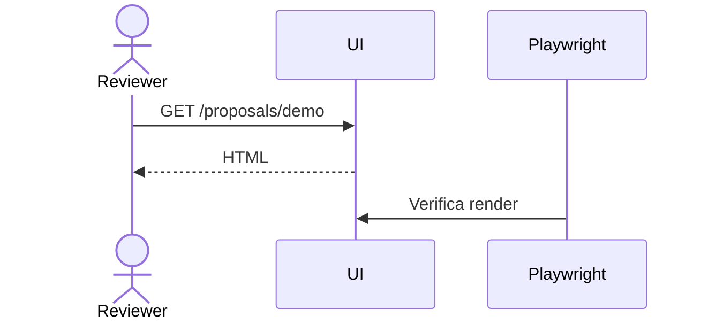

# Propuesta Técnica: Playwright Fixture

**ID:** 2026-11-13-playwright-fixture
**Prefijo:** FIXT-1a2b
**Fecha de Creación:** 2026-11-13
**Estado:** 🟡 Propuesta
**Prioridad:** P1
**Complejidad:** Baja
**Servicios Afectados:** ui

---

## Resumen Ejecutivo

Propuesta de fixture para validar el review visual con Playwright.

## Contenido de prueba

| Columna | Valor |
|---|---|
| Render | Markdown |
| Mermaid | Sí |



```python
def demo():
    return "ok"
```
